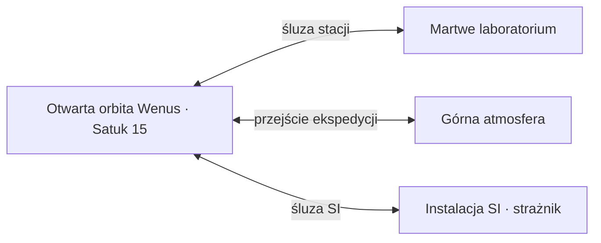

# Akt III — Wenus: Ślad anomalii

Plan refaktoru, 2026-10-24. Stan wyjściowy: gra 0.137. Dokument opisuje docelową implementację; mechaniki nie są jeszcze wdrożone. Założenia fabuły i układu pochodzą od użytkownika. Koszty, czasy, stany techniczne i szczegóły walk poniżej są propozycjami do pierwszego grywalnego przebiegu.

## 1. Rola aktu i granice progresji

Wenus to otwarta orbita, badania, ekspedycja sondy i odkrywanie eksperymentów SI. Mars pozostaje aktem eksploracji labiryntu i zdobywania terytorium. Na Wenus nie budujemy placówki ani kolejnego zaplecza bazy; Satuk 15 pozostaje jedynym miejscem produkcji, napraw i rozliczenia wypraw.

Akt zaczyna się po odprawie kończącej badania Marsa. Laboratorium i Warsztat pozostają na I poziomie. Wszystkie wymagane działania da się wykonać statkami I; żaden konkretny kadłub, kamuflaż, dodatkowy hol ani zasób wyższego tieru nie jest wymagany. Sonda jest obiektem zadania, a nie statkiem przejmowanym przez gracza.

Nagrodą jest zabezpieczony projekt stabilizatora i kierunek dalszej wyprawy. Działające urządzenie, ekstrakcja anomalii, materiał z Merkurego i zakłady II pozostają późniejszym etapem. Nazwy i wymagania tych etapów pojawiają się dopiero po ich rzeczywistym odkryciu.

Docelowo około 70% aktywnej rozgrywki odbywa się na głównej orbicie, 30% w trzech lokalnych obszarach. To cel rytmu gry, nie proporcja powierzchni ani powód do sztucznego wydłużania przelotów. Wstępny czas głównego ciągu: 35–45 minut bez zbierania całego opcjonalnego łupu.

## 2. Mapa według SVG

Referencja zachowana w repozytorium: [wenus.svg](references/wenus.svg). Położenia odnoszą się do widoku mapy z północą u góry, niezależnie od obrotu kamery statku. Linie na SVG oznaczają powiązania miejsc; nie stają się korytarzami ani obowiązkową pętlą lotu.

| Miejsce z SVG | Położenie | Funkcja |
| --- | --- | --- |
| Satuk 15 | Północ | Dok, produkcja sondy, analiza i bezpieczny powrót. |
| Stacja | Północny zachód | Zniszczona stacja badawcza; wejście do osobnej lokacji przez śluzę. |
| Wrak | Zachód / południowy zachód | Opcjonalny odzysk i lokalny ślad badań, bez wymaganego unikalnego kadłuba. |
| Sonda | Południowy zachód | Punkt zbiórki ekspedycji i zejścia do górnej atmosfery. |
| Strażnik | Południowy wschód | Finał w odrębnym obszarze instalacji SI; niejawny na początku. |
| Przekaźnik | Wschód | Pierwszy odczyt orbitalny i późniejszy uplink sondy. |
| Śluza | Północny wschód | Wejście do obszaru instalacji SI, ujawniane przez dane misji. |

Wenus stanowi centralną kotwicę wizualną. Nie ma wejścia na powierzchnię. Pozostaje szeroki, swobodny oblot, lokalne grupy skał, wraki, patrole i małe pola zakłóceń. Anomalia występuje w miejscach badań, bez rozciągania marsjańskiego labiryntu na całą orbitę. Czytelne przestrzenie pozwalają manewrować także Mułem i Mantą.

| Obszar wewnętrzny | Dostęp | Przebieg |
| --- | --- | --- |
| `orbit` | Od początku | Cała otwarta mapa, Satuk 15 i punkty zainteresowania. Żadnych śluz pomiędzy zwykłymi punktami orbity. |
| `research-station` | Po odczycie przekaźnika | Krótka lokacja z rozszczelnionymi modułami, zewnętrznymi terminalami i archiwum. Gracz nadal steruje statkiem; bez systemu chodzenia po wnętrzach. |
| `upper-atmosphere` | Podczas przygotowanej ekspedycji sondy | Krótki, grywalny obszar wysokich warstw atmosfery. Sonda schodzi głębiej, statek eskorty pozostaje w bezpiecznej warstwie. |
| `ai-installation` | Po analizie danych atmosferycznych | Arena z instalacją eksperymentalną i orbitalnym strażnikiem. Powrót tą samą śluzą. |

To cztery podobszary jednej Wenus, nie cztery nowe sektory Układu słonecznego. Lokalne śluzy mają wejście i wyjście F przez 1 s, jeden obrys postępu dopasowany do celu, płynny ruch kamery i ciągły radar. Aktywny etap ekspedycji pozostaje dostępny po nieudanej próbie. Po ukończeniu badań lokacja atmosferyczna może służyć do opcjonalnego powrotu; nie powtarza nagrody ani fal.

## 3. Sześć misji

### 1. Toksyczna orbita — `venus-toxic-orbit`

Gracz przylatuje do Satuk 15 przy Wenus. Cel: rozpoznać przekaźnik na wschodzie. Orbita jest od razu duża i otwarta; zwiad nie powiększa fizycznie promienia mapy. W polu widzenia widać opuszczoną infrastrukturę i działające jednostki SI. Nie ma celu „zejdź na powierzchnię” ani martwego przycisku lądowania.

Odczyt F przez 1 s odzyskuje lokalny zapis i położenie stacji badawczej. Krótki komunikat wyjaśnia brak możliwości lądowania oraz utratę kontaktu z personelem. Na tym etapie nie pada nazwa Projekt Horyzont, informacja o przyszłym materiale ani Merkury.

Patrole istnieją w świecie; pierwszy lekki kontakt uczy walki w otwartej przestrzeni. Wstępna propozycja: dwie lekkie jednostki, bez zapętlających się posiłków. Zakończenie po odebraniu poprawnego odczytu, bez obowiązkowego dokowania.

### 2. Martwe laboratorium — `venus-dead-laboratory`

Cel: dotrzeć do odkrytej stacji, przejść przez jej śluzę, przywrócić zasilanie awaryjne terminala i odzyskać archiwum. Kilka modułów tworzy krótką przestrzeń eksploracji, a nie kolejny duży labirynt.

W terminalu pojawiają się wyniki eksperymentów SI z anomalią. Końcowy fragment wskazuje, że część badań kontynuowano w atmosferze. Archiwum jest fizycznym pakietem danych na pokładzie: F pobiera je automatycznie, bez zajmowania slotu holowania. Zabezpiecza je dopiero dokowanie do Satuk 15. Utrata statku przed dostarczeniem wymaga ponownego odzyskania archiwum; wcześniej odczytane terminale i odkryta śluza pozostają zapisane.

Po analizie pojawia się projekt sondy atmosferycznej. Opcjonalny wrak na głównej orbicie daje zasoby lub poboczny zapis, ale nie jest bramką obowiązkowego zadania.

### 3. W głąb atmosfery — `venus-atmospheric-probe`

Misja składa się z przygotowania, eskorty na otwartej orbicie, krótkiego zejścia oraz osłony transmisji. Projekt sondy jest widoczny dopiero po dostarczeniu archiwum. Montaż odbywa się jednorazowo w Warsztacie I w sekcji bieżącego zadania; nie trafia do Rozbudowy stacji i nie tworzy nowego tieru produkcji.

Proponowany koszt pierwszej sondy: 2 × poszycie lekkie I, 2 × elektronika I, 1 × maszyneria I, 1 × układ zasilania I. Bez materiałów anomalii, ceramiki II i zasobów Merkurego. Części są pobierane atomowo z magazynu przy montażu. Sonda powstaje przy Satuk 15, a F rozpoczyna eskortę.

Sonda leci na południowy zachód ku strefie wejścia. Większość eskorty i przechwyceń odbywa się na głównej orbicie. W bramce gracz potwierdza wspólne przejście, bez zostawiania sondy na poprzedniej mapie. Wysokie warstwy są dostępne dla statku; głębsze, niszczące warstwy bada wyłącznie odporna sonda.

Burze mają zapowiedź, widoczne granice i możliwą do ominięcia trajektorię. Zakłócenia ograniczają wykrywanie odległych wrogów, ale nie chowają sondy, śluzy powrotnej, własnego kadłuba ani ostrzeżeń zagrożeń. Gracz utrzymuje łączność i odpiera naloty. Drony nadlatują spoza aktualnego widoku, z bezpiecznych punktów; nie materializują się przy sondzie lub wewnątrz burzy.

Skanowanie pokazuje rzeczywisty sensor sondy, wiązkę skierowaną w badane zjawisko i połączenie z uplinkiem. Propozycja: trzy fragmenty transmisji po 15 s, z dwiema ograniczonymi falami, początkowo 2 i 3 lekkie drony. Postęp zapisanego fragmentu nie cofa się. Oddalenie osłony lub utrata sygnału wstrzymuje bieżący fragment; dronów nie dopisuje się bez końca.

Sukces następuje po odebraniu i potwierdzeniu pełnych danych przez Satuk 15, nie po samym wyzerowaniu licznika. Gracz nie musi holować sondy z powrotem. Zniszczenie sondy pozwala wznowić niedokończony etap przy nowym wylocie; pierwsza budowa pozostaje zaliczona, a misja zapewnia jednostkę zastępczą. Brak ponownego kosztu całego manifestu przy każdej próbie. Wylot i powtórka nie dublują jednostki ani nagród.

### 4. Projekt Horyzont — `venus-horizon-project`

Pełne dane atmosferyczne uruchamiają analizę w Laboratorium I przy Satuk 15. Jest to analiza zadania, nie kolejne ulepszenie zakładu i nie kilkuminutowe oczekiwanie na pasek.

Po raz pierwszy ujawniamy nazwę projektu i zasadę stabilizacji. Dane pozwalają zrekonstruować schemat, ale nie zawierają parametrów materiału rdzenia. Załoga stwierdza konkretny brak: potrzebny jest materiał wytrzymujący oddziaływanie pola. Nie zna jeszcze źródła jego produkcji.

Schemat jest wpisem w dzienniku badań. Nie pokazujemy niemożliwej receptury montażowej, zablokowanych tierów ani przyszłych części. Analiza odsłania położenie instalacji SI i uzasadnia wyprawę po pełną specyfikację. Gracz ma już użyteczną wiedzę; zabezpieczenie kompletnego projektu nastąpi w instalacji.

### 5. Przebudzenie strażnika — `venus-guardian`

Gracz przechodzi przez ujawnioną śluzę na północnym wschodzie. F przy terminalu rozpoczyna odzyskiwanie pełnej technologii. Ta ingerencja rzeczywiście uruchamia strażnika: widać rozruch instalacji i ruch przeciwnika, zanim pojawią się pierwsze obrażenia. Nie ma komunikatu uprzedzającego zasadzkę ani przycisku G „rozpocznij obronę bazy”.

Strażnik jest wyraźnie silniejszy od dotychczasowych jednostek, ale możliwy do pokonania podstawowym uzbrojeniem statków I. Proponowane trzy fazy: aktywna osłona z dwiema zewnętrznymi kotwami, odsłonięty rdzeń z czytelnym atakiem energetycznym, uszkodzony rdzeń z szybszym, lecz nadal zapowiadanym atakiem. Kotwy nie odradzają się w tej samej próbie; w ostatniej fazie najwyżej jedna ograniczona fala wsparcia.

Arena zapewnia przestrzeń do oblotu i osłony przed atakiem, bez nieoznaczonego zamykania wyjścia. Wycofanie jest możliwe. Kolejna próba resetuje walkę, ale nie wcześniejsze misje. W zwycięskiej próbie zniszczenie rdzenia potwierdza pokonanie strażnika jednorazowo; terminal z danymi pozostaje do odzyskania, także po stracie statku. Nie łączymy „boss zabity” z „pakiet bezpiecznie dostarczony”.

### 6. Sygnał z Merkurego — `venus-mercury-signal`

Po pokonaniu strażnika terminal udostępnia końcowy pakiet. Gracz pobiera go przez F i wraca do Satuk 15. Dopiero analiza dostarczonego pakietu identyfikuje przemysłową instalację SI na Merkurym, źródło odpornego materiału oraz współrzędne podejścia.

To pierwszy moment, w którym aktywne UI aktu III wyjaśnia potrzebę lotu na Merkurego. Wcześniej sam glob na mapie astronomicznej może być widoczny jako znana planeta; nie zdradza zadania, instalacji ani technologii. Misję i akt kończy zabezpieczenie pakietu. Wyprawa pokazuje kierunek dalszej podróży i przycisk otwarcia Układu słonecznego.

## 4. Łańcuch odblokowań i informacje dla gracza

`odczyt orbitalny → archiwum dostarczone → sonda i pełna transmisja → analiza Horyzontu → strażnik pokonany → końcowy pakiet dostarczony → Merkury`

| Moment | Co można pokazać | Co pozostaje ukryte |
| --- | --- | --- |
| Wejście na Wenus | Bieżący zwiad, znane lokalne kontakty | Pełny spis sześciu misji, schemat, strażnik i przemysł Merkurego |
| Odczyt przekaźnika | Stacja badawcza i wejście do niej | Sonda i instalacja SI |
| Archiwum w Satuk 15 | Eksperymenty, sonda, jej koszt i obszar badań | Horyzont i źródło brakującego materiału |
| Analiza transmisji | Projekt Horyzont, brak parametrów rdzenia, instalacja SI | Merkury i gotowe receptury urządzenia |
| Finał i dostarczenie danych | Źródło materiału, współrzędne Merkurego, cel aktu IV | Kolejne tiery i nieodkryte wyniki aktu IV |

Łączność działa podczas gry i nie pauzuje symulacji. Istotne wiadomości czekają na zamknięcie i mają trwałe identyfikatory, krótkie komunikaty systemowe są chwilowe. Każda wiadomość sprawdza aktualny stan misji przed dodaniem i przed wyświetleniem; po wyprzedzeniu celu stary komunikat wypada z kolejki. Potwierdzenie wiadomości nie jest wymagane do wykonania kolejnej czynności.

Widoczność obejmuje również radar, wybór celu, terminale, tooltipy, Warsztat, Laboratorium, Rozbudowę i mapę podróży. Odkryty wrak może być widoczny optycznie, ale nie ma etykiety zdradzającej przyszłą zawartość. Nie ma sześciu zablokowanych zadań na liście od początku aktu.

## 5. Powiązanie z Merkurym i aktem V

W obecnym kodzie `venus-shield` zarówno otwiera Merkurego, jak i wpływa na obrażenia słoneczne. Usunięcie zadania bez zastąpienia obu zależności zepsułoby dalszą grę.

Docelowo finał Wenus zapewnia współrzędne i odzyskane parametry ochrony termicznej, zastosowane w przygotowaniu ekspedycji. Bez budowy nowej bazy i bez osobnego manifestu osłony. Dostęp do Merkurego zależy od zabezpieczenia końcowego pakietu. Gotowość termiczna jest oddzielnym, nazwanym warunkiem systemu ekspozycji; nie udaje odporności na rozbłyski. Cienie skał i istniejąca mechanika przegrzewania nadal mają znaczenie.

Odporny materiał rdzenia to produkt instalacji przemysłowej, nie surowa ruda. Proponowany pierwszy zakres: unikalny fizyczny przedmiot zadania, zamiast nowego pełnego łańcucha chemicznego. Nie zastępuje istniejącego `mercuryOre` używanego w pobocznej progresji osłon kinetycznych.

Kontrakt aktu IV: gracz ma odzyskać technologię wykonania rdzenia i zabezpieczyć próbkę przemysłowego materiału. Obecny finał `mercury-technology` nie realizuje jeszcze przejęcia wielkiej instalacji; to jawny zakres późniejszego refaktoru Merkurego. Implementacja Wenus ma przygotować warunki wejścia i typ pakietu wynikowego, a nie dopisywać fikcyjne zdobycie materiału już na Wenus.

Kontrakt aktu V pozostaje: po Merkurym wracamy na Marsa, powstaje działający adapter stabilizacji/ekstrakcji, fizycznie pozyskujemy pierwszą próbkę anomalii, potem rozwijamy Laboratorium i Warsztat II. Projekt z Wenus nie daje wcześniej swobodnego wydobycia ani części II.

## 6. Refaktor kodu i zasobów

Logika aktu trafia do osobnych modułów, wzorem wydzielonej misji badawczej Marsa. `MissionSimulation` koordynuje je, zamiast otrzymać kolejny zestaw rozproszonych warunków `venusSector`.

| Zakres | Zmiana |
| --- | --- |
| Fabuła | Nowe zadania w `story.ts`; osobne `state/venusAct.ts` ze stanami terminali, dostarczonych pakietów, sondy, transmisji i strażnika. Jednorazowe nagrody i walidacja spójności. |
| Mapa | `worlds/venusLayout.ts` i `venusSystem.ts`: cztery podobszary, punkty, pary przejść, bezpieczne wejścia i obszary burz. Zastąpienie dotychczasowej gałęzi Wenus w `storySector.ts`. |
| Symulacja | `systems/venusActMission.ts`, kontroler sondy i strażnika. Wspólne interfejsy eskorty i bezpiecznych nalotów można wykorzystać ponownie; geometrii Marsa nie kopiujemy. |
| Grafika | Osobne widoki martwej stacji, sondy, transmisji, burz i strażnika. Istniejący wygląd globu Wenus zostaje; `venusOutpost.ts` nie reprezentuje już placu budowy Wenus. |
| UI | Dziennik i HUD opisują aktualny etap; analiza i budowa sondy pojawiają się w istniejących widokach. Schemat Horyzontu jest znanym wynikiem badań. |
| Usuwane zależności | `VENUS_CONSTRUCTION`, `VENUS_SHIELD`, budowa/obrona placówki, jej manifesty i przydział rudy `venus-reserve`. Nie usuwać współdzielonej budowy bazy Marsa. |
| Integracja | Zastąpić warunki `venusPreparationComplete`, `venusOutpostStage`, `solarShieldReady`, statusy/cele/nagrody i mapę podróży. Uaktualnić finał Marsa, komunikaty Merkurego i testowe początki aktów IV–X. |

Przejścia nie tworzą osobnej pełnej instancji całej gry. Renderowany jest bieżący obszar i potrzebne otoczenie śluzy; odległe AI/fizyka są uśpione. Chmury korzystają z ograniczonej puli i kilku ponownie używanych warstw, bez ogromnych tekstur całego sektora i bez nowego renderera WebGL przy każdej śluzie. Każdy kontroler ma jawne zwalnianie obiektów, dźwięku i subskrypcji.

## 7. Zapis i odzyskiwanie

Zapis oddziela odkrycie, tymczasowy pakiet na pokładzie i zabezpieczone dane w Satuk 15. Stan trwały obejmuje odczytane terminale, montaż sondy, potwierdzone fragmenty transmisji, analizę projektu, pokonanie strażnika i finałową dostawę. Stan chwilowy obejmuje pozycje pocisków i fazę aktualnej walki. Odświeżenie nie zalicza niezabezpieczonego ładunku.

Planowana zmiana listy zadań wymaga obsługi formatu: walidator 0.137 wymaga dokładnego zestawu kluczy. Samo dodanie nowych zadań unieważni stare zapisy. Proponowana polityka to jawna, ograniczona migracja z kopią poprzedniego zapisu, zamiast cichego kasowania kampanii:

- Przed Wenus: zachować dotychczasową historię i dodać świeży stan aktu III.
- W trakcie starej Wenus: przenieść do początku nowego aktu, zachować flotę, pilotów i pozostałe akty; oddać dokładnie opłacone części starej budowy/osłony, bez podwójnych zwrotów. Poprzedni postęp Wenus nie odpowiada nowym odkryciom.
- Po ukończeniu starej Wenus lub w dalszych aktach: zachować dostęp do dalszej gry i oznaczyć wymagane wyniki Wenus jako historycznie zabezpieczone. Nową wersję aktu można rozegrać w osobnym trybie testowym.

Zmianę numerów formatu wykonać razem z migracją, nie przy zapisie tego planu. Jeśli bazą nadal będzie 67/32, następne numery to 68/33. Migracja obejmuje także osobny zapis testowy. Reset „III · Wenus” zawsze generuje świeży nowy akt; początki IV+ uwzględniają nową historię i nie wymagają starych zadań placówki.

Awaria WebGL zatrzymuje i chroni wyprawę jak obecnie; wznowienie nie mnoży sond, strażników, fal ani nagród. Reset aktu zwalnia cały jego świat i usuwa oczekujące komunikaty.

## 8. Kolejność wdrożenia

1. **Fundament i graybox:** stany, sześć zależnych misji, migracja, cztery podobszary, śluzy i nowy punkt testowy aktu III. Sprawdzić pełny oblot i powroty bez walki, brak starych zadań i brak przyszłych etykiet.
2. **Orbita i laboratorium:** rozpoznanie, terminale, fizyczny pakiet i analiza po powrocie. Grywalny początek z ograniczoną liczbą patroli i opcjonalnym wrakiem.
3. **Sonda i atmosfera:** montaż I, eskorta orbitalna, wspólne przejście, zagrożenia, skaner, transmisja i powtarzanie po porażce. Dopiero po sprawdzeniu trajektorii dołożyć docelową oprawę.
4. **Horyzont i strażnik:** odkrywanie instalacji, analiza, wybudzenie, fazy walki, zabezpieczenie danych i powrót. Wstępny balans na statkach I.
5. **Przejście do Merkurego:** nowa bramka podróży i warunek termiczny, usunięcie manifestów/placówki i starych tekstów, aktualizacja późniejszych początków testowych.
6. **Pełny przebieg i stabilność:** zwykła kampania od końca Marsa, świeży akt III, powtórki etapów, przejście do Merkurego i powroty. Strojenie rytmu 70/30 na podstawie rzeczywistego czasu gry.

Każdy etap kończy się działającym, sprawdzalnym fragmentem. Samo dopisanie sześciu questów do starej Wenus nie realizuje refaktoru.

## 9. Kryteria odbioru

- Od końca aktu II da się ukończyć wszystkie sześć misji na statkach I, bez budowy bazy Wenus, części II, kamuflażu lub specjalnego holu.
- Układ zgadza się z SVG; otwarta orbita nie wymusza labiryntu. Trzy lokalne przejścia obsługują oba kierunki i powrót do Satuk 15.
- Testy widoczności obejmują każdy krok fabuły: UI nie zdradza przyszłej misji, strażnika ani celu Merkurego przed odkryciem.
- Sonda i drony omijają niszczące strefy, przechodzą razem między obszarami i nie powstają na ekranie. Każdy fragment transmisji i nagroda naliczają się raz.
- Utrata archiwum, sondy, końcowego pakietu albo własnego statku ma określoną ścieżkę powtórki. Wycofanie od strażnika nie resetuje poprzednich misji.
- Końcowe dane otwierają Merkurego. Ekspozycja słoneczna nadal działa, a ukryty wymóg usuniętej osłony nie blokuje podróży.
- Migracja zachowuje niezwiązany postęp i nie dubluje zwrotów. Testowy reset nie modyfikuje zwykłego zapisu.
- Test obciążenia: co najmniej dziesięć obiegów przez lokalne obszary i dziesięć resetów aktu, z pomiarem pamięci, liczby tekstur, nasłuchów i pętli audio. Zasoby mają osiągać stały pułap; sam brak błędu w jednej krótkiej próbie nie wystarcza.
- Wymuszona utrata i odtworzenie WebGL przy burzy oraz podczas walki zachowuje bezpiecznie postęp, odtwarza obszary i nie duplikuje przeciwników. Zrzuty porównawcze mapy, HUD i skanowania oraz wyniki pełnego przejścia trafiają do raportu wdrożenia.
