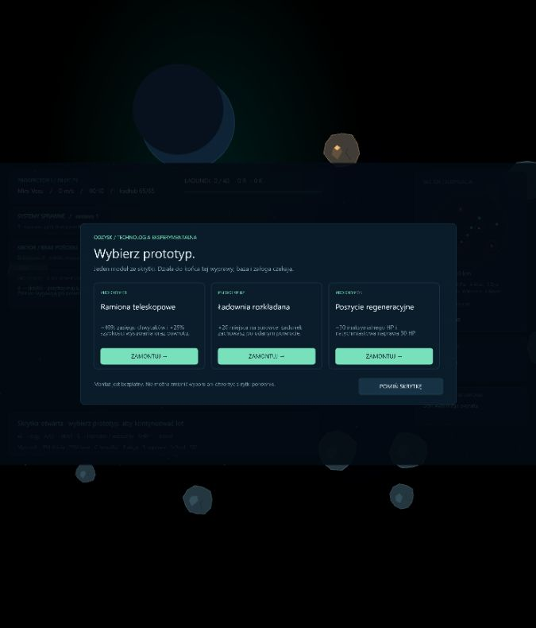

# Asteroids 0.10 — skrytki i prototypy podczas wyprawy

Data: 2026-10-14. Etap rozwija wybory podczas wyprawy: statek przygotowany w bazie może otrzymać dwa tymczasowe moduły ze znalezionych skrytek.

## Pętla gry

- Sektor zawiera dwie skrytki: Kurier w odległości 1,1–1,5 km od Aurory oraz Nomada w odległości 3,2–3,9 km. Mają własną geometrię Pixi, etykiety i znaczniki na minimapie. Pierwsze podejście jest wolne od skał i odsunięte od stacji badawczych, wraku oraz macierzystych punktów patroli; ruchome skały i drony nadal mogą tam dotrzeć.
- **9** wskazuje najbliższą nieotwartą skrytkę. Po opróżnieniu obu wskazuje Aurorę. Klawisze 1–8 zachowują swoje znaczenie.
- W promieniu 150 przytrzymaj **E** przez 2,5 s, poniżej 60 m/s, bez ciągu, ognia, lasera i naprawy. Puszczenie E, oddalenie, przyspieszenie, użycie narzędzi lub trafienie zeruje postęp. Akcja ratunkowa ma pierwszeństwo, jeśli kapsuła pojawi się przy skrytce.
- Wybierz **jeden z trzech** prototypów albo pomiń skrytkę. Montaż nie kosztuje surowców. Wybór zatrzymuje fizykę, pociski, AI, czas wyprawy i pracę mechanika, także pozostałe kroki symulacji w tej samej klatce.
- Otwarta skrytka pozostaje pusta. Oferty zależą od ziarna sektora i ID skrytki; nie można ich ponownie losować, a druga skrytka nie proponuje już zamontowanego modułu. Losownik jest oddzielony od generowania świata i łupu.

## Moduły

| Prototyp | Działanie |
| --- | --- |
| Napęd impulsowy | +20% ciągu i prędkości maksymalnej, także boostu |
| Dysze wektorowe | +25% maksymalnego skrętu i szybkości reakcji na A/D; zachowuje łagodny obrót kamery |
| Soczewka rezonansowa | +35% obrażeń laserów skałom, +25% zasięgu; dotyczy wszystkich laserów kadłuba |
| Akcelerator pocisków | +35% obrażeń działek dronom; skuteczność przeciw skałom pozostaje mała |
| Ładownia rozkładana | +20 jednostek pojemności, bez zmiany chwytaków |
| Ramiona teleskopowe | +40% zasięgu oraz +25% szybkości wysuwania i powrotu wszystkich chwytaków |
| Poszycie regeneracyjne | +30 maksymalnego HP i natychmiastowe odzyskanie 30 HP |

Premie łączą się z parametrami kadłuba, modułami kupionymi w bazie i umiejętnościami pilota. Panel pokładu pod Tabem pokazuje zamontowane prototypy i ich działanie. Surowce zebrane dzięki większej ładowni są zwykłym łupem i trafiają do magazynu po bezpiecznym dokowaniu, z zachowaniem jego limitu.

## Zapis i ograniczenia

Format kampanii pozostaje **7**. Prototypy, oferty i otwarte skrytki żyją wyłącznie w symulacji wyprawy. Nie zmieniają zakupionych modułów, bazowej charakterystyki statku ani szansy ewakuacji. Wygasają po powrocie, śmierci lub odświeżeniu i nie zostają na odzyskanym wraku. Odświeżenie ekranu wyboru nadal rozlicza aktywną wyprawę jako przegraną.

To pierwsza pula prostych premii; nie ma jeszcze rzadkości modułów, wad, wymiany zamontowanego prototypu ani specjalnych zdolności. Balans pozostaje roboczy. Skrytki nie mają fizycznego kolidera, podobnie jak miejsca badawcze.

## Weryfikacja

Zestaw 105 testów obejmuje dotychczasową grę i 13 nowych scenariuszy: generowanie skrytek dla 200 ziaren, stabilne oferty, przerwanie otwierania, trafienia i śmierć przy końcu interakcji, zatrzymanie symulacji, wybór tylko oferowanego modułu, jednokrotne otwarcie, pominięcie, pierwszeństwo ratunku, odświeżenie podczas wyboru oraz rzeczywisty wpływ na fizykę, laser, pociski, zbieranie i pojemność. Sprawdzono również brak zapisu premii w kampanii i ich wygaśnięcie przy kolejnej wyprawie po powrocie lub śmierci.

Przeszły również kontrola typów, lint i build. Podgląd przeglądarkowy korzystał z jednorazowej kampanii na osobnym porcie 3001 i testowego startu przy skrytce, bez zmiany zapisu gracza na localhost:3000. Sprawdzono otwarcie skrytki, montaż ładowni (40 → 60), nawigację do kolejnej skrytki, pominięcie oraz zatrzymanie rafinacji na czas wyboru. Konsola nie zgłosiła błędów ani ostrzeżeń. Widok wyboru:

[HUD po montażu ładowni](screenshots/prototype-installed-v0.10.jpg).
