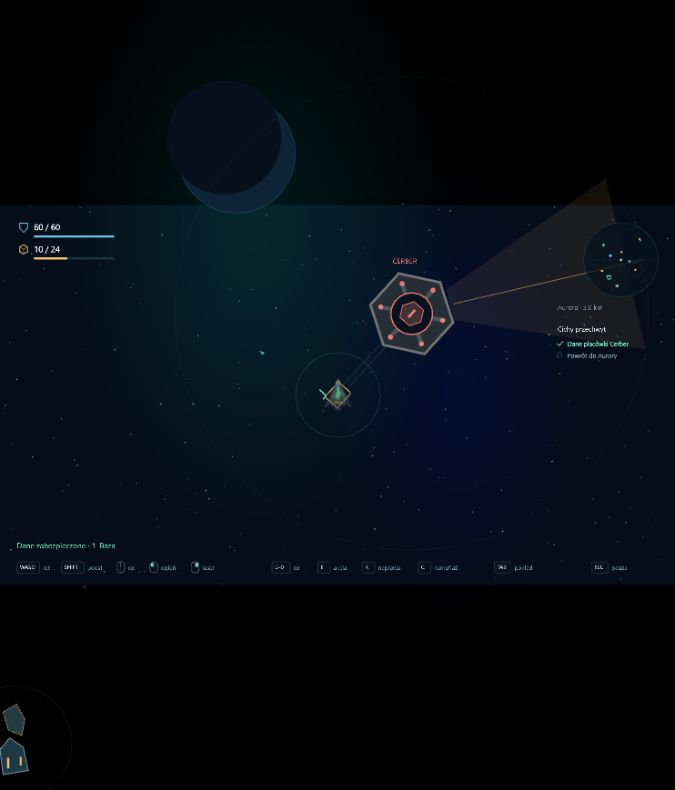
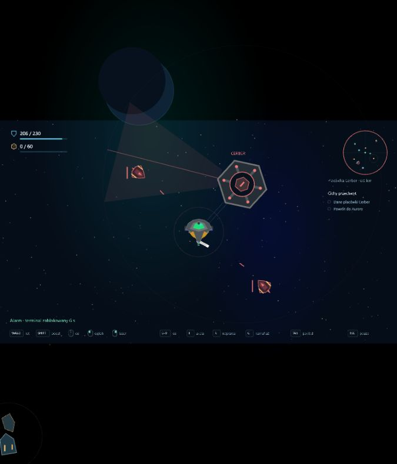

# Asteroids 0.11 — infiltracja placówki Cerber

Data: 2026-10-14. Pierwszy cel wykorzystujący kamuflaż i spokojne podejście do wrogiej stacji.

## Pętla infiltracji

- Jeden Cerber na sektor, 2,8–4,5 km od Aurory. Generator ma osobny losownik; zachowuje rozmieszczenie dotychczasowych skał, miejsc, patroli i skrytek. Placówka powstaje z dala od istniejących celów, z wolnym podejściem do terminalu oraz miejscami startu dronów. Ruchome skały nadal mogą tu dotrzeć.
- **0** wskazuje zewnętrzny terminal. Klawisze 1–9 zachowują dotychczasowe znaczenie. Kontrakt infiltracji wskazuje Cerbera automatycznie; po zabraniu danych nawigacja przełącza się na Aurorę.
- Skaner obraca się z prędkością 0,28 rad/s, ma zasięg 560 i wiązkę o szerokości około 44°. Pierścień przy statku pokazuje narastające wykrywanie. Skały zasłaniają statek. Kamuflaż zmniejsza skuteczny zasięg tak jak przy zwykłych patrolach; ogień, laser, boost i trafienia ujawniają statek.
- Wykrywanie wymaga 2 s ekspozycji i wygasa dwa razy szybciej po opuszczeniu wiązki lub schowaniu się. Alarm blokuje terminal na 8 s od ostatniego pełnego wykrycia. Pierwszy alarm wypuszcza **dwa drony**, wykorzystujące istniejące pościgi, fizykę, celowanie i ostrzał. Kolejne alarmy nie tworzą następnych dronów ani nie pozwalają bez końca zdobywać ich łupu.
- Przy terminalu: promień 100, prędkość do 60 m/s, **E przez 4 s**, bez ciągu, wstecznego, ognia, lasera, naprawy, trafień i aktywnego alarmu. Puszczenie E lub opuszczenie strefy zeruje pobieranie. Ratunek kapsuły/wraku ma pierwszeństwo, jeśli jego sygnał pokrywa się z terminalem.
- Kradzież jest możliwa również statkiem bez kamuflażu: trzeba wykorzystać przerwę między skanami. Swift może pozostać przy terminalu w wiązce, jeśli utrzyma kamuflaż i odpowiedni odstęp od stacji. Słabszy kamuflaż wymaga ostrożniejszego podejścia.
- Przechwyt zabezpiecza dane i wypuszcza skrzynie: **6 komponentów oraz 4 jednostki rudy**. Trafiają do ładowni dopiero po powrocie chwytaków i respektują jej pojemność. Dane nie zajmują miejsca. Placówkę można okraść tylko raz podczas wyprawy.
- Kadłub placówki jest fizyczną przeszkodą Rapiera: zatrzymuje statek, pociski i laser. Drony uwzględniają go w unikaniu przeszkód i widoczności. Skaner i interakcja używają czasu symulacji, więc pauza, Tab oraz wybór prototypu zatrzymują również ochronę placówki.

## Kontrakt i zapis

**Cichy przechwyt** odblokowuje ukończony Nasłuch sektora i warsztat I. Wymaga danych Cerbera oraz powrotu; premia wynosi **32 rudy i 8 komponentów**. Dane z miejsc badawczych nie zastępują przechwytu. Premia, historia wykonań i doświadczenie pilota są rozliczane dopiero po dokowaniu, jednokrotnie.

Kampania przechodzi do **formatu 8**, pod tym samym kluczem localStorage. Poprawny dziennik zapisów formatu 7 otrzymuje piąty licznik z wartością 0. Zachowujemy surowce, flotę, moduły, pilotów, kolejkę, sygnały ratunkowe i znacznik wyprawy. Starsze migracje nadal działają. Odświeżenie aktywnej wyprawy pozostaje przegraną; przechwycone dane i niezabezpieczony łup przepadają.

Minimalny HUD pokazuje tylko cel, znacznik na radarze i bieżącą wskazówkę. Pod Tabem można sprawdzić stan Cerbera. Lobby mieści pięć kontraktów w dwóch rzędach bez dodatkowych paneli.

## Weryfikacja i zakres

**121 testów** przechodzi, w tym 13 nowych scenariuszy obejmujących 500 ziaren generatora, zasięg i kąty skanera, osłonę, kamuflaż, alarm i jednorazowe posiłki, spokojną kradzież bez kamuflażu, przerwania pobierania, śmiertelne trafienie w ostatniej klatce, rzeczywistą fizykę stacji, działanie chwytaków, powrót i migrację formatu 7. Przeszły kontrola typów, lint oraz build.

Przeglądarka: osobny zapis na 127.0.0.1:3001, testowy start przy terminalu. Sprawdzono przechwyt Swiftem, zebranie dziesięciu jednostek łupu, oznaczenie celu, alarm Mantą bez kamuflażu, dwa drony, utratę HP oraz zatrzymanie alarmu pod Tabem. Konsola bez błędów i ostrzeżeń. Zapis użytkownika na localhost:3000 pozostaje osobny.

To pierwsza placówka z kradzieżą danych i materiałów. Nie ma jeszcze sabotażu, niszczenia samej stacji, kradzieży modułów, kilku typów ochrony ani trwałego poziomu poszukiwania. Parametry wykrywania i nagrody pozostają do dalszego balansowania.
