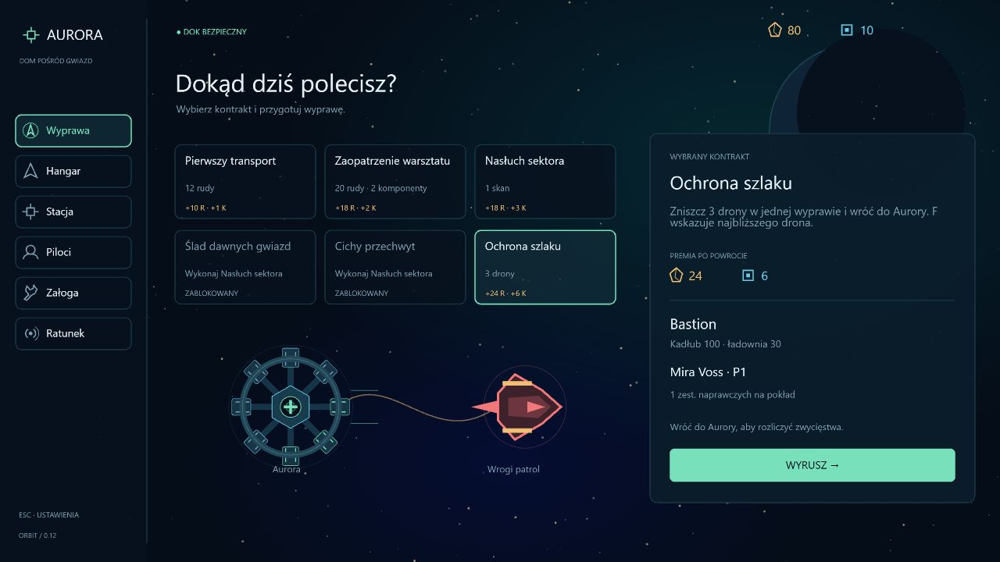

# Asteroids 0.12 — kontrakt bojowy i nawigacja do dronów

Data: 2026-10-14. Etap łączy istniejącą walkę z celami wyprawy i rozwojem pilota.

## Rozgrywka

- **Ochrona szlaku:** zniszcz trzy drony podczas jednej wyprawy i wróć do Aurory. Kontrakt odblokowują pierwszy udany powrót i warsztat I. Nagroda: **24 rudy i 6 komponentów**, niezależnie od łupu zebranego chwytakami.
- HUD oraz panel pod Tabem pokazują `Drony 0/3` i osobny, niewykonany cel powrotu. Zniszczenie trzech dronów nie wypłaca nagrody w kosmosie. Po wykonaniu celu nawigacja wskazuje bazę, albo niepodjęty sygnał ratunkowy.
- **F** wskazuje najbliższego żywego drona w każdej wyprawie. Nawigacja śledzi jego aktualną pozycję i zachowuje cel, nawet gdy inny dron podleci bliżej. Po zniszczeniu wybiera kolejnego. Ponowne F wybiera najbliższy aktualnie; 0–9 pozwalają wrócić do zwykłych miejsc. Gdy nie ma dronów, wskazuje Aurorę. Kontrakt bojowy wybiera pierwszy cel automatycznie.
- Liczą się rzeczywiste zniszczenia przez gracza, w tym drony ochrony Cerbera. Usunięcie wroga po śmiertelnym trafieniu zapobiega podwójnemu zaliczeniu. Dotychczasowy generator i liczba patroli pozostają bez zmian; wyprawy wydobywcze nie otrzymują dodatkowych wrogów.
- Pilot zdobywa **2 PD za drona, do 10 PD na wyprawę**, także poza kontraktem bojowym. Doświadczenie przyznajemy tylko po bezpiecznym powrocie; łączy się z łupem, badaniami, ratunkiem i premią za kontrakt, z zachowaniem istniejącego limitu PD. Częściowy powrót zachowuje łup i doświadczenie, ale nie daje premii za niewykonany kontrakt.
- Lobby nadal mieści wszystkie sześć kontraktów w dwóch rzędach. Podgląd bojowy pokazuje wrogi patrol i właściwą informację o powrocie. HUD zyskuje jedną krótką podpowiedź klawisza, bez nowego panelu.

## Zapis

Format kampanii **9**, pod dotychczasowym kluczem. Dziennik formatu 8 otrzymuje szósty licznik z wartością 0. Migracje wcześniejszych formatów nadal działają. Zachowujemy historię misji, flotę, pilotów, bank, załogę, sygnały i znacznik aktywnej wyprawy.

Liczba zniszczonych dronów żyje tylko w symulacji. Następna wyprawa zaczyna od 0. Śmierć lub odświeżenie nie daje premii ani doświadczenia i nie przenosi zwycięstw do kolejnego lotu. Dokowanie rozlicza nagrody oraz historię tylko raz. Wybrany cel nawigacji również nie jest stanem kampanii.

## Weryfikacja

**127 testów**, w tym sześć nowych scenariuszy: odblokowania i wybór kontraktu, poprawne warunki bojowe, trzy rzeczywiste trafienia pociskami i dokowanie, częściowy powrót oraz przegrana, śledzenie ruchomego celu i migracja zapisu. Testy sprawdzają również limity doświadczenia, brak ponownej wypłaty oraz odrzucanie uszkodzonego dziennika. Typecheck, lint i build przeszły.

Przeglądarka: osobna kampania na porcie 3001. Sprawdzono lobby, licznik 0/3, klawisze 1 oraz F i panel Tab. Drugi scenariusz testowy ustawiał początkowo trzy zwycięstwa w strefie bazy, aby sprawdzić oznaczenie celu i rzeczywiste dokowanie przez E: bank 81/10 → 105/16, kontrakt rozliczony, pilot +16 PD. Same trafienia i naliczanie zwycięstw sprawdzają testy rzeczywistej symulacji. Konsola bez błędów i ostrzeżeń. Kampania użytkownika na localhost:3000 nie była otwierana ani odświeżana.

[Minimalny HUD i nawigacja do drona](screenshots/combat-contract-hud-v0.12.jpg) · [Rozliczenie powrotu](screenshots/combat-contract-return-v0.12.jpg).

Następne rozszerzenia z planu: inne typy przeciwników i uzbrojenia, profesje załogi, gospodarka oraz sabotaż i kradzież wyposażenia podczas infiltracji.
