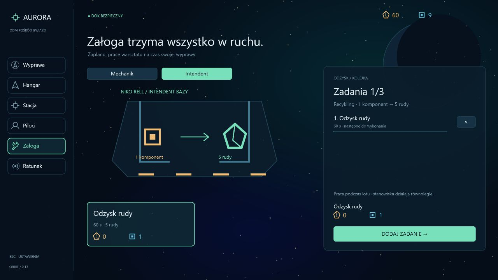

# Asteroids 0.13 — intendent i równoległa praca załogi

Data: 2026-10-14. Druga profesja bazy daje możliwość odzysku rudy z nadmiarowych komponentów.

- **Niko Rell / intendent:** zatrudnienie kosztuje 20 rudy i 2 komponenty, wymaga warsztatu I. Zatrudniamy w bazie, jednokrotnie.
- **Odzysk rudy:** 1 komponent → 5 rudy, 60 s pracy podczas wyprawy. Rafinacja mechanika zużywa 8 rudy na komponent, więc konwersje nie tworzą dodatniego obiegu surowców.
- Mechanik zachowuje rafinację i produkcję zestawów. Każdy pracownik ma **osobną kolejkę do trzech zadań**. Obie kolejki pracują równolegle, a zadania jednego pracownika są wykonywane w kolejności. Nadmiar czasu po zakończeniu zadania przechodzi do kolejnego zadania tej samej osoby. Zablokowana produkcja zestawów nie zatrzymuje intendenta.
- Zakładka **Załoga** ma przełącznik Mechanik / Intendent. Środkowy schemat, receptury i prawy panel pokazują wybrane stanowisko. Pod Tabem są dwie krótkie linie bieżącej pracy; HUD nie dostaje kolejnego panelu.
- Materiały pobieramy przy kolejkowaniu. Anulowanie w bazie zwraca je raz. Recykling rezerwuje pięć miejsc w magazynie, a nie tylko miejsce komponentu: musi zmieścić się zarówno zwrot, jak i gotowy produkt. Zapełnienie magazynu łupem nie powoduje przepełnienia przy kończeniu produkcji. Pełny magazyn blokuje dodanie zadania przed pobraniem kosztu.
- Praca postępuje wyłącznie o rzeczywisty czas symulacji wyprawy. Lobby, pauza, Tab i wybór prototypu nie naliczają pracy. Załoga bazy i niedokończone zadania pozostają po utracie statku. Brak produkcji offline.

## Zapis i weryfikacja

Kampania przechodzi do **formatu 10**. Starsze zapisy otrzymują niezatrudnionego intendenta, zachowując wszystkie kolejki mechanika, czasy, identyfikatory, bank, flotę, pilotów i historię kontraktów. Walidacja sprawdza właściciela receptury, limit każdej kolejki, unikalne ID oraz rezerwacje magazynu.

**134 testy**, w tym siedem nowych scenariuszy: zatrudnianie, uprawnienia receptur i limity kolejek, równoległy postęp, bezpieczne rezerwacje i anulowanie, niezależność od zablokowanego mechanika, brak zyskownego obiegu oraz migracja i błędne zapisy. Typecheck, lint i build przeszły.

Przeglądarka: osobna kampania na porcie 3001. Sprawdzono zatrudnienie (80/12 → 60/10), kolejkowanie, anulowanie ze zwrotem komponentu i ponowne kolejkowanie. Po 15 s lotu mechanik miał 30 s pozostałej rafinacji, a intendent 45 s odzysku — oba stanowiska wykonały 15 s pracy równolegle. Panel Tab pokazuje oba zadania bez nakładania tekstu i zatrzymuje ich postęp. Po wznowieniu oba zadania zakończyły się; powrót do bazy potwierdził magazyn 65 rudy / 10 komponentów, wobec 60 / 9 po kolejkowaniu, bez nagrody kontraktowej. Konsola bez błędów i ostrzeżeń; kampania użytkownika nie była otwierana ani odświeżana.

[Obie kolejki pod Tabem](screenshots/quartermaster-tab-v0.13.jpg).

To druga stała profesja bazy. Załoga pokładowa, rozwój pracowników, praca offline i kolejne łańcuchy gospodarcze pozostają do dalszych etapów.
