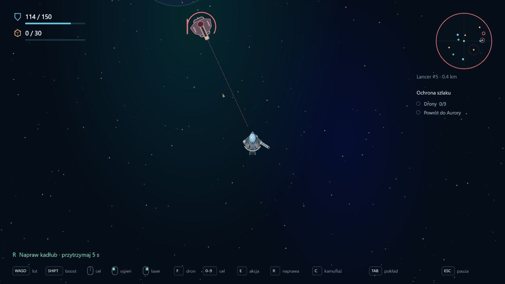

# Asteroids 0.14 — Lancer, ciężki przeciwnik dystansowy

Data: 2026-10-14. Pierwsze zróżnicowanie przeciwników: ciężki strażnik obserwatorium walczy inaczej od lekkiego patrolu.

## Zachowanie i rozpoznawanie

Sektor nadal ma pięciu początkowych przeciwników. Jeden z dwóch strażników Mnemos jest teraz **Lancerem**; wrak i bogata żyła zachowują lekkie patrole. Początkowe pole wydobywcze i Lumen pozostają bez dodatkowych wrogów. Ochrona Cerbera nadal wzywa dwa lekkie drony.

| Parametr | Patrol | Lancer |
| --- | ---: | ---: |
| Kadłub | 54 HP | 90 HP |
| Prędkość pościgu | 250 | 165 |
| Docelowy dystans | 340 | 400 |
| Zasięg ostrzału | 650 | 900 |
| Ładowanie strzału | 0,65 s | 1,2 s |
| Przerwa po strzale | 1,3 s | 2,5 s |
| Prędkość pocisku | 650 | 900 |
| Obrażenia | 12 | 18 |
| Łup | 3 rudy / 2 komponenty | 4 rudy / 4 komponenty |

Lancer podchodzi do odległego celu i wycofuje się, gdy przeciwnik zbliży się za bardzo. Wolniej skręca i ma słabszy ruch boczny. Dłuższe ładowanie oraz przerwa między strzałami dają czas na manewr lub zbliżenie; większy zasięg wymaga ostrożnego podejścia. Docelowe 400 jednostek pozwala zobaczyć przeciwnika przed graczem przy standardowej kamerze.

Ma szerokie skrzydła i wyraźną długą lufę. Ładowanie pokazuje pierścień oraz dłuższą linię kierunku strzału. Ciężki pocisk jest większy i bursztynowy. Radar rozróżnia go rombem, a nawigacja pod F pokazuje nazwę Lancer. Pasek HP i postęp ładowania korzystają z parametrów konkretnego przeciwnika.

AI korzysta z istniejących Rapiera, patrolowania, pościgu, pamięci ostatniej pozycji i unikania skał. Celowanie z wyprzedzeniem uwzględnia prędkość jego pocisku. Skały oraz kadłub Cerbera zasłaniają widoczność i ostrzał. Kamuflaż zmniejsza wykrywanie. Strefa Aurory nadal kończy pościg i chroni przed pociskami.

Zniszczenie Lancera zalicza jednego przeciwnika do kontraktu oraz normalne 2 PD za walkę po powrocie. Łup pozostaje w kosmosie i wymaga chwytaków. Usunięcie po śmiertelnym trafieniu jest jednokrotne.

## Zapis i weryfikacja

Format kampanii pozostaje **10**. Profile przeciwników i pociski są stanem wyprawy. Generator dodaje rodzaj wroga bez dodatkowych losowań, zachowując miejsca, skały, skrytki i pozycje patroli dla istniejących ziaren. Nie ma nowej automatycznej eskalacji z czasem.

**140 testów**, w tym sześć nowych scenariuszy: generowanie nowej obsady dla 100 ziaren, większy fizyczny kadłub i pięć trafień, ładowanie i cooldown, odwrót oraz kamuflaż i strefa bazy, osłona oraz rzeczywiste parametry pocisku, nawigacja i bogatszy łup po śmiertelnym trafieniu. Typecheck, lint i build przeszły.

Podgląd korzystał z osobnej kampanii na porcie 3001 oraz testowej areny: jeden Lancer i Bastion z 150 HP. Sprawdzono sylwetkę, ostrzeżenie, zmianę dystansu, nazwę nawigacji, trafienia po 18 HP, pauzę i przegraną nieruchomego statku. Konsola bez błędów i ostrzeżeń. Kampania użytkownika na localhost:3000 nie była otwierana ani odświeżana.

To pierwsza ciężka odmiana. Kolejne etapy mogą dodać inne uzbrojenie przeciwników, załogę pokładową i sabotaż placówek. Balans dystansu, ładowania i nagrody pozostaje do ogrania.
