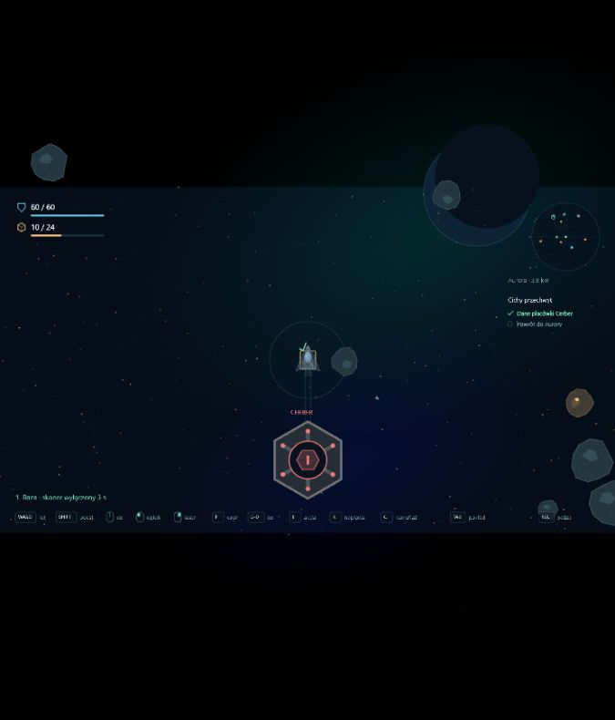

# Etap 0.15 — sabotaż Cerbera

Sabotaż daje dodatkową drogę do przejęcia danych oraz krótkie okno ucieczki. Przy zewnętrznym terminalu Cerbera przytrzymaj **G przez 3 sekundy**. Koszt: **jeden komponent z ładowni statku**, pobierany dopiero po ukończeniu. Komponenty w magazynie Aurory nie są dostępne w locie.

Skaner wyłącza się na **20 sekund czasu symulacji**. Wykrycie i aktywny alarm są zerowane, terminal odblokowuje się. Drony już wezwane do pościgu pozostają w sektorze i nadal działają. Przejęcie danych wymaga osobnej interakcji **E przez 4 sekundy** oraz bezpiecznego powrotu do bazy. Sabotaż sam nie daje danych ani nagrody.

Akcja wymaga bliskości terminala, prędkości do 60 m/s i spokojnego lotu bez ciągu, ognia, lasera, naprawy ani E. Zwolnienie G, odejście, przyspieszenie lub trafienie zeruje postęp bez pobrania kosztu. Ratunek oraz pobliska skrytka mają pierwszeństwo. Sabotaż jest dostępny **raz na wyprawę**, również po przejęciu danych; po wygaśnięciu skaner wraca do pracy. Kolejna wyprawa ma nową możliwość sabotażu.

HUD nadal pokazuje tylko lokalny kontekst. Przy terminalu widać G oraz koszt, podczas akcji pierścień postępu, a po ukończeniu czas wyłączenia. Wiązka skanera znika. Szczegóły dostępne pod Tab. Tab, pauza oraz wybór prototypu zatrzymują czas symulacji i licznik. Stan nie jest zapisywany do wznowienia; polityka utraty aktywnej wyprawy po odświeżeniu pozostaje zgodna z ustaleniami. Format kampanii pozostaje 10.

## Weryfikacja

- 145 testów: koszt i wymagania, przerwanie akcji, obrażenia na ostatniej klatce, aktywni strażnicy, osobne przejęcie danych, wygaśnięcie blokady, jednorazowość, pierwszeństwo ratunku oraz zatrzymanie licznika przy wyborze prototypu.
- TypeScript, ESLint i produkcyjny build.
- Test przeglądarkowy na osobnym porcie 3001 i osobnym zapisie. Fixture ustawia Swift przy terminalu z jednym komponentem i aktywnym kamuflażem. Rozgrywka korzysta z rzeczywistych klawiszy G, E i Tab; zapis użytkownika na porcie 3000 pozostaje niezależny.

Podgląd po sabotażu i przejęciu danych:

## Co dalej

Załoga pokładowa i zadania podczas lotu, wymienne rodzaje broni i części, kradzież sprzętu oraz kolejne placówki i misje. Pełne wznowienie wypraw oraz praca offline są późniejszymi etapami.
