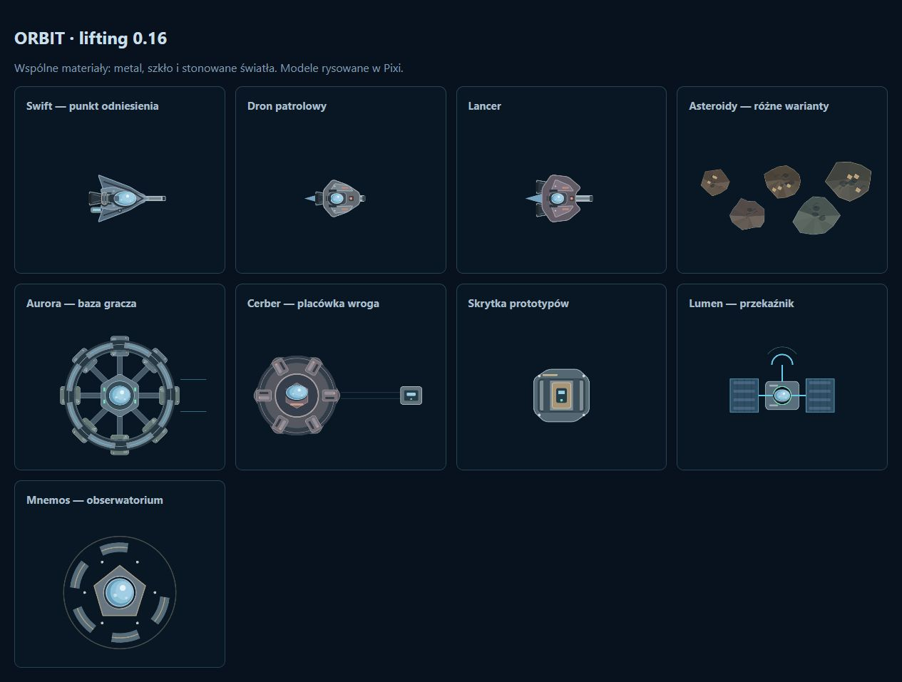
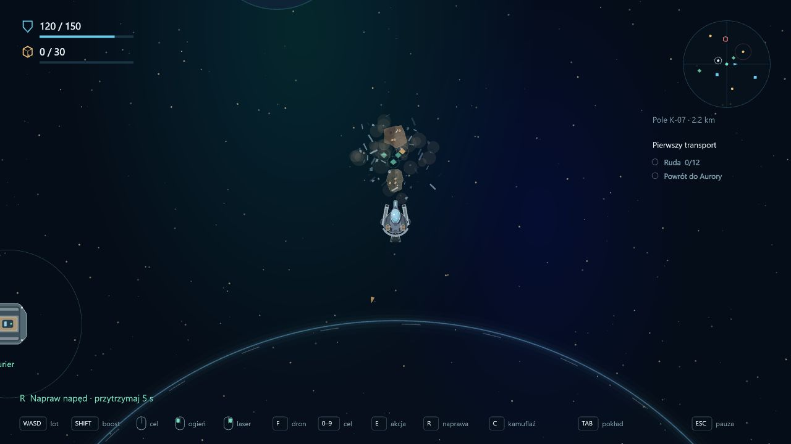

# Etap 0.16 — lifting elementów rozgrywki

## Wspólny styl

Punktem odniesienia jest flota gracza: stonowane metale, zaokrąglone narożniki, oddzielne panele poszycia, mocowania i jasnoniebieskie szkło z refleksami. Modele pozostają figurami Pixi bez bitmap i atlasów.

- Patrol i Lancer mają warstwowe kadłuby, podkadłubowe działka, trapezowe silniki, dysze, wloty, mocowania i szklane sensory. Lancer zachowuje szerszą sylwetkę, dwa silniki oraz dłuższą lufę; odcienie bordowego metalu i przygaszone światła odróżniają wrogów od gracza.
- Aurora ma segmentowany pierścień habitatu, panele i okna, moduły dokujące, masywne ramiona oraz szklany centralny moduł. Rozbudowa nadal zmienia aktywne segmenty. Model jest współdzielony przez lot i lobby.
- Cerber ma metaliczny kadłub, pierścień i sześć zewnętrznych modułów, centralne szkło oraz terminal z ekranem. Skrytki przypominają zamknięte kontenery z pasami mocującymi i panelem dostępu. Wrak, Lumen i Mnemos otrzymały spójne materiały i detale.
- Asteroidy mają 128 wariantów zamiast ośmiu: zmienna liczba wierzchołków i proporcje, kilka palet, asymetryczne płaszczyzny, kratery, szczeliny i minerały. Odłamki dostają różne warianty zamiast kopii rodzica. Biblioteka współdzieli konteksty graficzne.

## Efekty

Pociski emitują iskry z rzeczywistego punktu przecięcia promienia z koliderem. Zderzenia korzystają z punktu kontaktu solvera Rapiera i prędkości względnych przed rozwiązywaniem kolizji. Drony otrzymują teraz obrażenia od silnych zderzeń, także z asteroidami i stacją. Lekkie otarcia pozostają nieszkodliwe. Liczba iskier rośnie z obrażeniami; zniszczenia większych asteroid dają więcej odłamków i rozszerzający się pył. Eksplozje przenoszą część prędkości obiektu.

Naprawa co około 1/12 sekundy emituje błysk i iskry z jednego z czterech miejsc obróconego kadłuba. Przerwanie akcji zatrzymuje emisję; istniejące iskry krótko wygasają. Efekty są nad kadłubami i pod HUD-em. Emitowane są tylko przy widocznych zdarzeniach, z limitem 800 żywych cząsteczek. Pył, odłamki i iskry mają różne rozmiary, czas życia, obrót i zanikanie. Nie dodano pól HUD-u.

## Tarcza Aurory

Promień 850 odpowiada dotychczasowej strefie, w której drony nie prowadziły ostrzału. Teraz granica ma delikatną niebieską poświatę, segmenty i puls. Działa również w symulacji:

- Asteroidy są ustawiane poza obszarem wraz z całym wizualnym promieniem; dryfujące skały odbijają się od granicy i emitują niebieskie iskry.
- Drony są zatrzymywane na zewnątrz i przechodzą do powrotu. Nie mogą przeniknąć tarczy wskutek rozpędu ani kolizji.
- Pociski obu stron są pochłaniane. Test przecięcia odcinka wychwytuje również pocisk, który w jednym kroku przeleciałby przez całą strefę. Pociski powstałe wewnątrz są pochłaniane przed opuszczeniem strefy.
- Gracz i łup swobodnie przekraczają granicę. Wewnątrz gracz pozostaje chroniony przed obrażeniami od ostrzału i zderzeń. Dokowanie oraz naprawa zachowują dotychczasowe sterowanie.

Format zapisu pozostaje 10. Układ punktów zainteresowania i seed odzysku pozostają zachowane. Początkowe skały znajdujące się w nowej pełnej strefie bezpieczeństwa są przesuwane na zewnątrz w symulacji.

## Weryfikacja

151 testów obejmuje także: przechwycenie pocisku przez tarczę w jednym kroku, oba rodzaje pocisków, odpychanie asteroid i dronów (również ze środka strefy), odbicie skały i pozycję efektu na granicy, trafienia w powierzchnię obu kadłubów, obrażenia drona po zderzeniu i emisję spawania z obróconego kadłuba. Starsze testy strzelania przeniesiono poza nową tarczę.

Sprawdzono TypeScript, lint i produkcyjny build. Weryfikacja wizualna używała osobnej galerii rzeczywistych modeli Pixi oraz sceny testowej na porcie 3001: uszkodzony Bastion, tarcza i asteroida do zniszczenia. Fixture ustawia tylko warunki startowe; sterowanie naprawą i laserem odbyło się zwykłymi klawiszami i myszą. Zapis użytkownika na porcie 3000 pozostaje niezależny.
