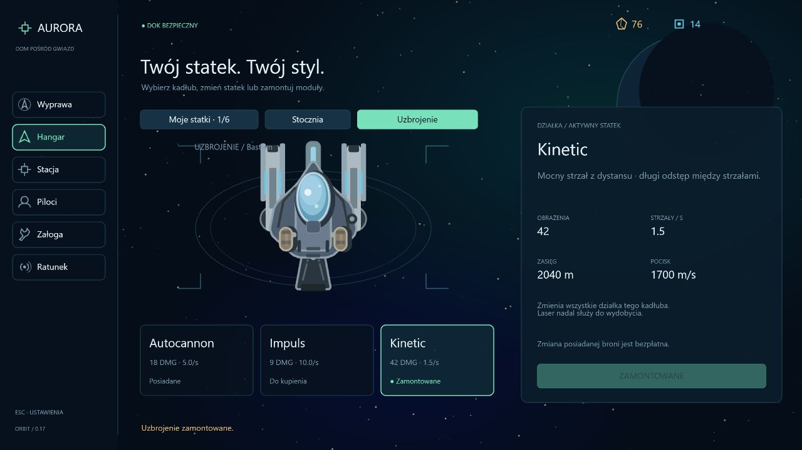

# Etap 0.17 — wymienne uzbrojenie

Hangar ma osobny widok **Uzbrojenie** dla aktywnego statku. Trzy karty pokazują podstawowe parametry i status posiadania; wybrana karta zmienia duży podgląd działek oraz kontekst prawego panelu. Zakup od razu montuje wybrany model. W bazie można darmowo przełączać posiadaną broń. Brak nowych klawiszy i pól HUD-u; strzelanie pozostaje pod LPM, a nazwę zamontowanej broni widać pod Tab.

| Model | Obrażenia | Odstęp | Prędkość pocisku | Czas życia / zasięg nominalny | Zakup |
| --- | --- | --- | --- | --- | --- |
| Autocannon | 18 | 0,20 s | 1150 m/s | 1,15 s / 1323 m | Dostępny z każdym kadłubem |
| Impuls | 9 | 0,10 s | 1050 m/s | 0,80 s / 840 m | Warsztat I · 16 rudy / 3 komponenty |
| Kinetic | 42 | 0,65 s | 1700 m/s | 1,20 s / 2040 m | Warsztat I · 24 rudy / 6 komponentów |

Szybkostrzelność dotyczy całego systemu działek: statki z dwoma działkami strzelają naprzemiennie, tak jak wcześniej. Autocannon zachowuje poprzednie parametry. Impuls ma podobną nominalną siłę ognia, ale mniejsze pojedyncze trafienia i krótszy dystans. Kinetic ma niższą siłę ognia na sekundę, ale mocne pojedyncze trafienie i szybszy pocisk na większy dystans. Nominalny zasięg to prędkość pocisku pomnożona przez czas życia, bez dodatkowej prędkości odziedziczonej po statku.

Każdy model ma widoczne różnice działek: Impuls dostaje obudowę z radiatorem, Kinetic dłuższą lufę z równoległymi szynami i niebieskim światłem. Pociski Kinetic są większe i niebieskie; ciężkie pociski Lancera pozostają złote. Wszystkie bronie mają nadal tylko 2 obrażenia przeciw skałom — laser pozostaje głównym narzędziem wydobycia. Prototyp działek zwiększa obrażenia wybranego modelu o 35%. Tarcza Aurory pochłania je tak samo jak wcześniejsze pociski.

Zakup dotyczy konkretnego kadłuba, nie całej floty. Zmiana aktywnego statku przywraca jego własną konfigurację. W czasie wyprawy zakup i montaż są zablokowane. Utrata statku oznacza utratę jego broni; odzyskanie wraku przywraca wybrany model i zakupione alternatywy. Nowy zestaw awaryjny ma tylko Autocannon. Złomowanie zwraca połowę wartości również kupionych modeli, bez osobnego zwrotu za ich przełączanie.

Format zapisu **11** waliduje wybrany model i listę zakupionych broni, włącznie z rezerwą oraz wrakami. Zapisy 1–10 migrują wszystkie kadłuby do Autocannona, zachowując bazę, pilotów, wyposażenie, załogę i znacznik przerwanej wyprawy. Odświeżenie aktywnej wyprawy nadal rozlicza ją jako stratę.

## Weryfikacja

157 testów. Nowe scenariusze obejmują wymagania zakupu, jednorazowe pobranie kosztu, darmowy montaż, blokadę podczas wyprawy, konfigurację osobno dla każdego statku, wartość złomowania, migrację aktywnego statku/rezerwy/wraku, odrzucanie nieprawidłowych zapisów, rzeczywiste pociski i rytm ognia wszystkich modeli oraz zachowanie broni po stracie i ratunku.

TypeScript, lint i produkcyjny build przechodzą. Test w przeglądarce na osobnym porcie 3001 używał produkcyjnego kodu oraz osobnego zapisu z Bastionem, warsztatem I i środkami: wybór Kinetic zmienił podgląd, montaż obniżył zasoby ze 100/20 do 76/14 i pokazał status zamontowania. Zapis użytkownika na porcie 3000 pozostaje niezależny.

Dalsze większe etapy: załoga pokładowa, kradzież sprzętu, kolejne części, placówki oraz misje; później wznowienie wypraw i praca offline.
