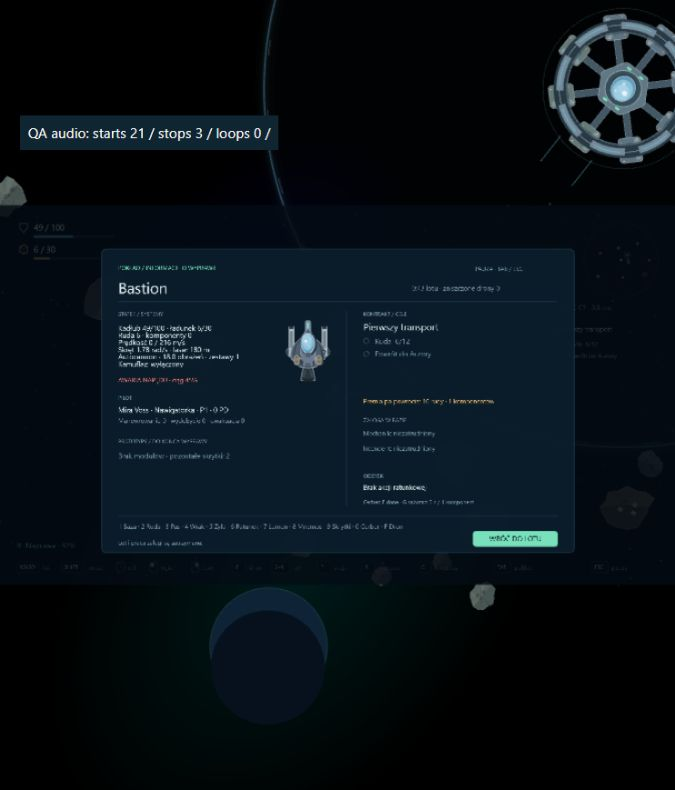

# Etap 0.18 — dźwięki rozgrywki i interfejsu

18 plików OGG wybranych z trzech paczek CC0 zastępuje używane dotąd cztery syntetyczne efekty. Oryginalne pliki WAV pozostają w projekcie, ale bieżący miks ich nie wywołuje. Kopiujemy wyłącznie wybór, nie pełne paczki. Wykaz źródeł: [audio-credits.md](audio-credits.md).

## Miks

- Autocannon, Impuls i Kinetic mają osobne próbki, podobnie jak patrol i Lancer.
- Trafienia, zderzenia, eksplozje, zbieranie łupu oraz uderzenia w tarczę mają odpowiednie efekty. Głośność zdarzeń maleje z odległością, do zera przy 1300 jednostkach; głośność trafień i eksplozji dodatkowo zależy od siły zdarzenia.
- Silnik, laser i spawanie korzystają z cichych pięciosekundowych pętli. Na każdą akcję przypada jedna aktywna instancja. Boost podnosi głośność napędu, a awaria ją obniża.
- Limity odstępów i równocześnie odtwarzanych próbek ograniczają serie iskier, eksplozji oraz sygnałów zbierania. Maksymalnie 18 głosów w grupie, zwykle 1–3 na daną próbkę. Spawanie nie wywołuje dźwięku dla każdej cząsteczki.
- Przyciski mają krótki klik. Udane zmiany w bazie, błędy, start i wynik wyprawy mają osobne sygnały.

Audio używa istniejących `SoundManager`, `GameSettings` oraz automatycznego preloadu. Respektuje suwak i wyciszenie efektów. Pętle zatrzymują się po puszczeniu sterowania, przerwaniu działania, wejściu w Tab/pauzę, utracie fokusu, wyborze prototypu i zakończeniu wyprawy. Po powrocie do lotu powstają nowe instancje wyłącznie aktywnych działań. Zapis kampanii pozostaje w formacie 11.

## Weryfikacja

162 testy: istnienie i nagłówki OGG wszystkich próbek, pojedyncze instancje pętli i zmiana głośności boosta, zatrzymywanie po przerwaniu/pauzie/wyciszeniu/wyborze prototypu/końcu, ponowne uruchamianie, ograniczenia serii, odrębne próbki broni oraz odległość i siła zdarzeń.

TypeScript, lint i produkcyjny build przechodzą. Preload zawiera wszystkie 18 nowych plików. W osobnej przeglądarkowej sesji na porcie 3001 sprawdzono start wyprawy, silnik i laser, faktyczne wydobycie i zderzenia, naprawę oraz Tab. Nie wystąpiły błędy ani ostrzeżenia konsoli. Testowa nakładka obserwowała rzeczywisty SoundManager: silnik, laser i naprawa uruchomiły oraz zatrzymały swoje trzy pętle; menu miało zero aktywnych pętli. Nakładka istnieje wyłącznie w ignorowanym buildzie QA. Zapis użytkownika na porcie 3000 jest niezależny.

