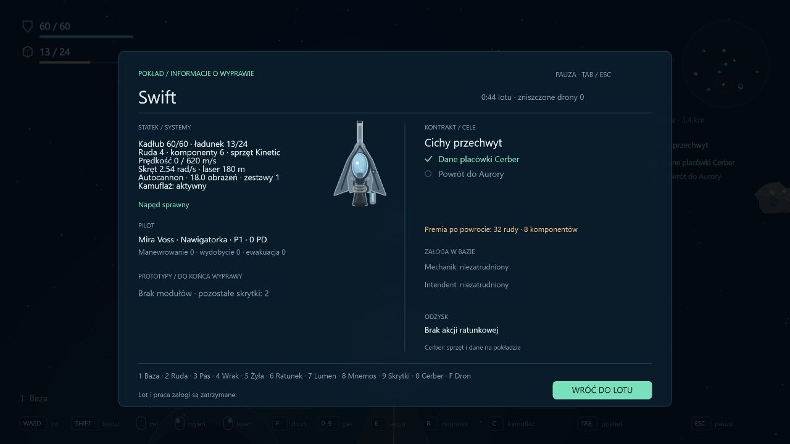

# Etap 0.19 — kradzież sprzętu z Cerbera

Po pobraniu danych Cerbera magazyn przy tym samym terminalu staje się dostępny. **Puść E**, a następnie **przytrzymaj E przez 5 sekund**, aby zabrać broń. Samo ciągłe trzymanie E podczas pobierania danych nie rozpoczyna automatycznie kolejnej akcji.

Magazyn zawiera **Impuls albo Kinetic**, deterministycznie wybrane z seeda sektora. Nie zmienia to układu miejsc ani seeda odzysku. Sprzęt zajmuje **3 miejsca w ładowni** i jest dostępny raz na wyprawę. Wymagane jest miejsce także dla surowców już niesionych lub pobieranych przez chwytaki. Pozostała wolna przestrzeń nadal działa ze zwykłym wydobyciem.

Kradzież wymaga spokojnego lotu do 60 m/s bez ciągu, ognia, lasera, naprawy i sabotażu. Alarm blokuje magazyn; utrata warunków, odejście, puszczenie E oraz obrażenia zerują postęp. Sabotaż skanera daje czas na obie akcje, ale nie usuwa wezwanych dronów. Ratunek i skrytka mają pierwszeństwo przy ewentualnym nakładaniu się stref.

## Powrót i strata

Broń staje się własnością aktywnego kadłuba **dopiero po bezpiecznym dokowaniu**. Nie montuje się automatycznie — można ją wybrać w Hangar → Uzbrojenie. Znaleziona broń może ominąć wymóg warsztatu przy zakupie; przełączanie już posiadanego modelu pozostaje darmowe.

Duplikat daje połowę ceny zakupu: Impuls 8 rudy / 1 komponent, Kinetic 12 rudy / 3 komponenty. Materiały podlegają zwykłemu limitowi magazynu i raportowaniu nadwyżek. Rozliczenie działa raz, niezależnie od nagrody za kontrakt. Śmierć lub odświeżenie nie odblokowuje przewożonej broni; niezabezpieczony sprzęt nie zostaje na odzyskanym wraku. Nowa wyprawa ma nowy magazyn. Format kampanii pozostaje 11.

## Interfejs

HUD pokazuje tylko lokalną podpowiedź E, nazwę broni i wymagane miejsca oraz pierścień postępu przy terminalu. Pasek ładunku uwzględnia trzy zajęte miejsca. Szczegóły przewożonej broni są pod Tab; ekran wyniku informuje o odblokowaniu albo rozebraniu duplikatu. Nie dodano nowych zakładek ani klawiszy. Przejęcie sprzętu jest opcjonalne, a kontrakt Cichy przechwyt nadal wymaga danych i powrotu.

## Weryfikacja

166 testów. Nowe scenariusze sprawdzają osobną akcję po danych, pojemność i rezerwacje chwytaków, przerwanie akcji, jednorazowość magazynu, śmiertelne trafienie na ostatniej klatce, odblokowanie dopiero po powrocie, zachowanie aktualnie zamontowanej broni, duplikat i jednorazową wypłatę, stratę przy śmierci oraz odrzucenie rozliczenia bez danych.

TypeScript, lint i produkcyjny build przechodzą. Test w przeglądarce używał osobnego zapisu na porcie 3001 i fixture ustawiającego Swifta przy terminalu. Zwykłe G i E przeprowadziły sabotaż, pobranie danych i sprzętu; ładownia wzrosła z 10 do 13 zajętych miejsc, a Tab pokazał przewożony Kinetic przy nadal zamontowanym Autocannonie. Zapis użytkownika na porcie 3000 pozostaje niezależny.

Dalsze większe etapy obejmują załogę pokładową, kolejne części, miejsca i misje oraz późniejsze wznowienie wypraw i pracę offline.
