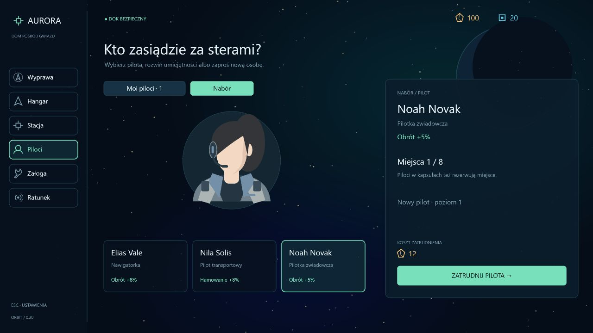

# Etap 0.20 — postacie i czytelność podróży

Pierwsza paczka z nowych propozycji użytkownika. Pozostałe propozycje są rozpisane w [roadmap-after-v0.19.md](roadmap-after-v0.19.md).

## Portrety i tożsamość

Piloci i załoga mają geometryczne sylwetki z widoczną skórą, fryzurami, mundurami i zestawami słuchawkowymi. Zgodnie z korektą użytkownika nie rysujemy oczu, nosa, ust ani brwi. Wygląd zależy od tożsamości pilota, a nie wyłącznie profesji; miniatury, duży podgląd i ratunek korzystają z tej samej sylwetki. Ada i Niko mają własne warianty.

Pula ma 20 imion i 18 nazwisk. Nazwa jest wyznaczana z identyfikatora i profesji, stabilna po wczytaniu i odzysku. Mira Voss zachowuje pierwotną nazwę. Nabór pokazuje nazwę przyszłego pilota; kolejne osoby tego samego typu otrzymują inne imiona. Nazwy są spójne w lobby, panelu pokładu, wynikach i akcji ratunkowej. Zapis nie wymaga migracji i pozostaje w formacie 11.

## Lot i radar

Ślad na radarze składa się z małych niebieskich kropek. Próbki powstają po przemieszczeniu o co najmniej 80 jednostek i nie częściej niż co 0,25 s, z limitem 240 punktów. Zanikają przez 75 s czasu wyprawy. Postój nie dodaje punktów, pauza nie postarza trasy, a nowa wyprawa ma pustą historię.

Radar oznacza niebieską strefę bezpieczeństwa Aurory i czerwone obszary pościgu żywych patroli. Duplikaty bazowych punktów patrolu są łączone. Czerwone granice w świecie są delikatne i przerywane; ich promień odpowiada limitowi oddalenia drona od punktu patrolu, 1100 jednostek. Istniejąca tarcza Aurory pozostaje rzeczywistą granicą bezpieczeństwa.

Kamera łagodnie oddala się po przekroczeniu 220 m/s, do skali 0,64 przy 1000 m/s. Po zwolnieniu wraca płynnie do 1. Interpolacja jest niezależna od liczby klatek, HUD pozostaje w swojej skali. Celowanie nadal używa transformacji kamery, a culling uwzględnia rozszerzony widok.

Kapsuła ratunkowa ma segmentowany kadłub, szklany wizjer z refleksami, widoczną sylwetkę pasażera, boczne mocowania i zielony sygnał. Holowanie zachowuje dotychczasową fizykę.

## Weryfikacja

171 testów, w tym stabilna tożsamość, 100 różnych nazw kolejnych pilotów, próbkowanie i wygasanie śladu, limit historii oraz płynny zoom przy 30/60/144 FPS i powrót skali na postoju. TypeScript, lint i produkcyjny build przechodzą. Galeria w przeglądarce przedstawia rzeczywiste portrety Pixi i potwierdza brak rysów twarzy. Zapis użytkownika na porcie 3000 pozostaje niezależny od podglądu na 3001.

## Poprawka różnorodności naboru

Kandydaci dzielą przyszły identyfikator w rejestrze, ale generator uwzględnia teraz również profesję przy imieniu oraz tożsamości wizualnej. Trzy równoczesne oferty mają różne imiona, fryzury i odcienie skóry. Podgląd i zatrudniona osoba korzystają z tego samego identyfikatora wizualnego, także po wczytaniu oraz odzysku. Nie dodano rysów twarzy ani nowego formatu zapisu.

Regresja obejmuje pozycje rejestru od 2 do 499 oraz zatrudnienie wszystkich trzech profesji, wczytanie i klonowanie tożsamości. Test w rzeczywistym lobby odtwarza zgłoszony przypadek przyszłego ID 11: Elias Vale, Nila Solis i Noah Novak mają różne portrety.
