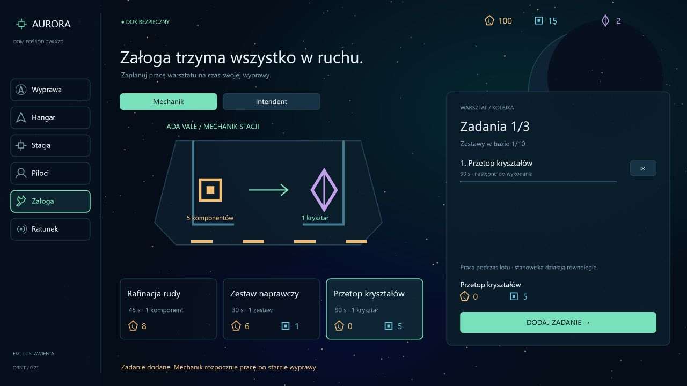

# Etap 0.21 — kryształy technologiczne

Trzeci surowiec, **kryształy technologiczne**, rozwija gospodarkę bez zmiany podstawowych zakupów. Ma fioletową ikonę kryształu, a każdy kryształ zajmuje jedno miejsce w ładowni i magazynie. Podczas lotu pozostaje minimalny HUD: poziom załadunku uwzględnia wszystkie trzy surowce, a ich szczegóły są pod Tab.

## Zdobywanie

Generator wybiera do pięciu rzadkich asteroid z bogatej żyły poza początkowym obszarem, deterministycznie i niezależnie od generatora miejsc. Skały mają fioletowe kryształy oraz większą wytrzymałość: 1,8 × promień zamiast 1,35 ×. Mała skała krystaliczna zostawia jeden kryształ; duża rozpada się na dwa krystaliczne fragmenty, które trzeba dalej wydobyć. Ruda i komponenty pozostają częścią łupu. Kryształy zbierają zwykłe chwytaki, a śmierć oznacza utratę ładunku.

Mechanik przy warsztacie I może wykonać **Przetop kryształów: 5 komponentów → 1 kryształ / 90 s**. Receptura współdzieli jego kolejkę z rafinacją i zestawami. Koszt jest pobierany przy zleceniu, miejsce na zwrot lub produkt rezerwowane w magazynie, a anulowanie zwraca koszt raz. Praca odbywa się podczas wyprawy i zatrzymuje razem z nią w menu. Intendent nadal działa równolegle. Wyprodukowany w bazie surowiec pozostaje po przegranej wyprawie.

## Mocniejsze ulepszenia

Dotychczasowe koszty rudy i komponentów pozostają. Dodatkowy koszt:

| Zakup | Kryształy |
| --- | --- |
| Moduł statku I | 0 |
| Moduł statku II | 1 |
| Moduł statku III | 2 |
| Warsztat I | 0 |
| Warsztat II | 2 |
| Magazyn I | 0 |
| Magazyn II | 1 |
| Magazyn III | 2 |

Kontrola kosztu działa atomowo: brak kryształów nie pobiera pozostałych surowców. Ceny są widoczne w hangarze i stacji; mały znak ◆ przy module oznacza kryształy. Złomowanie oraz recykling odzyskanego kadłuba przy pełnym hangarze uwzględniają połowę wartości kryształów użytych w jego modułach. Kupowane bronie i kadłuby zachowują poprzednie ceny.

## Magazyn i zapis

Dokowanie zachowuje najpierw kryształy, następnie komponenty, a na końcu rudę. Nadwyżka jest raportowana. Kryształy dają także doświadczenie za dowieziony ładunek, w ramach dotychczasowego limitu PD.

Format kampanii **12** przyjmuje starsze zapisy 1–11 bez utraty pilotów, kadłubów, broni, kolejek i znacznika przerwanej wyprawy. Brak pola kryształów oznacza zero; zerowy stan może być pominięty w danych. Nowe pole musi być nieujemną liczbą całkowitą w dotychczasowym limicie zasobów. Rezerwacje kolejki i kryształy są wliczane do pojemności. Odświeżenie aktywnej wyprawy nadal rozlicza ją jako stratę.

## Weryfikacja

177 testów obejmuje także migrację i walidację kryształów, wymagania przetopu, rezerwację i zwrot kosztu, produkcję wyłącznie podczas wyprawy, blokadę ulepszeń bez częściowego obciążenia, wartość złomowania, priorytet rzadkiego surowca przy przepełnieniu magazynu, stratę ładunku, deterministyczne rzadkie skały oraz rzeczywiste wydobycie laserem i zbieranie chwytakiem.

TypeScript, lint i build przechodzą. W osobnej sesji przeglądarkowej na porcie 3001 zlecenie zmniejszyło zapas komponentów z 20 do 15 i utworzyło zadanie 90 s. Warsztat II pokazał koszt 60 rudy / 6 komponentów / 2 kryształy, a jego zakup zmniejszył kryształy z 2 do 0. Nie zmieniano zapisu użytkownika na porcie 3000.

Kolejny zapisany etap: większy świat, mocniejszy dryf, klastry ze skarbami i patrole sektora, a następnie strzeżone sekcje oraz wraki do holowania i recyklingu.
