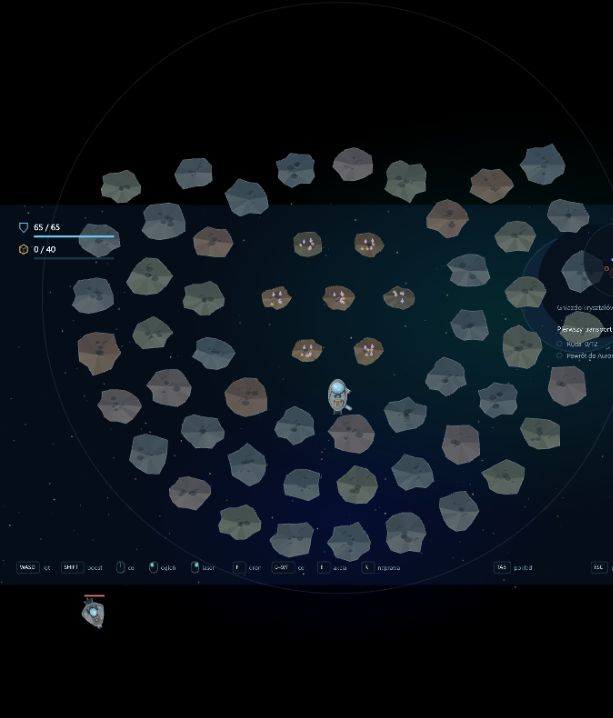

# Etap 0.22 — zewnętrzny sektor

Promień sektora rośnie z 5400 do 8000 jednostek, co daje około 2,2 razy większą powierzchnię. Aurora zachowuje tarczę i spokojny początek wyprawy. Dotychczasowe lokacje, skrytki, Cerber i położenia skał w wewnętrznym sektorze korzystają ze starego strumienia losowego; nowa zawartość ma oddzielny strumień. Zapis kampanii pozostaje w formacie 12.

## Nowe miejsca

- **Gniazdo kryształów**, 6400 jednostek od Aurory: trzy gęste pierścienie, razem 63 skały, otaczają siedem małych krystalicznych asteroid. Skały powłoki dają zwykłą rudę; kryształy trzeba wydobyć z rdzenia i dowieźć do bazy. Pięć dotychczasowych krystalicznych asteroid pozostaje w wewnętrznym sektorze.
- **Prąd Perseid**, również w zewnętrznym sektorze: zmienne rozmiary skał, prędkości 95–130 jednostek/s i ciągły obieg. Helios ma teraz podtrzymany obieg z prędkością docelową 75 jednostek/s.
- **T** przełącza nawigację między Gniazdem a Prądem. Obszary są zaznaczone na radarze i subtelną obwódką w świecie. Szczegóły skrótów nadal są pod Tab; HUD pozostaje minimalny.

Dryf jest podtrzymywany ograniczonym impulsem w Rapier, z łagodną korektą promienia obiegu. Skały zachowują kolizje i reakcję na uderzenia, bez teleportowania czy odradzania wydobytych zasobów. Fragmenty dziedziczą przepływ. Obieg pomaga utrzymać ruchomy obszar przez dłuższą wyprawę.

## Patrole

Trzy dodatkowe drony podróżują po sześciopunktowych trasach, zależnych od ziarna wyprawy. Trasy obejmują środkową i zewnętrzną przestrzeń i omijają spokojny rejon początkowy. Dotychczasowych pięciu strażników nadal pilnuje swoich miejsc; posiłki Cerbera działają osobno.

Patrol rozpoczynający pościg zapamiętuje miejsce wykrycia jako lokalny punkt powrotu. Po utracie celu wraca w jego okolice i kontynuuje trasę. Trafienie patrolu również wyznacza lokalny punkt pościgu. Ruchome patrole nie tworzą stałych czerwonych stref wpływu na radarze.

## Weryfikacja

181 testów: generacja dla wielu ziaren, kompletność pierścieni i rdzenia, odstępy i granice, przebieg tras poza początkiem sektora, ruch patrolu i lokalny pościg, 30 sekund rzeczywistego dryfu w Rapier oraz dotychczasowe mechaniki. Typecheck, lint i build przechodzą. Osobny lokalny serwer QA używa testowego zapisu i startu przy klastrze; sprawdzone renderowanie i przełączanie T, bez błędów konsoli. Bieżąca karta gry użytkownika nie jest przeładowywana.

## Kolejne etapy

Ogrodzone strefy z silną obstawą i osobnymi celami; później wraki pokonanych przeciwników, holowanie i recykling. To nie jest jeszcze część 0.22.
