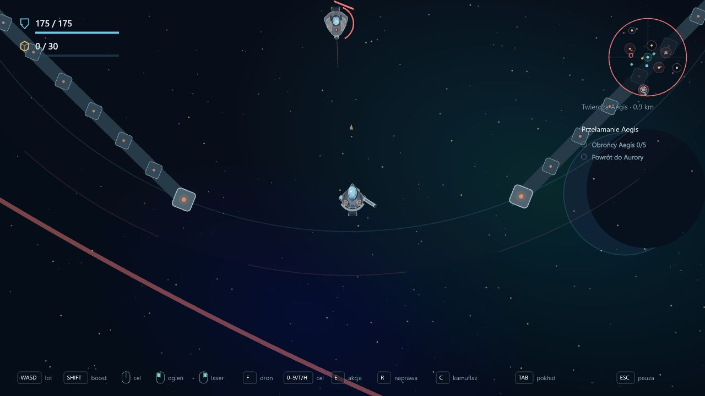

# Etap 0.23 — twierdza Aegis

Aegis to nowa duża, ogrodzona lokacja w zewnętrznym sektorze, 6800 jednostek od Aurory. Siedem wzmocnionych ścian tworzy ośmiokątny obwód o promieniu 1000. Jedna krawędź pozostaje otwartą bramą, oznaczoną pomarańczowymi latarniami. Rdzeń ma metalowy kadłub, jasne szkło oraz światła w palecie floty.

Ściany i rdzeń są stałymi colliderami Rapier: blokują ruch, laser, pociski obu stron i linię widzenia dronów. Mocne zderzenia stosują dotychczasowe obrażenia i cząsteczki. Strzał w mur emituje efekt w miejscu trafienia. Brama pozostaje fizycznie otwarta; ścian nie da się zniszczyć w tej wersji.

Pięciu strażników — trzy zwykłe drony i dwa ciężkie Lancer — patroluje wnętrze. Obowiązują ich dotychczasowe wykrywanie, pościg, osłony, naładowanie strzału i łup. Wędrujące patrole rozpoczynają lot poza twierdzą, bez nakładania się na obstawę. Generator zachowuje dotychczasowe lokacje wewnętrznego sektora; nowe miejsce nie koliduje z gniazdem kryształów ani Prądem Perseid.

## Kontrakt i interfejs

**Przełamanie Aegis** odblokowuje ukończony Nasłuch sektora oraz warsztat I. Pokonaj wszystkich pięciu obrońców, pobierz dane rdzenia spokojnym przytrzymaniem E przez 3 s, a następnie wróć do Aurory. Rdzeń jest zablokowany, dopóki żyje choć jeden strażnik. Przerwany skan resetuje postęp; samo pokonanie innych dronów nie zastępuje pobrania danych.

Premia wynosi 48 rudy i 12 komponentów, naliczana raz po bezpiecznym powrocie. Dane nie zajmują ładowni i przepadają wraz z przegraną wyprawą. Po ich pobraniu HUD kieruje do Aurory.

**H** wskazuje Aegis. Radar pokazuje jej strefę, a lista celów kolejno pokazuje obrońców 0/5, pobranie danych i powrót. Skrót jest także pod Tab. Lobby ma nowy kontrakt w trzecim rzędzie, a grafika wyprawy została przesunięta niżej, aby nie nachodziła na karty.

## Zapis i weryfikacja

Format zapisu 13 dopisuje pustą pozycję kontraktu do poprawnego dziennika wersji 12. Zachowuje dotychczasowe wyniki, flotę, bank, pilotów, sygnały odzysku i znacznik aktywnej wyprawy. Zamknięcie/odświeżenie podczas lotu nadal oznacza przegraną, zgodnie z wcześniejszym ustaleniem.

186 testów przechodzi: generator dla wielu ziaren i odstępy strażników, otwarta brama, ściany blokujące ruch i pociski, linia widzenia, blokada rdzenia, przerwany skan, nagroda tylko po powrocie i migracja historii. Typecheck, lint i build przechodzą. Osobny serwer na porcie 3001 posłużył do podglądu lobby, nawigacji H, bramy i walki z ciężkimi dronami; konsola bez błędów. Testowe pozostanie bez ruchu w bramie skończyło się zniszczeniem statku, zgodnie z działaniem obstawy. Bieżący zapis i karta gry użytkownika nie były przeładowywane.

## Dalej

Następny etap to wraki pokonanych przeciwników, holowanie do bazy i recykling. Do planu dopisano także eskortę statku badawczego AI, tarcze kinetyczne i uszkadzanie holowanego obiektu przez asteroidy/pociski wroga, przy wyłączeniu friendly fire i kolizji z graczem. Te trzy nowe kierunki nie są jeszcze wdrożone.
