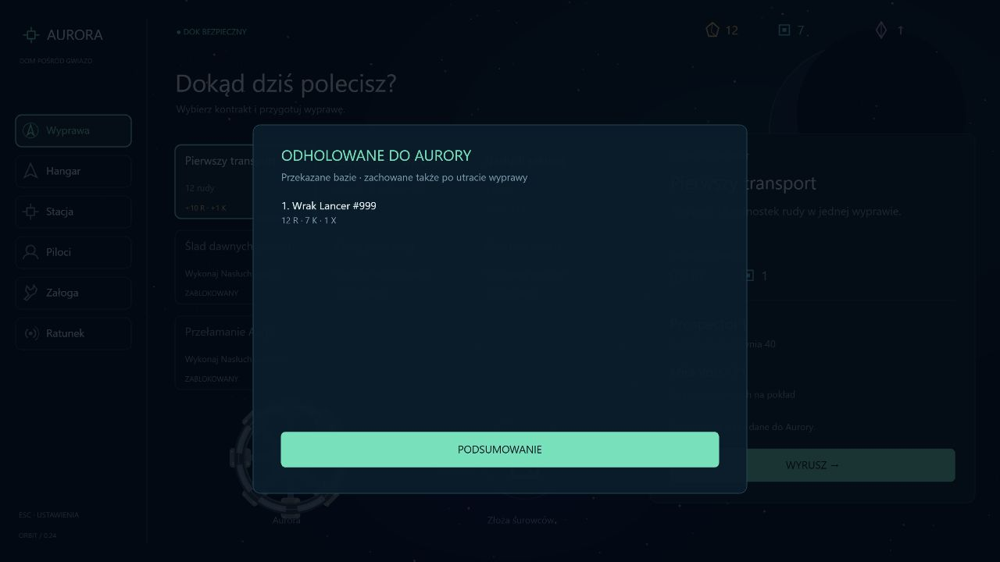

# Etap 0.24 — wraki, holowanie i dostawy do Aurory

Zniszczony dron ma 35% szansy pozostawienia wraku zamiast zwykłej rudy i komponentów. Wynik jest deterministyczny dla ziarna sektora i tożsamości przeciwnika, z oddzielnym strumieniem losowym. Po osiągnięciu limitu 12 wraków kolejne zniszczenia dają luźne surowce; miejsce na wybrany cel ratunkowy pozostaje dostępne. Uszkodzona sylwetka korzysta z geometrii drona, z wygaszonym silnikiem, ciemnymi śladami i paskiem odporności.

## Sterowanie i fizyka

- **Z** wskazuje najbliższy wrak i śledzi jego ruch.
- **E** przytrzymane przez 3 s podejmuje wrak w zasięgu 160, przy prędkości poniżej 80, bez ciągu, strzelania, lasera, naprawy ani sabotażu. Przerwanie resetuje postęp. Pełna ładownia nie przeszkadza.
- Jeden aktywny hol: wybrany cel ratunkowy albo wrak przeciwnika. Wybrana akcja ratunkowa ma pierwszeństwo przy podejmowaniu w jej obszarze.
- **J** zwalnia hol wraku przeciwnika. Obiekt zachowuje położenie, odporność i dryf; można go podjąć ponownie. Podjętego celu ratunkowego nie zwalnia się tym skrótem.

Wrak oraz podjęty cel ratunkowy mają dynamiczne ciało Rapier, bezwładność, delikatne napięcie liny i fizyczne ograniczenie jej długości do 230. Hol reaguje na skały, ściany, wrogie statki i inne wraki. Gracz nie ma z nim fizycznych kontaktów; własne pociski i laser go nie uszkadzają. Kamera nie obraca pasków odporności.

## Przekazanie bazy nie kończy wyprawy

Wciągnięcie **samego holowanego obiektu do doku Aurory (promień 190)** automatycznie przekazuje go bazie i zwalnia hol. Wyprawa trwa dalej: można odlecieć po kolejne obiekty. Samo przekroczenie zewnętrznej tarczy Aurory nie jest jeszcze dostawą.

Przytrzymanie E do normalnego dokowania również rozlicza hol, jeśli obiekt znajduje się przy bazie (do 350 od środka). Dopiero zwykłe dokowanie kończy rundę. Statek nie może zadokować z obiektem pozostawionym daleko od bazy.

Materiały trafiają do magazynu **w momencie dostawy**, a uratowany pilot/statek do odpowiedniej części bazy. Są zachowane także po późniejszej śmierci lub odświeżeniu tej wyprawy. Pełny hangar zamienia odzyskany statek na materiały według dotychczasowych zasad. Magazyn uwzględnia rezerwacje załogi; nadwyżka jest odnotowana. Pierwszeństwo przy zapełnieniu: kryształy, komponenty, ruda.

| Wrak przeciwnika | Odporność | Recykling |
| --- | --- | --- |
| Patrol | 70 | 8 rudy / 4 komponenty |
| Lancer | 120 | 12 rudy / 7 komponentów / 1 kryształ |

Hol nie zajmuje ładowni. Dostawy nie zastępują wydobycia wymaganego przez kontrakt transportowy: ten nadal sprawdza ładunek danej wyprawy.

## Ryzyko odzysku

Wrak z pilotem ma 120 odporności, sama kapsuła 45. Po podjęciu korzystają z tej samej fizyki i obrażeń co wraki przeciwników. Zderzenia emitują cząsteczki w punkcie kontaktu i mają obrażenia zależne od prędkości; ostrzał wroga może zniszczyć cel. Aurora chroni holowane obiekty wewnątrz swojej tarczy. Zniszczenie celu ratunkowego wyklucza ponowne podjęcie, usuwa jego sygnał przy rozliczeniu i nalicza stratę pilota raz. Dostarczonego już celu nie można utracić.

W przypadku wspólnego holu wraku i kapsuły są jednym celem odzysku: zniszczenie ciała oznacza utratę obu. Rozdzielenie ich odporności byłoby kolejnym rozszerzeniem.

## Podsumowanie i zapis

Podsumowanie sukcesu lub porażki ma przycisk **Odholowane obiekty**, pokazujący wszystkie dostawy tej rundy, nazwy, otrzymane materiały i nadwyżki. Lista jest stronicowana po pięć pozycji, aby nie zasłaniać ekranu tekstem.

Format kampanii pozostaje **13**; aktywna wyprawa może mieć opcjonalny dziennik dostaw. Starsze zapisy działają bez niego. Nowe rekordy są walidowane, mają niepowtarzalne identyfikatory i nie odtwarzają nagród po wczytaniu. Po dostawie zapisywane są bank, odzyskane osoby/statki i dziennik. Znacznik wybranej akcji ratunkowej zostaje wyczyszczony po jej dostarczeniu; odświeżenie nadal kończy trwający run porażką, zachowując wcześniejsze dostawy.

## Weryfikacja

199 testów: deterministyczna szansa wraku i oba wyniki walki, pełna ładownia, nieprzerwane podejmowanie, jeden hol, zwolnienie, brak friendly fire i kontaktów z graczem, trafienia wroga, zderzenia, ochrona Aurory, zniszczenie kapsuły, recykling, nadwyżki, wiele dostaw, auto-dostawa bez końca rundy, dokowanie E, późniejsza śmierć/refresh i walidacja dziennika. Typecheck, lint i build przechodzą.

Osobny serwer QA na 3001: Z, podjęcie E, zwolnienie J, ponowne podjęcie, lot wstecz do Aurory, automatyczne zwolnienie holu bez końca rundy, późniejsze dokowanie E i lista z dostarczonym Lancerem (12 R / 7 K / 1 X). Konsola bez błędów; bieżąca karta i zapis użytkownika nie były przeładowywane.

## Kolejne kierunki

Eskorta przyjaznego statku badawczego AI do miejsca badań, następnie tarcze kinetyczne z indywidualnymi parametrami statków. Załoga pokładowa oraz wznowienie runu/praca offline nadal pozostają w planie.
