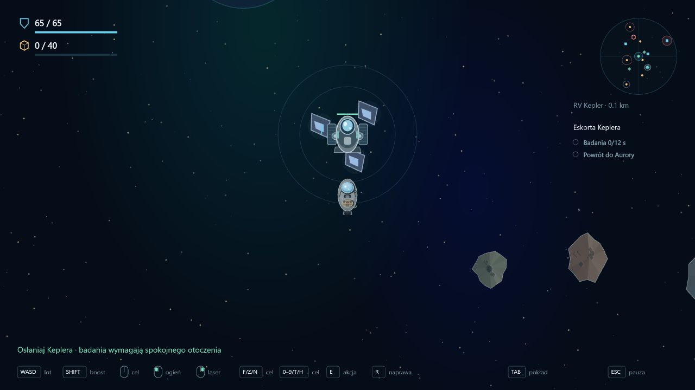

# Etap 0.25 — eskorta Keplera

Opcjonalny kontrakt **Eskorta Keplera**, odblokowany po Nasłuchu sektora i przy warsztacie I. Statek badawczy RV Kepler istnieje tylko na wyprawie z tym kontraktem. Model jest zbudowany w Pixi: metalowy kadłub, jasnoniebieskie szkło, panele i anteny badawcze, bez uzbrojenia. Gracz nadal steruje własnym statkiem.

## Przebieg

1. **N** wskazuje Keplera. W Aurorze przytrzymaj **E przez 2 s**, przy małej prędkości i bez ognia/ciągu, aby wystartował. Przerwanie resetuje rozpoczęcie. Dalsze trzymanie tego samego E nie kończy przypadkiem wyprawy przez dokowanie.
2. Kepler leci do proceduralnej **Anomalii Keplera**, 2400–3700 jednostek od Aurory. Nawigacja szuka drogi między asteroidami, wygładza trasę i przelicza ją, kiedy ruchoma skała blokuje przejście. Ma też łagodne wycofanie przy bliskiej przeszkodzie. Prędkość 125 pozwala nadążyć podstawowym statkiem.
3. Jeśli gracz oddali się ponad 650, Kepler hamuje i czeka. Wróć w jego okolice, aby ruszył. Przy zablokowanej trasie pomaga oczyszczenie skał laserem.
4. W locie pojawia się jedna zasadzka dwóch zwykłych dronów. Drony mogą obrać za cel gracza albo Keplera, zależnie od odległości, widoczności i kamuflażu gracza. Kamuflaż nie ukrywa statku badawczego. Osłony blokują także strzały w Keplera.
5. Na miejscu Kepler prowadzi **12 s badań**. Gracz musi być w pobliżu, a wrogowie poza bezpośrednim obszarem badań. Zagrożenie zatrzymuje postęp; trafienie resetuje go. Po ukończeniu przekazuje dane i znika po krótkim odlocie.
6. Gracz wraca z danymi do Aurory. Premia **36 rudy / 8 komponentów** jest naliczana raz po bezpiecznym powrocie; śmierć oznacza utratę danych i nagrody. Zniszczenie Keplera uniemożliwia wykonanie celu, ale nie kończy całej wyprawy: nadal można zbierać surowce i wracać.

## Ochrona i UI

Kepler ma 140 odporności i własne dynamiczne ciało Rapier. Skały, ściany, drony i wrogie pociski mogą go uszkodzić. Aurora chroni go w swojej strefie. Własne pociski i laser przechodzą obok niego bez friendly fire; brak fizycznych kontaktów z graczem. Nie należy do zatrudnionej załogi gracza, więc jego zniszczenie nie usuwa pilotów z kampanii.

HUD pozostaje minimalny: radar pokazuje statek i anomalię, cel pokazuje odporność lub postęp badań, a kontekst informuje o rozpoczęciu, czekaniu i badaniach. Pasek odporności w świecie jest zawsze poziomy. N jest w podpowiedzi celów oraz pod Tab. Lobby ma nowy kontrakt, mieszczący się w dotychczasowym trzecim rzędzie.

## Zapis i weryfikacja

Format kampanii **14** dopisuje pusty kontrakt do poprawnego dziennika wersji 13. Pozostałe kontrakty, aktywny marker, bank, flota, piloci i dziennik dostaw holowanych obiektów pozostają zachowane. Nadal nie ma wznowienia wyprawy po odświeżeniu — obowiązuje dotychczasowe rozliczenie przegranej z zachowaniem wcześniejszych dostaw do Aurory.

205 testów przechodzi. Nowe testy obejmują 80 ziaren i wolne trasy, trzy rzeczywiste przejazdy przez ruchome asteroidy, rozpoczęcie i czekanie, wybór Keplera jako celu przez AI także gdy gracz jest w Aurorze, rzeczywiste trafienia, brak friendly fire, zniszczenie celu, postęp badań, jednorazową nagrodę oraz migrację. Typecheck, lint i build przechodzą. Osobny serwer QA 3001 używa startu przy anomalii bez obstawy do podglądu badań; sprawdzone rozpoczęcie E, odlot i powrót nawigacji na Aurorę, bez błędów konsoli. Bieżąca karta gry użytkownika nie była przeładowywana.

## Kolejne etapy

Tarcze kinetyczne gracza i statystyki dla kadłubów. Sześć nowych propozycji floty użytkownika zapisano jako [referencję i kierunki balansu](fleet-concepts.md), nie jako sztywną specyfikację ani ukończone kadłuby.
