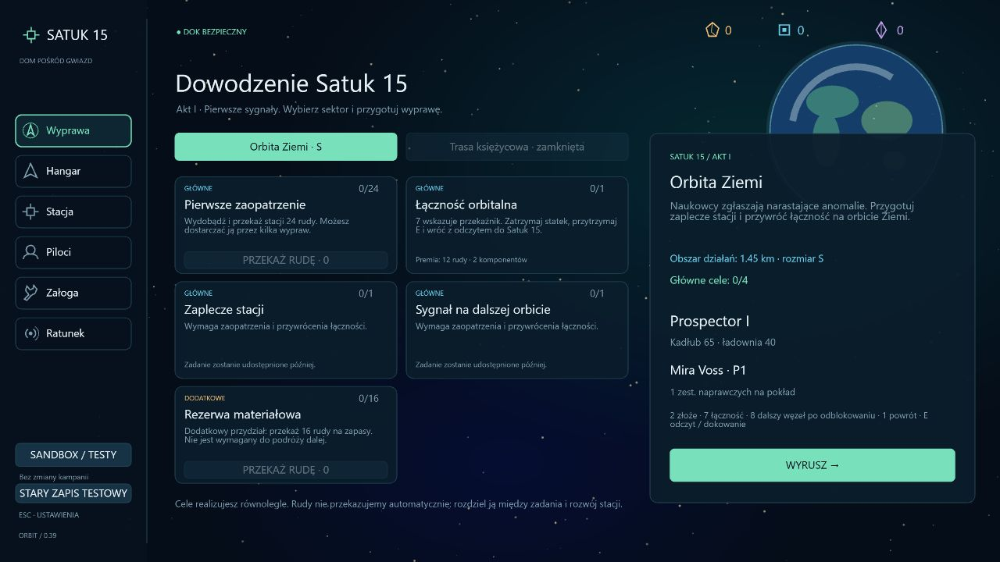

# 0.39 — trwałe sektory i grywalny początek aktu I

Stan: 2026-10-15. Satuk 15 rozpoczyna osobną kampanię przy Ziemi. Ten zakres wdraża początek aktu I, bez rozstrzygania prawdy o anomalii, tożsamości przeciwnika ani dalszych zwrotów fabularnych.

## Pętla rozgrywki

W zakładce Wyprawa widać wszystkie zadania aktualnego sektora: główne, dodatkowe, ukończone i oczekujące na zależności. Dostępne zadania można wykonywać równolegle. Cele wydobywcze przyjmują częściowe dostawy z magazynu stacji, przekazywane przyciskiem; gracz sam rozdziela rudę między rozwój a zadania. Skany wymagają bezpiecznego dokowania. Śmierć lub przerwanie wyprawy nie zatwierdza danych ani ładunku, ale zachowuje wcześniejsze postępy kampanii.

| Zadanie                         | Warunek                                                  | Nagroda: ruda / komponenty |
| ------------------------------- | -------------------------------------------------------- | -------------------------- |
| Pierwsze zaopatrzenie           | Przekaż 24 rudy                                          | 30 / 4                     |
| Łączność orbitalna              | Skan przekaźnika i powrót                                | 12 / 2                     |
| Zaplecze stacji                 | Po dwóch powyższych celach: warsztat I                   | —                          |
| Sygnał na dalszej orbicie       | Po dwóch pierwszych celach: skan dalszego węzła i powrót | 15 / 3                     |
| Rezerwa materiałowa — dodatkowe | Przekaż 16 rudy                                          | 8 / 3                      |
| Zwiad trasy księżycowej         | W drugim sektorze: skan i powrót                         | 15 / 2                     |

Nagrody są jednorazowe. Obowiązuje pojemność magazynu; nadmiar jest wykazywany w komunikacie. Kontrakty dawnego sektora testowego nie wypłacają dodatkowych nagród ani premii kontraktowych PD w nowej kampanii.

Orbita Ziemi ma początkowo promień 1450 m. Zaopatrzenie i łączność otwierają obszar do 2450 m i nowy punkt skanowania. Ukończenie wszystkich czterech celów głównych Ziemi udostępnia trasę księżycową o promieniu 3200 m. Zadanie dodatkowe nie blokuje podróży. Sektory wybiera się w stacji; po odblokowaniu można wracać w obie strony. Oba mają własny stały seed, układ punktów, tło i zapisane cele. Początkowe sektory są pozbawione przeciwników i dawnych placówek kontraktowych w obszarze gry.

Sterowanie: **2** złoże, **7** przekaźnik / punkt zwiadu, **8** dalszy węzeł po odblokowaniu, **1** stacja. **PPM** wydobywa laserem bazowego Prospectora; **E** skanuje lub dokuje przy małej prędkości. **TAB** pokazuje dziennik aktualnego sektora i parametry lotu.

## Zapis i zgodność

- Kampania Satuk 15 używa osobnego klucza `asteroids.satuk15.v1`. Domyślnie otwiera się nowy profil; **Stary zapis testowy** w lewym panelu przełącza na wcześniejszą grę. Wybór profilu jest zapamiętywany. Zmiana profilu jest dostępna w stacji.
- Dawny klucz `asteroids.campaign.v1` pozostaje oddzielny. Format kampanii 19 migruje wcześniejsze wersje, zachowując ich stan jako profil testowy bez dopisywania fikcyjnych postępów fabularnych.
- Dziennik przechowuje sektor, postęp każdego zadania, odebrane nagrody i przeszukane pozostałości konstrukcji. Walidacja odrzuca nieznane cele, niemożliwe zależności, powtórzone nagrody i aktywne wyprawy niezgodne z sektorem / seedem.
- Sygnały ratunkowe należą do sektora straty. Nie można uruchomić akcji ratunkowej z innego sektora; trzeba najpierw wrócić do właściwego. Awaryjny zestaw startowy nadal pozwala kontynuować po utracie całego wyposażenia bez środków.
- Sandbox działa niezależnie w obu profilach i nie zmienia ich postępu.

Trwałość sektorów dotyczy ich tożsamości, odkryć i zadań. Skały oraz luźny łup są generowane ponownie przy wylocie. Przeszukanie pozostałości konstrukcji jest utrwalane po bezpiecznym powrocie. Aktywna wyprawa nadal nie jest wznawiana po odświeżeniu; rozlicza się jako strata.

## Weryfikacja

- Dziewięć testów kampanii: dowolna kolejność celów, częściowe dostawy, nagroda tylko raz, zależności, migracja i oddzielne profile, śmierć, awaryjny start, granice sektorów, ratunek oraz przeszukanie wraku po rozszerzeniu mapy.
- Próba od świeżej kampanii przez rzeczywiste wejścia symulacji: lot bazowym Prospectorem, wydobycie i zebranie łupu, skan, dokowanie, przekazanie materiałów, zakup warsztatu I, dalszy skan, podróż księżycowa i powrót do Ziemi. Bez dodawania zasobów, teleportowania ani zmiany konfiguracji statku.
- Końcowe sprawdzenia: **313/313 testów**, TypeScript, ESLint i produkcyjny build przeszły poprawnie.
- W przeglądarce sprawdzono panel celów, HUD i TAB, przełączenie na wcześniejszy zapis oraz powrót do Satuk 15 zachowany po odświeżeniu. Poprawiono też zbędną kreskę w rysowaniu tła Ziemi.

## Kolejny zakres

1. Projekt budowy stacji księżycowej: etapy dostaw, koszty, stan konstrukcji i czytelne cele.
2. Instancja lotu nad powierzchnią Księżyca z wejściem i wyjściem, zasadami powrotu, holu oraz przerwania sesji.
3. Obrona budowy przed asteroidami, następnie fabularny atak zamykający akt I po ustaleniu jego treści.

Nie wdrożono jeszcze całego aktu I, systemu paliwa, wszystkich dziesięciu aktów ani treści finału. Zarys autora pozostaje w [dokumencie kampanii](campaign-outline.md).
