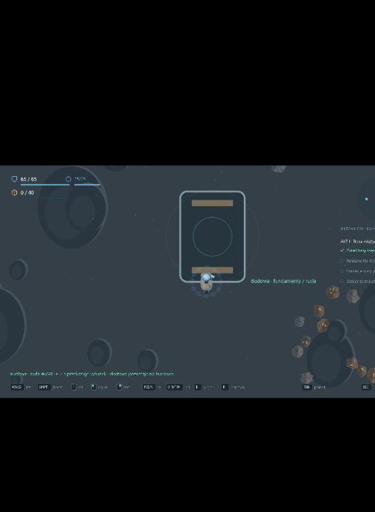

# 0.40 — powierzchnia Księżyca i budowa stacji paliw

Po zwiadzie trasy księżycowej można wlecieć nad Księżyc i przewozić materiały na budowę. Zakres rozwija początek aktu I bez dopisywania prawdy o anomalii ani treści finałowego ataku.

## Rozgrywka

- Ukończ **Zwiad trasy księżycowej**, wracając z odczytem do Satuk 15. Kolejny wylot udostępnia **3 — Podejście do Księżyca**.
- Przy podejściu zwolnij poniżej 60 m/s i przytrzymaj **E przez 2 s**, bez ciągu, strzelania, wydobycia, naprawy ani sabotażu. Po przejściu puść E przed następną zmianą obszaru. Chwytaki muszą zakończyć zaciąganie trzymanego łupu.
- Powierzchnia ma własne tło terenu i kratery, radar, granicę korytarza lotu oraz złoże. **1** wskazuje wyjście na orbitę, **2** złoże, **7** budowę. Złoże dostarcza rudę i komponenty przy użyciu zwykłego lasera i chwytaków.
- Przelot zachowuje kadłub, tarczę, awarię napędu, ładunek, zestawy, dane, drona Aegisa i fizyczny hol. Nie kończy wyprawy ani nie naprawia statku. Pozostawione skały i luźny łup czekają w swoim obszarze podczas tej samej wyprawy.
- Budowa wymaga najpierw **48 rudy** na fundamenty, następnie **12 komponentów** na instalacje. Przy budowie spokojnie przytrzymaj **E przez 2 s**: pobierana jest wyłącznie potrzebna ilość materiału z ładowni. Można realizować dostawy przez kilka lotów.
- **Wylot z dostawą** w lobby pokazuje dokładny manifest i pobiera materiały z magazynu tylko po wybraniu tego przycisku. Ilość uwzględnia pozostały koszt etapu, stan banku i pojemność statku. Zwykły Wyrusz pozostawia magazyn nietknięty; można pozyskać materiały podczas lotu.
- Dostawy są od razu trwałe, podobnie jak dostarczenie holu do stacji. Utrata statku lub przerwana sesja nie cofa zatwierdzonej budowy. Materiały wciąż na pokładzie przepadają.
- Po instalacjach **E skanuje odbiór techniczny przez 3 s**. Raport trzeba dowieźć do Satuk 15. Dopiero wtedy stacja otrzymuje status odebranej i wypłacana jest jednorazowa premia **24 rudy / 6 komponentów**, z uwzględnieniem magazynu. Widok konstrukcji zmienia się po fundamentach, instalacjach i odbiorze.

Stacja paliw jest elementem rozwoju kampanii; nie dodaje mechaniki paliwa statków. Odbiór techniczny nie kończy całego aktu I. Obrona przed asteroidami i finałowy atak to kolejny zakres.

## Zapis i ratunek

Format kampanii **20** migruje zapis 19, zachowując sektor, ukończone cele, odebrane nagrody i wcześniejsze przeszukania. Dziennik wersji 2 dopisuje trzy nowe cele księżycowe z zerowym postępem. Oba profile nadal mają oddzielne zapisy.

Aktywna wyprawa zapisuje obszar i ostatnią pozycję. Odświeżenie nadal oznacza stratę wyprawy, a nie jej wznowienie. Przy stracie na powierzchni sygnał ratunkowy pozostaje na Księżycu, w osiągalnym korytarzu lotu; nawigacja orbitalna kieruje najpierw do wejścia. Odzyskany obiekt można wyholować na orbitę i dostarczyć do Satuk 15. Przejścia zapisują zmianę obszaru od razu. W starych sektorach ograniczono także odległość nowych sygnałów do aktualnej granicy obszaru działań.

Manifest pobiera materiały z banku tylko raz. Powrót z niewykorzystanym transportem oddaje pozostały ładunek do magazynu, bez naliczania PD za samo przewożenie zaopatrzenia tam i z powrotem. Błąd inicjalizacji wyprawy zwraca zarezerwowany transport.

## Weryfikacja

Osiem nowych testów obejmuje migrację, manifesty i ich walidację, zachowanie holu i stanu statku przy zmianie map, blokady przejścia, przetrwanie dostaw po przerwaniu sesji, ratunek na powierzchni, rzeczywiste wydobycie bazowym Prospectorem oraz pełny lot z trzema dostawami i powrotem z raportem. Przebieg budowy używa przygotowanego magazynu i ukończonego zwiadu jako stanu wejściowego; loty i interakcje odbywają się przez zwykłe wejścia symulacji. Wcześniejszy test nadal sprawdza progresję od świeżej gry do zwiadu księżycowego.

Pełna regresja: **321/321 testów**. TypeScript, ESLint i produkcyjny build przechodzą poprawnie. Kontrola w przeglądarce używa oddzielnego lokalnego scenariusza z przygotowanym magazynem i ukończonym zwiadem. Przy wąskim widoku ograniczono rysowanie świata do obszaru gry; podpisy powierzchni pozostają poziome przy obracaniu kamery.

W próbie interfejsu wykonano wylot z 40 rudy, przejście na powierzchnię i dostawę na budowę: ładownia 0/40, fundamenty 40/48. Sprawdzono też panel TAB z postępem projektu.

## Następne kroki

1. Obrona budowy przed asteroidami: fale, stan chronionego obiektu i uczciwe ponowienie po porażce.
2. Finałowy atak aktu I po doprecyzowaniu jego przebiegu przez autora.
3. Rozwój kolejnych sektorów i blokad fabularnych według zarysu kampanii.
