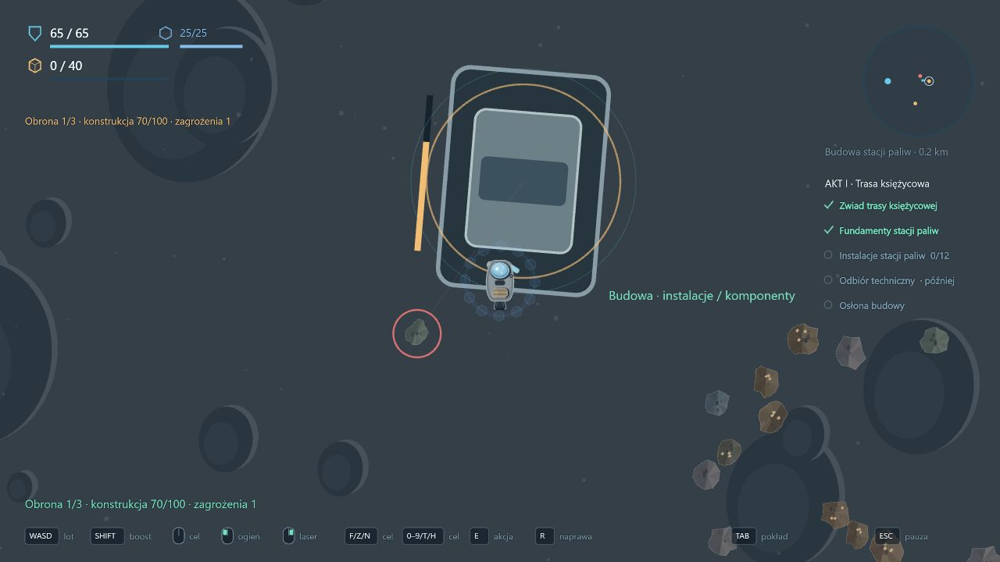

# 0.41 — obrona budowy przed asteroidami

Po postawieniu fundamentów stacji księżycowej dostępny jest nowy główny cel **Osłona budowy**. Jest równoległy do dalszych dostaw i odbioru technicznego. Wcześniej ukończone instalacje i odbiór pozostają zaliczone; obronę można wykonać również po nich. Ten zakres nie dopisuje tożsamości przeciwnika ani fabuły finałowego ataku.

## Obsługa i przebieg

1. Dotrzyj na powierzchnię Księżyca; **7** wskazuje budowę.
2. Przy konstrukcji przytrzymaj **G przez 2 s**, przy prędkości poniżej 60 m/s, bez ciągu, strzelania, wydobycia, naprawy ani równoczesnej interakcji E.
3. Broń obiektu przed **trzema falami: 2, 3 i 4 asteroidy**. Każda fala ma pięciosekundowe ostrzeżenie z kierunkiem na radarze i w świecie. Skały pojawiają się co 3 s, około 900 m od obiektu, z prędkościami 56, 64 i 72 m/s w kolejnych falach.
4. Zwykłe uzbrojenie i laser niszczą oznaczone asteroidy. Można je również fizycznie zepchnąć z trasy. Nowa fala zaczyna się po usunięciu wszystkich zagrożeń poprzedniej; nie wystarczy przeczekać jej samego zegara.

Konstrukcja ma **100 HP**. Każde trafienie zabiera **30 HP**, więc czwarte kończy próbę porażką. Podczas obrony widać pasek obiektu, stan HP, numer fali, ostrzeżenie i liczbę pozostałych zagrożeń. Asteroidy są oznaczone czerwonym obrysem i punktami na radarze. Trafienia konstrukcji tworzą efekty uderzeń.

## Sukces, porażka i ponowienie

- Po trzech falach udana obrona jest natychmiast zapisywana. Jednorazowa premia wynosi **20 rudy / 4 komponenty**, z uwzględnieniem limitu magazynu i komunikatu o nadwyżce. Późniejsza strata statku nie cofa obrony.
- Porażka nie usuwa fundamentów, instalacji ani wcześniejszych dostaw. Po puszczeniu G można ponownie przytrzymać klawisz przy konstrukcji: nowa próba zaczyna od 100 HP i pierwszej fali, bez ponownego kosztu materiałów. Statek zachowuje swoje obrażenia i zapasy.
- Wyjście na orbitę, oddalenie się ponad 1250 m od konstrukcji lub utrata statku przerywa aktywną obronę. Ostrzeżenie przy wyjściu wyjaśnia tę konsekwencję. Przerwanie usuwa wyłącznie asteroidy danej próby; zwykłe skały i łup pozostają.
- Asteroidy obrony nie zostawiają surowców ani mniejszych fragmentów. Ponawianie prób nie stanowi nieograniczonego źródła łupu.
- Po ukończeniu celu nie można uruchomić kolejnej próby ani odebrać powtórnej nagrody. Instalacje można dalej odwiedzać i wykonywać pozostałe zadania.
- TAB i pauza zatrzymują symulację wraz z falami. Odświeżenie rozlicza aktywną wyprawę jako stratę: dostawy pozostają, niedokończona obrona nie zostaje zaliczona.

## Zapis i zgodność

Format kampanii **21** oraz dziennik wersji **3** migrują wcześniejsze zapisy, dopisując niedokończony cel obrony. Nie kasują odbioru stacji, nie nadają fikcyjnego zwycięstwa i nie przyznają premii w migracji. Zachowano oddzielność starego profilu testowego, Satuk 15 i sandboxa.

Stan pojedynczej próby — HP, skały i zegary — trwa tylko w bieżącej wyprawie. Utrwalany jest ukończony cel, a nie częściowo rozegrana fala.

## Weryfikacja

Sześć nowych testów sprawdza:

- porażkę przy bezczynności i ponowienie z zachowaniem dostaw;
- zwycięstwo bazowym Prospectorem przez normalne wejścia lotu, działka i lasera, jednorazową premię oraz zachowanie ukończenia po późniejszej stracie;
- przerwanie przez wyjście na orbitę i usuwanie wyłącznie zagrożeń danej próby;
- wymagania rozpoczęcia i blokadę ponownego uruchomienia ukończonego celu;
- migrację zapisu 20 z odebraną stacją;
- przerwaną sesję podczas fali, bez przyznawania zwycięstwa.

Test obrony używa przygotowanego stanu kampanii z postawionymi fundamentami. Nie dodaje zasobów ani obrażeń asteroidom podczas walki; korzysta z rzeczywistych wejść symulacji. To weryfikacja wykonalności, a nie pomiar czasu i trudności dla gracza.

Końcowe sprawdzenia: **327/327 testów**, TypeScript, ESLint i produkcyjny build przeszły poprawnie. W przeglądarce sprawdzono nowy cel w lobby, start przez G, zapowiedź fali, czerwone oznaczenia zagrożeń, spadek HP ze 100 do 70 i pauzę TAB zachowującą ten sam stan obrony. Konsola aplikacji nie zgłosiła błędów podczas próby. Scenariusz przeglądarkowy miał przygotowane fundamenty i oddzielny lokalny zapis.

[Panel kampanii z celem Osłona budowy](validation-v0.41/overview.png).

## Dalszy zakres

Finałowy atak przeciwnika, zamknięcie aktu I i przejście do aktu II nadal wymagają doprecyzowania przebiegu fabularnego. Obrona asteroidowa jest ukończonym fragmentem mechanicznym; nie kończy całego aktu I.
