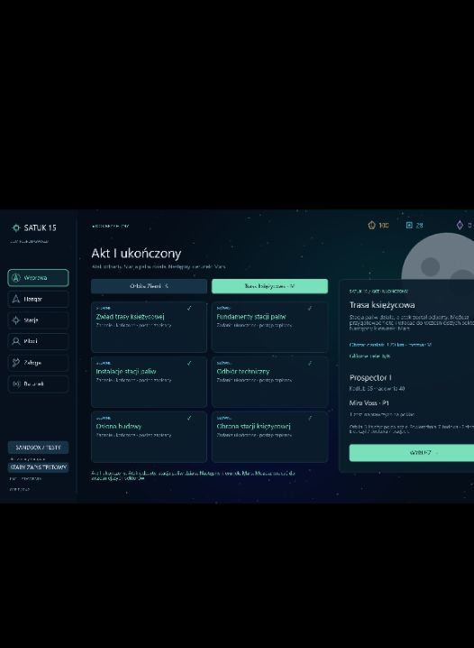

# 0.42 — finałowa obrona i mechaniczne zakończenie aktu I

Po odebraniu instalacji i ukończeniu Osłony budowy dostępny jest ostatni główny cel: **Obrona stacji księżycowej**. Atak wykorzystuje istniejące jednostki i walkę z AI. Nie określa tożsamości napastników, ich motywów ani prawdy o anomalii; treść fabularnego zwrotu nadal należy do autora.

## Przebieg

- Na powierzchni, przy stacji wskazywanej przez **7**, przytrzymaj **G przez 2 s**. Wymagania spokojnego rozpoczęcia są takie same jak przy obronie asteroidowej: poniżej 60 m/s, bez ciągu, broni, naprawy ani równoczesnego E.
- Następują trzy kontakty: **dron patrolowy, drugi dron patrolowy i Lancer**. Kolejny kontakt pojawia się po zniszczeniu poprzedniego, z sześcioma sekundami ostrzeżenia. Każdą walkę trzeba rozstrzygnąć w 90 s.
- Stacja ma **180 HP**. AI wybiera między statkiem gracza a stacją, celuje i wystrzeliwuje normalne pociski. Stacja otrzymuje obrażenia dopiero po rzeczywistym trafieniu. Można przechwytywać przeciwników i odciągać ich ostrzał. **F** wskazuje napastnika również na powierzchni; HUD i radar pokazują kierunek nadchodzącego kontaktu oraz stan obiektu.
- Po pokonaniu trzeciej jednostki trzeba wrócić przez wyjście na orbitę i zadokować w **Satuk 15**. HUD pokazuje oczekiwanie na raport. Dopiero bezpieczny powrót zalicza cel, wypłaca jednorazowe **40 rudy / 8 komponentów** i oznacza akt I jako ukończony.
- Podsumowanie powrotu i lobby wskazują odparcie ataku, działającą stację paliw i następny kierunek: Mars. Wcześniejsze sektory i nieukończone zadanie dodatkowe pozostają dostępne.

## Porażka i zapis

Zniszczenie stacji, utrata statku, wyjście na orbitę podczas walki, oddalenie się ponad 1350 m lub przekroczenie czasu kontaktu przerywa próbę. Usuwani są wyłącznie napastnicy tej próby i ich pociski. G po puszczeniu i ponownym przytrzymaniu pozwala zacząć od pierwszego kontaktu i pełnego stanu stacji. Wcześniejsze dostawy, odbiór instalacji i obrona asteroidowa pozostają zapisane; statek zachowuje swoje obrażenia i zużyte zapasy.

Napastnicy finału nie pozostawiają łupu ani kadłubów do odzysku, aby porażki i ponowienia nie tworzyły nieograniczonego źródła zasobów. Obowiązują dotychczasowe limity PD z walki po bezpiecznym powrocie.

Zwycięstwo w samej walce jest stanem bieżącej wyprawy. Śmierć lub odświeżenie przed dokowaniem oznacza utratę raportu, bez ukończenia aktu i bez nagrody finałowej. Po zatwierdzeniu w Satuk 15 nie można ponownie uruchomić ataku ani wypłacić nagrody.

Format kampanii **22** i dziennik **4** dopisują niedokończony cel finału. Migracja zachowuje wszystkie wcześniejsze cele i nagrody, bez automatycznego zamykania aktu. Zamknięcie wynika z ukończenia wszystkich głównych celów Ziemi i Księżyca; dodatkowa Rezerwa materiałowa go nie blokuje. Profile i sandbox pozostają oddzielne.

## Weryfikacja

Pięć nowych testów sprawdza rzeczywistą walkę bazowego Prospectora, trzy zniszczone jednostki, powrót z powierzchni przez orbitę do doku i jednorazowe rozliczenie; ostrzał oraz zniszczenie stacji przez AI; ponowienie i przerwanie przez wyjście; utratę raportu po zwycięstwie wskutek odświeżenia; migrację zapisu 21. Stan wejściowy testów ma ukończone wcześniejsze zadania aktu I. Walka i lot używają zwykłych wejść symulacji, bez dodawania obrażeń przeciwnikom.

Pełna regresja: **332/332 testów**. TypeScript, ESLint i produkcyjny build przeszły poprawnie. Po ostatniej korekcie tekstu podsumowania ponownie przeszło także pięć testów finału.

W przeglądarce sprawdzono start G, pojawienie się i ostrzał AI, kierowanie przez F, stan stacji i panel TAB z sześcioma celami bez nakładania tekstu. Próba używała oddzielnego lokalnego zapisu z przygotowanymi wcześniejszymi zadaniami. Widok ukończenia aktu sprawdzono na osobnym przygotowanym stanie po powrocie; rzeczywisty powrót z walki pokrywa test symulacji. Konsola aplikacji nie zgłosiła błędów podczas próby.

[Widok ataku na powierzchni Księżyca](validation-v0.42/assault.png).

## Granice zakresu

Akt I jest mechanicznie przechodni od początku do podsumowania. Dialogi, scenariusz odkryć, oprawa fabularnego zwrotu, tempo i trudność wymagają dalszego opracowania oraz testów graczy. Akt II i sektor Marsa nie są jeszcze grywalne; jego wskazanie określa dalszy kierunek ustalony w zarysie autora. Nie dodano paliwa statków ani rozstrzygnięć dotyczących anomalii.
