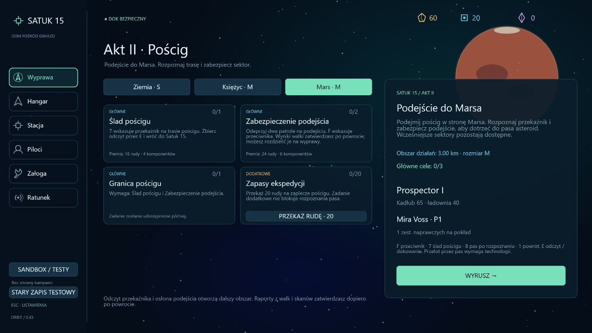

# 0.43 — podejście do Marsa, początek aktu II

Po zatwierdzeniu finałowego raportu aktu I dostępny jest trzeci sektor: **Podejście do Marsa**. Wybór w lobby przenosi Satuk 15 i zachowuje możliwość powrotu do Ziemi oraz Księżyca. Nie trzeba wykonywać wcześniejszych zadań dodatkowych.

## Grywalny odcinek

- **Ślad pościgu:** odczyt przekaźnika wskazywanego przez **7**, skan przez **E**, bezpieczny powrót. Nagroda jednorazowa: 16 rudy i 4 komponenty.
- **Zabezpieczenie podejścia:** dwa zwykłe patrole AI, **F** wskazuje przeciwnika. Liczą się wyłącznie jednostki tego zadania, po zatwierdzeniu raportu w stacji. Można wrócić po jednym kontakcie; kolejna wyprawa zawiera tylko pozostałą liczbę patroli. Nagroda za całość: 24 rudy i 6 komponentów.
- Te dwa cele można wykonywać równolegle i w dowolnej kolejności. Ich zatwierdzenie rozszerza promień działań z **3 do 4,6 km**.
- **Granica pościgu:** w dalszym obszarze **8** wskazuje punkt odczytu podejścia do pasa asteroid. Po skanie i powrocie raport informuje, że dalszy przelot wymaga nowej technologii. Nagroda: 20 rudy i 4 komponenty. Nie ma jeszcze przejścia przez pas.
- **Zapasy ekspedycji:** dodatkowe przekazanie 20 rudy z magazynu, nagroda 10 rudy i 4 komponenty. Nie blokuje głównych celów.

Mars ma własny stały seed, złoża, pozostałości konstrukcji i rysowane w kodzie tło planety. Nie otrzymuje księżycowych wejść na powierzchnię ani starszych struktur kontraktowych. HUD i panel TAB pokazują akt II, właściwe zadania, liczbę kontaktów i oczekiwanie na raport. Trzy przyciski sektorów mieszczą się w dotychczasowym panelu.

## Trwałość i migracja

Format kampanii **23**, dziennik **5**. Starsze formaty kampanii i kolejne wersje dziennika przechodzą istniejący łańcuch migracji, następnie dostają cztery nieukończone cele marsjańskie. Migracja nie wypłaca nagród, nie zeruje aktu I i nie odblokowuje Marsa przed finałem księżycowym. Nieznane lub niespójne klucze nadal powodują odrzucenie zapisu.

Skanowanie oraz wyniki walki pozostają tymczasowe do bezpiecznego dokowania. Śmierć albo odświeżenie aktywnej wyprawy oznacza utratę bieżącego raportu. Wcześniej zatwierdzone kontakty i skany pozostają zapisane. Sygnał ratunkowy zachowuje seed Marsa i osiągalną pozycję; ratunek wymaga powrotu do właściwego sektora. Ponowne odwiedziny i raporty nie powtarzają premii. Sandbox i stary profil testowy pozostają niezależne.

## Weryfikacja

Pełny zestaw: **338/338 testów**, w tym sześć nowych testów Marsa. Sprawdzają blokadę przed finałem aktu I, równoległe cele, częściowe raporty, jednorazowe nagrody, odblokowanie dalszego obszaru, migrację formatu 22, utratę raportu i ratunek we właściwym sektorze.

Test lotu używa bazowego Prospectora ze stanem wejściowym po ukończeniu wcześniejszych zadań. Normalnymi wejściami symulacji przelatuje sektor, pokonuje rzeczywiste AI obu patroli, skanuje przekaźnik, wraca do doku, a następnie wykonuje drugą wyprawę do pasa i wraca z odczytem. Bez teleportowania, dodawania obrażeń przeciwnikom ani darmowych ulepszeń w czasie lotu.

TypeScript, ESLint i produkcyjny build przeszły poprawnie. Po końcowej korekcie komunikatu blokady ponownie przeszło sześć testów Marsa i kontrole statyczne.

W przeglądarce sprawdzono przygotowane zapisy początku i końca odcinka, przełączanie sektorów, wylot, nawigację F, HUD i panel TAB. Konsola nie zgłosiła błędów aplikacji. To kontrola interfejsu; pełne przejście mechanik pokrywa test symulacji opisany powyżej.

[Odprawa podczas lotu](validation-v0.43/mars-briefing.png) · [Rozpoznana blokada pasa](validation-v0.43/mars-complete.png).

## Kolejny zakres

To **początek aktu II**, a nie ukończony akt. Następny krok: zadanie powrotu na Ziemię po rozpoznaniu blokady, wskazówka o technologii z Merkurego oraz otwarcie trasy do Wenus i przygotowań aktu III. Obecny komunikat wskazuje ten kierunek; odprawa ziemska i Wenus nie są jeszcze zaimplementowane.

Nie określono nazwy ani natury poszukiwanej technologii, tożsamości przeciwników, prawdy o anomalii ani fabularnych zwrotów. Nie dodano mechaniki paliwa statków.
