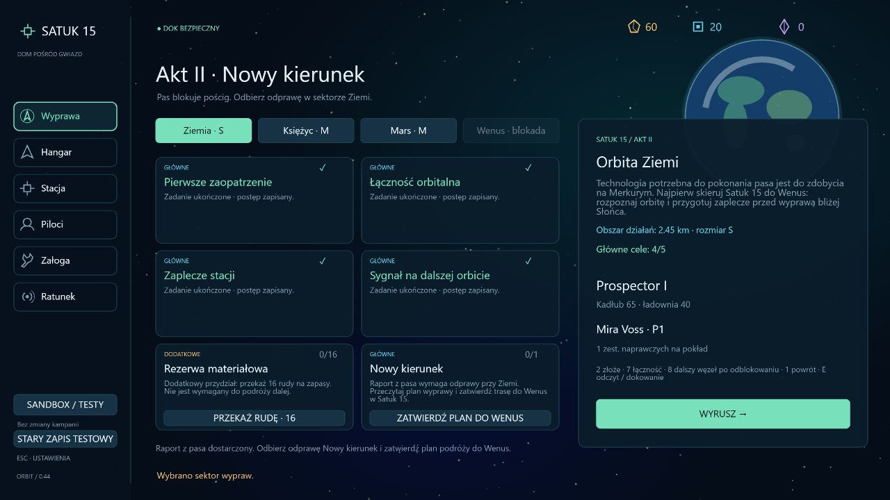

# 0.44 — odprawa ziemska i początek przygotowań przy Wenus

Po rozpoznaniu blokady pasa asteroid można wrócić do sektora Ziemi i odebrać odprawę **Nowy kierunek** w Satuk 15. Wskazuje ona zgodnie z zarysem autora, że potrzebnej technologii należy szukać na Merkurym, a wyprawę trzeba najpierw przygotować przy Wenus. Nie określa natury technologii ani prawdy o anomalii.

## Przejście z aktu II do III

Zadanie odprawy pojawia się dopiero po zatwierdzeniu raportu **Granica pościgu**. Na Ziemi panel pokazuje plan wyprawy oraz przycisk **Zatwierdź plan do Wenus**. Samo odwiedzenie sektora nie przyjmuje planu. Zatwierdzenie wymaga pobytu w stacji; nie działa podczas aktywnej wyprawy ani z innego sektora. Nie kosztuje surowców i nie przyznaje dodatkowej premii.

Przyjęcie planu zamyka mechaniczny ciąg aktu II i otwiera czwarty sektor, **Orbitę Wenus**. Wcześniejsze sektory i zadania dodatkowe pozostają dostępne. Cele mają jawnie przypisany akt: późniejsza odprawa na Ziemi nie blokuje wcześniejszego ukończenia aktu I ani dostępu do Księżyca i Marsa. Wskazówki w lobby zmieniają się po raporcie, po odprawie oraz podczas przygotowań przy Wenus.

## Pierwszy odcinek aktu III

- **Rozpoznanie orbity:** klawisz **7**, skan przekaźnika przez **E**, powrót do Satuk 15. Jednorazowa nagroda: 18 rudy i 4 komponenty. Zatwierdzenie rozszerza promień sektora z **2,8 do 3,9 km**.
- **Miejsce pod placówkę:** po zwiadzie **8** wskazuje nowy punkt pomiarowy. Skan i bezpieczny powrót zatwierdzają lokalizację przyszłej placówki. Nagroda: 16 rudy i 4 komponenty.
- **Materiały na placówkę:** po zwiadzie można przekazywać z magazynu **32 rudy**, również częściowo. Nagroda: 6 komponentów. Projekt pozostaje zapisany między wyprawami i po stracie statku.
- **Zapas na dalszą drogę:** dodatkowe przekazanie 16 rudy, premia 8 rudy i 3 komponenty. Nie blokuje celów głównych.

Pomiary i gromadzenie materiałów po zwiadzie można wykonywać w dowolnej kolejności. Materiały przekazuje się przyciskiem w stacji. Nie jest to powierzchniowa dostawa księżycowa. Sektor ma osobny seed, złoża, pozostałości i rysowane w kodzie tło Wenus. Nie zawiera wejść księżycowych ani patroli marsjańskich. HUD, nawigacja i panel TAB pokazują właściwy sektor i akt.

## Zapis

Format kampanii **24**, dziennik **6**. Migracja dopisuje nieukończoną odprawę i cztery cele Wenus, zachowując wcześniejsze raporty, nagrody, aktywną wyprawę i sygnały ratunkowe. Nie otwiera Wenus automatycznie nawet po ukończonym odcinku marsjańskim. Dotychczasowy łańcuch migracji starszych zapisów nadal działa; niespójne zależności i nieznane cele są odrzucane.

Skany pozostają tymczasowe do bezpiecznego powrotu. Częściowe przekazania rudy i zatwierdzone odczyty pozostają trwałe. Ratunek wymaga właściwego sektora i zachowuje osiągalną pozycję sygnału; dotychczasowe deterministyczne szanse przetrwania nie zostały zmienione. Profile testowy, fabularny i sandbox pozostają oddzielne.

## Weryfikacja

Pięć nowych testów obejmuje wymagania odprawy, świadome zatwierdzenie planu, dostęp do Wenus, częściowe projekty w obu kolejnościach, migrację formatu 23 również podczas aktywnej wyprawy, odrzucanie niespójnych zapisów oraz stratę statku i ratunek we właściwym sektorze.

Test zwykłego lotu zaczyna od przygotowanego stanu po wcześniejszych zadaniach marsjańskich. Bazowy Prospector wydobywa rudę, zbiera pierwszy odczyt przy Wenus i wraca do doku. W kolejnej wyprawie wykonuje pomiary miejsca pod placówkę i ponownie wraca. Następnie przekazuje wymagane materiały. Lot, wydobycie i skany korzystają ze zwykłych wejść symulacji; w trakcie próby nie ma teleportowania ani dodawania darmowych ulepszeń.

Pełna regresja: **343/343 testów**. TypeScript, ESLint i produkcyjny build przeszły poprawnie.

W przeglądarce użyto osobnego lokalnego zapisu z przygotowanymi wcześniejszymi zadaniami. Sprawdzono przejście Mars → Ziemia, sześć kart celów bez nakładania tekstu, treść odprawy, zatwierdzenie planu, odblokowanie i wybór Wenus, wylot, nawigację **7** oraz panel TAB. Konsola nie zgłosiła błędów aplikacji. Pełne przejście nowych mechanik pokrywa test symulacji opisany powyżej.

[Odblokowana trasa](validation-v0.44/venus-unlocked.png) · [Cele przy Wenus](validation-v0.44/venus-overview.png) · [Panel podczas lotu](validation-v0.44/venus-flight.png).

## Następny zakres

Akt III pozostaje rozpoczęty. Kolejny krok to budowa placówki po zatwierdzeniu miejsca i zgromadzeniu materiałów, opracowanie osłony przed Słońcem i obrona przygotowań przed atakami. Dopiero później wyprawa na Merkurego. Obecne zadania przygotowują miejsce i zapasy; nie tworzą jeszcze działającej placówki ani osłony.

Dialogi, sceny i tempo kulminacji aktu II pozostają do opracowania wraz z autorem. Nie dopisano tożsamości przeciwników, technologii, nowych frakcji ani wyjaśnienia anomalii. Nie dodano paliwa statków.
