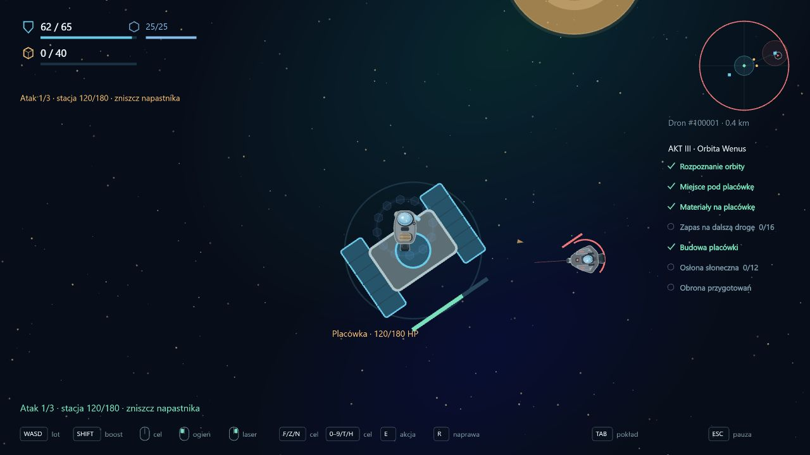

# 0.45 — placówka Wenus, osłona słoneczna i obrona przygotowań

Wcześniejsze pomiary i projekt **32 rudy** prowadzą teraz do zbudowania orbitalnej placówki. Po jej uruchomieniu można równolegle przygotować osłonę ekspedycji i odeprzeć atak na obiekt. Gotowa osłona oraz bezpiecznie dostarczony raport z obrony mechanicznie zamykają akt III.

## Budowa i osłona

**8** wskazuje miejsce placówki. Po zatwierdzeniu celów Miejsce pod placówkę i Materiały na placówkę przytrzymaj **E przez 2 s** w odległości poniżej 180 m, przy prędkości poniżej 60 m/s. Budowa wymaga spokojnej interakcji: bez ciągu, broni, naprawy, równoczesnego G ani świeżych obrażeń. Ruda została już pobrana przy wcześniejszym projekcie; montaż nie nalicza jej ponownie.

Plac budowy zmienia się w obiekt z modułem centralnym i panelami. Budowa od razu trafia do trwałego zapisu. Porażka lub odświeżenie późniejszej wyprawy nie cofa tego etapu. Placówka jest celem misji; dotychczasowy dok i magazyn pozostają w Satuk 15.

W stacji dostępny jest projekt **Osłona słoneczna** za **12 komponentów**. Przycisk pobiera komponenty, obsługuje częściowe wpłaty i nie pozwala zapłacić ponownie za ukończony projekt. Gotowość osłony jest trwałym stanem kampanii, niezależnym od straty konkretnego statku. Złoty pierścień placówki oznacza ukończenie projektu; nie jest bojową tarczą ani dodatkowym HP obiektu.

Osłona przygotowuje ekspedycję do następnego sektora. **Merkury i nowe zagrożenia termiczne nie są jeszcze wdrożone**; ich działanie z przygotowaną osłoną jest kolejnym zakresem. Nie dodano paliwa ani nowego obowiązkowego modułu statku.

## Obrona placówki

Po budowie przytrzymaj **G przez 2 s** przy obiekcie. Obrona nie wymaga wcześniejszego ukończenia projektu osłony. Obowiązują spokojny start, prędkość poniżej 60 m/s i konieczność puszczenia G przed kolejną próbą.

- Placówka ma **180 HP**. Kolejno nadlatują **dwa patrole i Lancer**, z ostrzeżeniem przed każdym kontaktem i limitem 90 s na jego pokonanie.
- AI wybiera między graczem a placówką i może uszkodzić obiekt rzeczywistymi pociskami. **F** wskazuje napastnika. HUD, model obiektu i panel TAB pokazują stan placówki oraz kierunek nadejścia.
- Utrata placówki, statku, oddalenie ponad 1350 m lub przekroczenie czasu przerywa próbę. Usuwani są wyłącznie napastnicy i pociski bieżącej obrony. Ponowienie przywraca 180 HP obiektu, zachowując obrażenia statku i zużyte zapasy.
- Zwycięstwo daje tymczasowy raport. Dopiero bezpieczny powrót do Satuk 15 zalicza zadanie i wypłaca jednorazowo **30 rudy i 8 komponentów**. Śmierć albo odświeżenie przed dokowaniem oznacza utratę raportu.
- Napastnicy tej próby nie pozostawiają łupu ani kadłubów do odzysku, tak jak w finale księżycowym. Przegrywanie i ponawianie obrony nie tworzy źródła materiałów.

Jeżeli obrona jest ukończona wcześniej, ostatnia wpłata na osłonę kończy przygotowania. Jeżeli osłona powstała wcześniej, akt zamyka powrót z raportem. Zadanie dodatkowego zapasu nie blokuje ukończenia. Raport finału księżycowego nie może zaliczyć obrony Wenus.

## Interfejs i zapis

Wenus ma siedem celów. Lobby pokazuje je na dwóch stronach, po maksymalnie sześć kart. Przyciski Poprzednie / Kolejne są pod kartami; zmiana sektora wraca do pierwszej strony. **Obrona przygotowań znajduje się na drugiej stronie.** HUD pokazuje wszystkie cele, a panel TAB mieści siedem pozycji bez nakładania podsumowania. Wskazówki reagują osobno na budowę, osłonę, obronę i pełną gotowość do dalszej wyprawy.

Format kampanii **25**, dziennik **7**. Migracja zachowuje wcześniejsze pomiary, wpłaty, raporty i aktywną wyprawę, dopisując trzy niedokończone zadania. Nie stawia placówki ani osłony automatycznie w starszym zapisie. Profile i sandbox pozostają niezależne.

## Weryfikacja

Pełna regresja: **351/351 testów**. Osiem nowych testów obejmuje warunki budowy, trwałość po przerwaniu wyprawy, częściowe wpłaty komponentów, obie kolejności obrony i osłony, jednorazowe premie, porażkę z ostrzału AI, ponowienie bez automatycznego startu po trzymanym G, selektywne sprzątanie próby, utratę raportu oraz migrację formatu 24.

Test lotu zaczyna od przygotowanego stanu po pomiarach i projekcie rudy, z 12 komponentami w magazynie. Bazowy Prospector zwykłymi wejściami symulacji leci do miejsca budowy, montuje placówkę i wraca. Po opłaceniu osłony ponownie dolatuje do obiektu, pokonuje rzeczywiste AI trzech kontaktów i wraca z raportem. W tej próbie nie ma teleportowania ani zadawania przeciwnikom obrażeń przez kod testu.

TypeScript, ESLint i produkcyjny build przeszły poprawnie. Po końcowej korekcie nazwy punktu nawigacyjnego i wskazówek ponownie przeszło trzynaście testów Wenus oraz kontrole statyczne.

W przeglądarce użyto oddzielnego lokalnego zapisu z przygotowanymi wcześniejszymi zadaniami. Sprawdzono obie strony celów, zwykły dolot, rzeczywistą budowę przez E, rozpoczęcie obrony przez G, pojawienie się AI, ostrzał placówki, F i panel TAB z siedmioma celami. Osobny przygotowany stan posłużył do kontroli przycisku wpłaty komponentów i widoku ukończenia aktu. Konsola nie zgłosiła błędów aplikacji. Pełną walkę z powrotem pokrywa test symulacji opisany powyżej.

[Zbudowany obiekt](validation-v0.45/outpost-built.png) · [Druga strona zadań](validation-v0.45/objectives-page2.png) · [Panel TAB](validation-v0.45/defense-briefing.png) · [Projekt osłony ukończony](validation-v0.45/shield-ready.png) · [Koniec przygotowań](validation-v0.45/act-complete.png).

## Dalej

Kolejny kierunek to **Merkury i akt IV**: trudniejszy sektor z zagrożeniami słonecznymi oraz wyprawa po technologię umożliwiającą przejście pasa. Natura technologii, tożsamość przeciwników i prawda o anomalii pozostają otwarte. Domknięcie aktu III dotyczy mechanik; dialogi, sceny, dramaturgia i balans wymagają dalszego opracowania.
