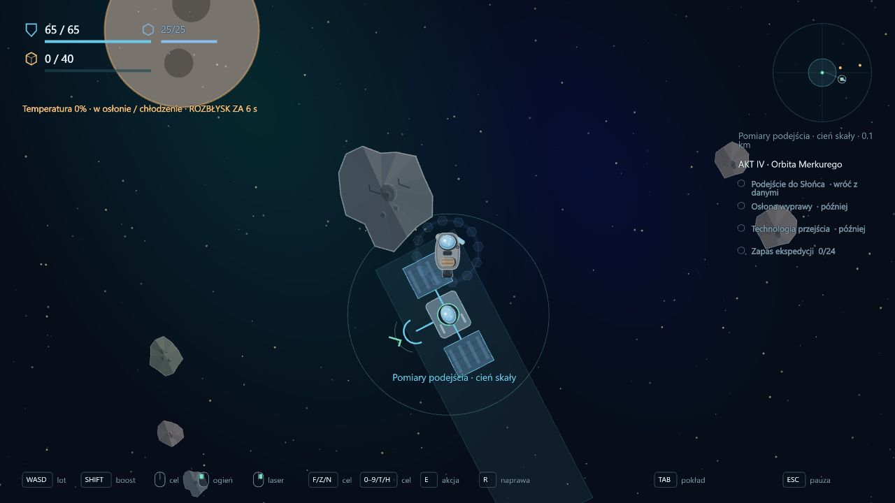

# 0.46 — Merkury, rozbłyski słoneczne i technologia przejścia pasa

Ukończenie głównych celów Wenus, w tym obrony placówki i osłony słonecznej, otwiera **Orbitę Merkurego**. Kampania ma pięć sektorów i mechaniczny ciąg aktu IV: pomiary podejścia, zabezpieczenie wyprawy oraz bezpieczny powrót z pakietem technologii potrzebnej do przekroczenia pasa asteroid.

## Temperatura i osłona

Nowa mechanika działa wyłącznie na Merkurym. Każda wyprawa zaczyna się z zimnym statkiem i własnym cyklem: **22 s spokoju, 6 s ostrzeżenia, 12 s rozbłysku**. HUD i panel TAB pokazują temperaturę, ekspozycję oraz czas fazy. Rozbłysk ma cieplejszą oprawę, a wysoka temperatura zmienia kolor wskaźnika.

Osłona przygotowana przy Wenus ogranicza nagrzewanie na otwartej przestrzeni do **1,5 punktu/s**, podczas rozbłysku do **8 punktów/s**. Bez osłony byłoby to 10 i 24 punkty/s; zwykły dostęp do sektora wymaga ukończenia przygotowań. Osłona nie daje pełnej odporności. Przy temperaturze **100%** ekspozycja uszkadza kadłub o **6 HP/s**, omijając tarczę kinetyczną i przerywając skanowanie oraz naprawę.

Przy Satuk 15, do 650 m od środka stacji, statek chłodzi się o **12 punktów/s**. Tak samo działa cień rzeczywistych asteroid o promieniu co najmniej 60 m. Promieniowanie nadchodzi od prawej strony mapy; bezpieczny pas leży po lewej stronie skały, do 650 m od jej środka i w granicach 72% jej promienia w pionie. Delikatnie zaznaczony obszar wskazuje miejsce osłony.

Cień jest liczony z aktualnej pozycji i rozmiaru skał. Ich przemieszczenie lub zniszczenie zmienia ochronę; odpowiednio duże odłamki mogą nadal ją zapewniać. Nie ma niezniszczalnych, niewidzialnych stref bezpieczeństwa przypisanych do punktów mapy. **3 i 4** wskazują bliskie schronienia, **5** dalsze po zwiadzie. Pomiary i węzeł technologii leżą za dużymi skałami. Nie warto niszczyć tych osłon bez potrzeby.

Temperatura nie jest zapisywana między wyprawami. Pauza zatrzymuje cykl razem z symulacją. Utrata statku i przerwanie gry rozliczają się według istniejących zasad. Sandbox oraz wcześniejsze sektory nie otrzymują nowego zagrożenia.

## Zadania

- **Podejście do Słońca:** 7 wskazuje pomiary w cieniu skały. E zbiera odczyt; powrót zatwierdza zwiad, daje jednorazowo 20 rudy i 6 komponentów oraz rozszerza promień sektora z **3 do 4,7 km**.
- **Osłona wyprawy:** po zwiadzie dostępne są patrol i Lancer. F wskazuje przeciwnika. Wyniki wymagają powrotu, ale można podzielić walki na wyprawy. Po pierwszym zatwierdzonym kontakcie pozostaje Lancer. Nagroda za całość: 28 rudy i 8 komponentów.
- **Technologia przejścia:** po zatwierdzeniu raportów bojowych 8 wskazuje dalszy węzeł. E zbiera pakiet; dopiero bezpieczny powrót trwale zabezpiecza technologię i wypłaca 35 rudy oraz 10 komponentów. Utrata statku przed dokowaniem oznacza utratę pakietu.
- **Zapas ekspedycji:** dodatkowe przekazanie 24 rudy, nagroda 12 rudy i 5 komponentów. Nie blokuje odzyskania technologii.

Główne cele zamykają mechaniczny ciąg aktu IV. Technologia jest trwałą gotowością kampanii. Wskazówki kierują gracza z powrotem na Marsa; dawne oznaczenie blokady pasa zmienia się na potwierdzenie zabezpieczonej technologii. **Nowe zadania Marsa z aktu V i fizyczne przejście pasa z aktu VI pozostają kolejnymi zakresami.** Nie pokazujemy nieczynnego przejścia jako grywalnego sektora.

Nie określono nazwy ani natury technologii, tożsamości wroga ani związku z prawdą o anomalii. Obecny pakiet danych pozwala przejść dalej mechanicznie bez utrwalania nieuzgodnionego wyjaśnienia fabularnego.

## Zapis i weryfikacja

Format kampanii **26**, dziennik **8**. Migracja dopisuje cztery niedokończone cele Merkurego, zachowując wcześniejsze projekty, raporty, zasoby i aktywny lot. Nie przyznaje technologii automatycznie. Ratunek zachowuje seed Merkurego i osiągalną pozycję; wymaga powrotu do właściwego sektora. Ponowne odwiedziny nie powtarzają nagród. Starsze łańcuchy migracji nadal przechodzą testy.

Pełny zestaw: **358/358 testów**. Siedem nowych testów sprawdza wymagania wejścia, fazy i ostrzeżenia, wpływ osłony oraz cienia, bieżące pozycje skał, obrażenia omijające tarczę, przerywanie skanów, brak zagrożenia w zwykłej grze, zależności raportów, utratę pakietu, jednorazowe nagrody, migrację i ratunek.

Test zwykłego lotu zaczyna od przygotowanego stanu po ukończeniu Wenus. Bazowy Prospector wykonuje pomiary i wraca; następnie dwie wyprawy bojowe podczas cyklu z rozbłyskiem, z chłodzeniem w rzeczywistych cieniach; na końcu dolatuje po pakiet i wraca do doku. Nie ma teleportowania, darmowych ulepszeń ani zadawania AI obrażeń przez kod testu w tym przejściu. Osobne testy geometrii i przegrzania używają kontrolowanych stanów symulacji.

TypeScript, ESLint i produkcyjny build przeszły poprawnie. W przeglądarce sprawdzono pięć przycisków sektorów, cele aktu IV, zwykły dolot, skanowanie w cieniu, wzrost temperatury po opuszczeniu osłony, ostrzeżenie i rozbłysk oraz panel TAB. Osobny przygotowany stan służył do kontroli widoku zabezpieczonej technologii. Próby używały oddzielnego lokalnego zapisu. Konsola aplikacji nie zgłosiła błędów. Pełną walkę i powroty pokrywa test symulacji opisany powyżej.

[Cele Merkurego](validation-v0.46/mercury-overview.png) · [Ekspozycja podczas rozbłysku](validation-v0.46/solar-flare.png) · [Panel temperatury](validation-v0.46/solar-briefing.png) · [Zabezpieczona technologia](validation-v0.46/technology-secured.png).

Kolejny zakres: **akt V przy Marsie**, miejscowa baza i zabezpieczenie dalszej ekspedycji. Potem przejście pasa. Dialogi, dramaturgia i balans wszystkich dotychczasowych aktów wymagają dalszego opracowania i prób graczy.
