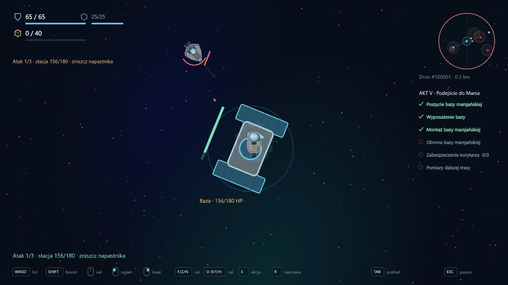

# 0.47 — powrót na Marsa i przygotowanie dalszej ekspedycji

Po bezpiecznym odzyskaniu technologii z Merkurego ponowny wybór sektora Marsa otwiera **akt V**. Poprzednie cele aktu II zachowują ukończenie i nagrody; nie trzeba powtarzać zwiadu ani dawnych walk. Nowy zakres obejmuje miejscową bazę i sześć kontaktów AI w dwóch niezależnych zadaniach.

## Baza marsjańska

W stacji dostępne są dwa równoległe projekty: **40 rudy** na poszycie i **10 komponentów** na wyposażenie. Można przekazywać materiały częściowo, w dowolnej kolejności i przez kilka wypraw. Wpłaty są trwałe.

Po ich zatwierdzeniu **7** wskazuje miejsce montażu bazy. Przytrzymaj **E przez 2 s**, poniżej 60 m/s i w odległości do 180 m. Wymagany jest spokojny statek: bez ciągu, broni, naprawy, równoczesnego G i świeżych obrażeń. Ruda i komponenty są już opłacone; montaż nie pobiera ich ponownie.

Baza pojawia się na orbicie, nazwa punktu nawigacyjnego zmienia się od razu, a postęp jest zapisywany natychmiast. Montaż rozszerza promień sektora z **4,6 do 5,4 km**. Nowe patrole oraz punkt dalszych pomiarów stają się dostępne jeszcze w tej samej wyprawie. Śmierć lub odświeżenie nie cofa bazy ani wpłat.

Miejscowa baza jest trwałym celem budowy i obrony. Zarządzanie flotą, magazyn i dok nadal znajdują się w Satuk 15, wskazywanym przez **1**. Nie dodano drugiego interfejsu stacji ani nowych usług bazowych.

## Dwa równoległe cele bojowe

**Obrona bazy marsjańskiej** rozpoczyna się przez **G przez 2 s** przy obiekcie. Baza ma **180 HP**. Kolejno nadlatują dwa patrole i Lancer, z ostrzeżeniem przed każdym kontaktem oraz limitem 90 s na jego pokonanie. AI może wybrać statek lub bazę; obiekt traci HP po rzeczywistym trafieniu. **F** wskazuje przeciwnika. HUD, model bazy i panel TAB pokazują stan obrony.

Utrata bazy, statku, oddalenie ponad 1350 m lub przekroczenie czasu przerywa próbę. Usuwani są wyłącznie napastnicy i pociski tej próby; zwykłe patrole korytarza pozostają. Po puszczeniu i ponownym przytrzymaniu G można zacząć od 180 HP bazy. Obrażenia statku i zużyte zapasy pozostają. Próba nie generuje łupu ani wraków do odzysku. Nagroda po bezpiecznym powrocie z raportem: jednorazowo **30 rudy i 8 komponentów**.

**Zabezpieczenie korytarza** obejmuje trzy zwykłe kontakty w dalszej części sektora: patrol i dwa Lancery. Są dostępne po montażu i niezależne od obrony bazy. Wyniki zatwierdzane są po powrocie; można wracać po pojedynczym kontakcie. Kolejne wyprawy zawierają tylko pozostałą liczbę jednostek. Nagroda za całość: **40 rudy i 12 komponentów**. Raporty nie zaliczają ponownie patroli z aktu II.

Obronę bazy i korytarz można ukończyć w dowolnej kolejności. Dopiero oba raporty wraz z montażem i technologią z Merkurego tworzą trwałą gotowość ekspedycji do następnego etapu. Raport księżycowy ani raport Wenus nie może zaliczyć nowej obrony.

## Zadania dodatkowe i interfejs

**Pomiary dalszej trasy:** po montażu **8** wskazuje odległy węzeł. E zbiera dane, powrót zatwierdza odczyt. Jednorazowa premia: 18 rudy i 5 komponentów. To zadanie oraz dawne Zapasy ekspedycji nie blokują ukończenia aktu V.

Lobby najpierw pokazuje sześć nowych celów aktu V. Druga strona zachowuje cztery wcześniejsze cele Marsa, w tym niedokończony zapas opcjonalny. Licznik głównych celów obejmuje cały sektor; HUD i panel TAB podczas nowej wyprawy pokazują tylko sześć bieżących zadań, bez powtarzania historycznych pozycji. Wcześniejsze sektory pozostają dostępne.

## Zapis i weryfikacja

Format kampanii **27**, dziennik **9**. Migracja dopisuje sześć niedokończonych celów. Zachowuje poprzednie akty, zasoby, oznaczenia przeszukanych pozostałości i aktywną wyprawę. Nie stawia bazy ani nie wypłaca nowych nagród automatycznie. Dodanie aktu V nie zmienia warunków zakończenia aktu II i dostępu do Wenus. Profile oraz sandbox pozostają niezależne.

Pełna regresja: **366/366 testów**. Osiem nowych testów obejmuje odblokowanie po Merkurym, widoczność bieżących i historycznych zadań, obie kolejności częściowych wpłat, montaż bez ponownego kosztu, odblokowanie patrolu i punktu pomiarowego podczas tej samej wyprawy, trwałość po przerwaniu, obie kolejności walk, jednorazowe premie, ostrzał bazy, ponowienie, selektywne sprzątanie, utratę raportu i migrację formatu 26.

Test zwykłego lotu zaczyna od przygotowanego stanu po Merkurym, z 40 rudy i 10 komponentami w magazynie. Bazowy Prospector opłaca projekty, leci do bazy, montuje ją i wraca. W kolejnej wyprawie dolatuje, odpiera rzeczywiste AI trzech kontaktów i wraca z raportem. Następnie trzy normalne wyprawy zabezpieczają kolejno kontakty korytarza. W tym przejściu nie ma teleportowania, darmowych ulepszeń ani zadawania przeciwnikom obrażeń przez kod testu. Osobne testy warunków startu i porażki używają kontrolowanych pozycji.

TypeScript, ESLint i produkcyjny build przeszły poprawnie. W przeglądarce sprawdzono wpłaty, historię aktu II na drugiej stronie, zwykły dolot, rzeczywisty montaż przez E, pojawienie się patroli i punktu pomiarowego, start G, ostrzał bazy, F oraz panel TAB z sześcioma celami. Próba używała osobnego lokalnego zapisu po przygotowanych wcześniejszych aktach. Widok zakończenia sprawdzono na osobnym przygotowanym stanie; pełne walki i powroty pokrywa opisany test symulacji. Konsola nie zgłosiła błędów aplikacji.

[Projekty materiałowe](validation-v0.47/mars-projects.png) · [Zachowana historia Marsa](validation-v0.47/mars-history.png) · [Zmontowana baza](validation-v0.47/mars-base-built.png) · [Panel podczas obrony](validation-v0.47/mars-defense-briefing.png) · [Gotowość ekspedycji](validation-v0.47/expedition-ready.png).

## Kolejny zakres

Akt V ma mechaniczny ciąg do gotowości ekspedycji. **Fizyczne przejście pasa asteroid z aktu VI nie jest jeszcze wdrożone**. Kolejny krok to osobny odcinek przejścia, wymagający technologii z Merkurego oraz zabezpieczonej bazy i korytarza. Potem kierunek Jowisz.

Dialogi, dramaturgia, tempo i balans pozostają do rozwinięcia. Nie ustalono natury technologii, tożsamości napastników ani prawdy o anomalii. Nie dodano paliwa statków ani sterowania wieloma jednostkami jednocześnie.
