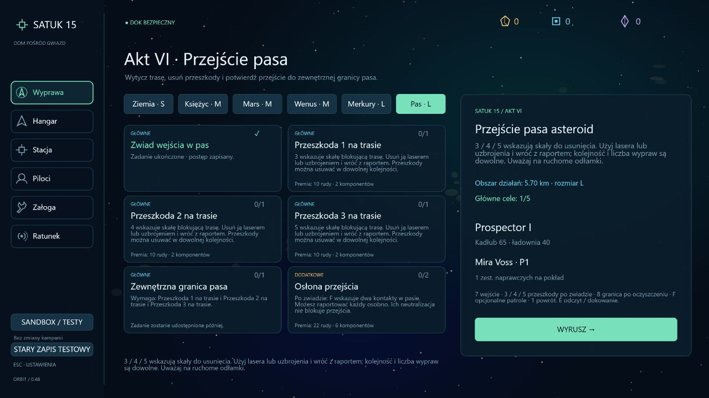
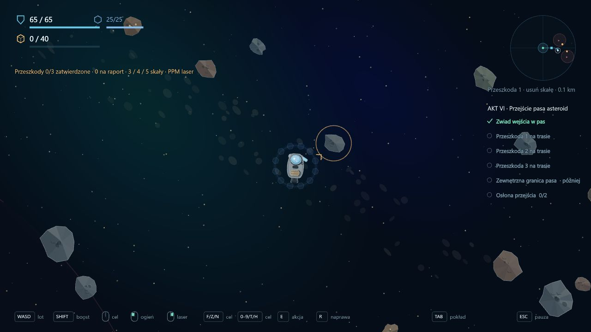
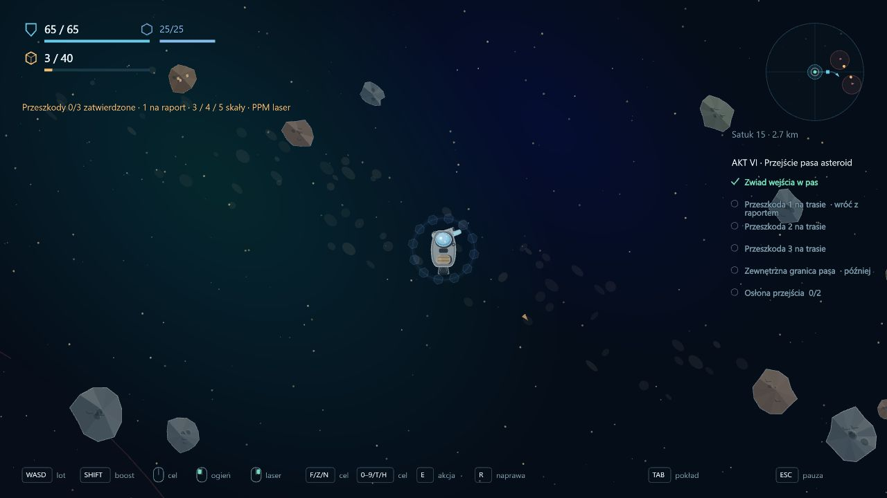
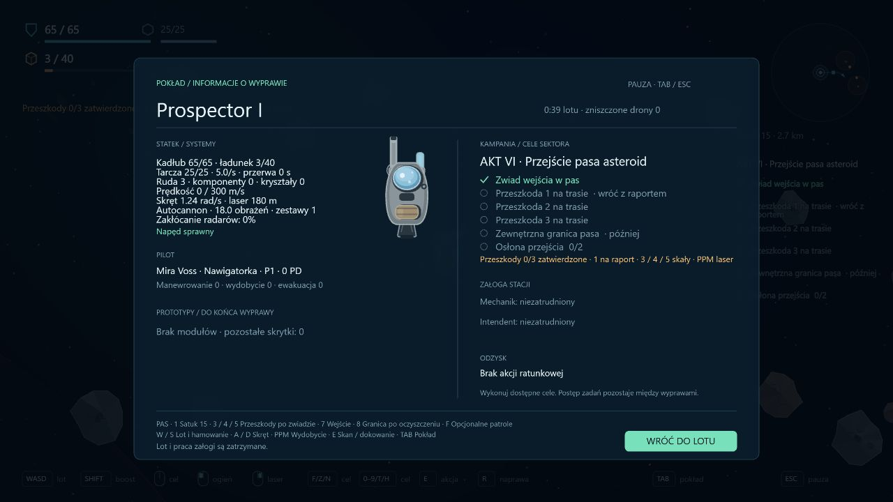
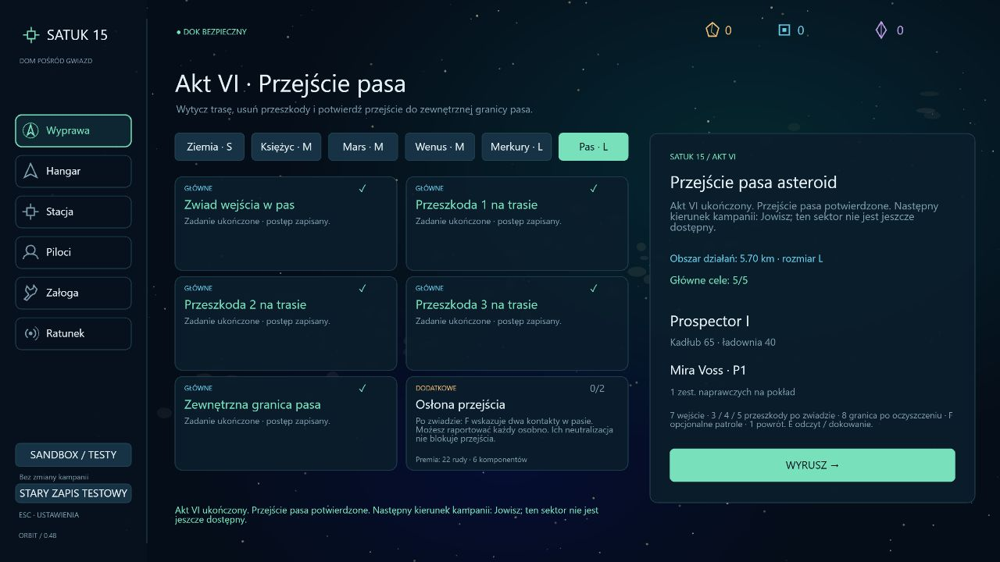

# Wdrożenie 0.48 — przejście pasa asteroid

Data: 2026-10-16. Zakres: mechaniczny ciąg aktu VI. Tożsamość przeciwników, natura technologii i prawda o anomalii pozostają otwarte.

## Przebieg wypraw

Sektor **Pas · L** odblokowuje się po bezpiecznym odzyskaniu technologii Merkurego oraz wszystkich głównych przygotowaniach aktu V na Marsie. Zwiad dodatkowy Marsa i dawne rezerwy materiałowe nie blokują podróży. Wcześniejsze sektory pozostają dostępne; zmiana sektora wymaga zakończenia aktywnej wyprawy.

1. **Zwiad wejścia w pas** — klawisz **7**, spokojny odczyt przez **E** i bezpieczny powrót. Raport rozszerza promień sektora z 2,2 do 5,7 km. Premia: 18 rudy i 4 komponenty.
2. **Trzy przeszkody na trasie** — klawisze **3 / 4 / 5** wskazują rzeczywiste skały. Laser lub uzbrojenie niszczy je zwykłą mechaniką wydobycia. Każda ma osobny cel i premię 10 rudy / 2 komponenty. Kolejność jest dowolna: można usunąć wszystkie podczas jednej wyprawy lub raportować je osobno. Zniszczenie zwykłej skały albo odłamka nie zalicza oznaczonej przeszkody.
3. **Zewnętrzna granica pasa** — po zatwierdzeniu trzech przeszkód pojawia się węzeł wskazywany przez **8**, 5,2 km od stacji. Odczyt przez E i powrót potwierdzają przejście i kończą akt VI. Premia: 30 rudy i 8 komponentów.

Równoległy cel dodatkowy **Osłona przejścia** obejmuje dwa patrole. F wskazuje przeciwników; raporty można dostarczać oddzielnie. Nagroda 22 rudy / 6 komponentów jest jednorazowa, a zadanie nie blokuje zakończenia aktu.

Pięć celów głównych daje łącznie 78 rudy i 18 komponentów, z opcjonalnymi patrolami 100 rudy i 24 komponenty. Obowiązują istniejące limity magazynu i zasady nadwyżek.

## Sektor, oznaczenia i zapis

Pas ma stały seed 150076, skupiska dużych asteroid i ruchome odłamki przecinające trasę. Początkowy układ jest deterministyczny. Centralny korytarz i podejścia do celów są czytelne; przeszkody i odłamki nadal podlegają zwykłej fizyce, kolizjom oraz wydobyciu. Zwalnianie i usuwanie skał przed statkiem ułatwia powrót. Brak dodatkowego kosztu paliwa, temperatury Merkurego czy nowej zdolności wymagającej zakupu — wcześniejsza gotowość technologiczna otwiera sektor.

Oznaczone skały mają złotą obwódkę. Nawigacja śledzi ich rzeczywiste położenie, także po poruszeniu przez kolizję, i usuwa znacznik po zniszczeniu. HUD oraz TAB pokazują osobno wyniki oczekujące na raport. Potwierdzone przeszkody nie pojawiają się na następnych wyprawach. Pozostałe skały odtwarzają się według dotychczasowej zasady map wypraw.

Zniszczenie celu podczas lotu nie zmienia trwałego dziennika. Dopiero bezpieczny powrót zatwierdza identyfikator konkretnej przeszkody. Strata lub odświeżenie aktywnej wyprawy odrzuca niezabezpieczone wyniki; wcześniejsze raporty i nagrody pozostają. Powtórne i zduplikowane raporty nie wypłacają premii ponownie. Obce sektory, błędne identyfikatory i raporty sprzed zwiadu nie zaliczają przeszkód.

Kampania ma wersję **28**, dziennik **10**. Migracja z wersji 27 / 9 dodaje sześć pustych zadań pasa, zachowując bank, historię wcześniejszych aktów, odwiedzone wraki i znacznik aktywnej wyprawy. Starsze migracje zachowują własne historyczne zestawy zadań.

## Weryfikacja

- Pełna regresja: **372/372 testów**. TypeScript, ESLint i build produkcyjny przechodzą.
- Sześć nowych testów sprawdza odblokowanie, backtracking, geometrię i deterministyczność sektora, przypisanie przeszkód, granice i zależności raportów, częściowe powroty, jednorazowość nagród, opcjonalne patrole, porażkę, odświeżenie oraz migrację wersji 27.
- Test bazowego Prospectora przechodzi pięć zwykłych wypraw: zwiad, przeszkody 3 → 2 → 1 i odczyt końca pasa. Statek rzeczywiście leci, korzysta z lasera także do oczyszczania napotkanych odłamków, skanuje i dokuje. Nie teleportuje się, nie otrzymuje darmowych ulepszeń ani ręcznie odejmowanego HP skał. Patrole pozostają opcjonalne i nie są wymagane w tej próbie.
- Kontrola przeglądarkowa na osobnym lokalnym porcie i przygotowanych zapisach QA: sześć kart dziennika, rozszerzony obszar, faktyczny przelot do pierwszej skały, jej wydobycie laserem i status oczekiwania na raport, TAB i podsumowanie ukończenia. Konsola bez błędów. Pełne przejście i bezpieczne rozliczenia sprawdza test symulacji; przeglądarka nie udaje ręcznego przejścia całej kampanii.

## Dalszy zakres

Następny sektor to Jowisz i akt VII. Obecne ukończenie pasa zapisuje gotowość do tego kierunku i wyraźnie informuje, że Jowisz nie jest jeszcze dostępny. Nie dodano jego mapy, zadań, przeciwników ani ujawnienia fabularnego. Przed pisaniem tego ujawnienia potrzebne są ustalenia autora.
