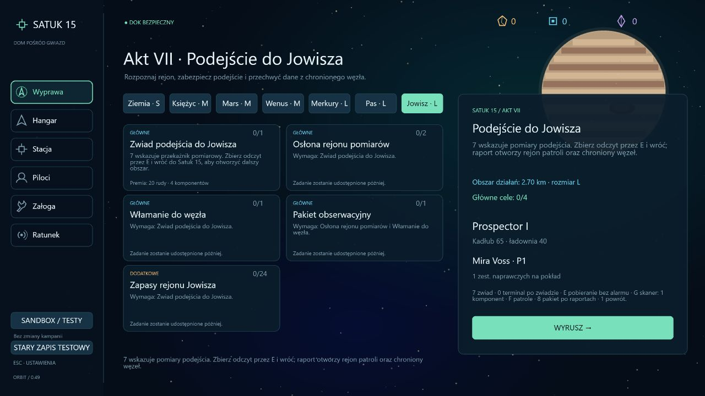
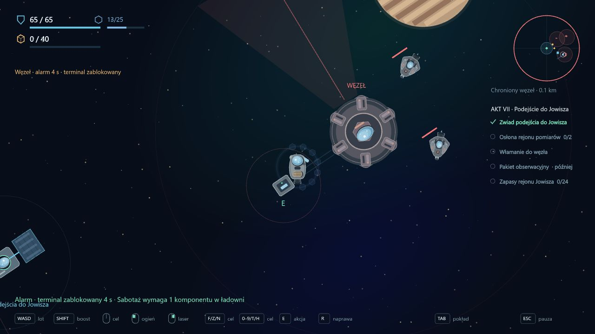
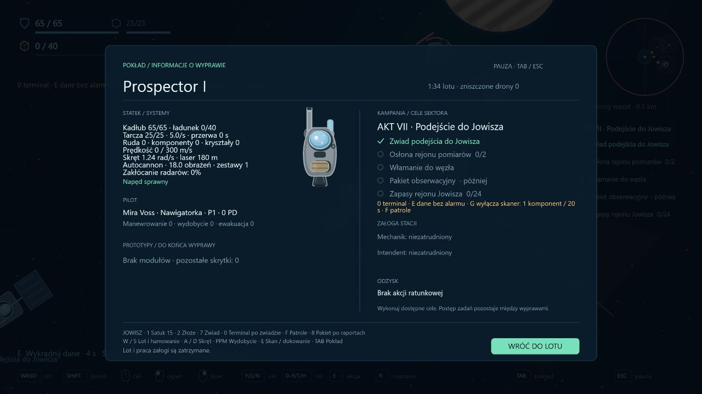
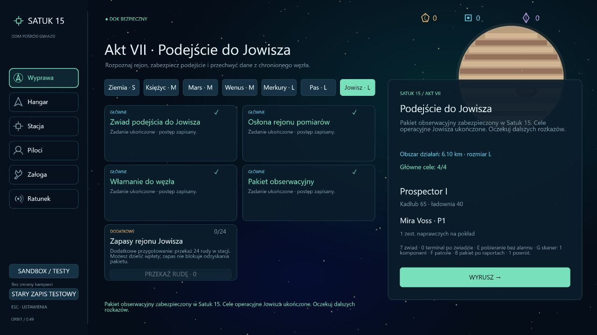

# Wdrożenie 0.49 — Jowisz i cele operacyjne aktu VII

Data: 2026-10-16. Ten zakres przygotowuje grywalny rejon Jowisza i odzyskanie pakietu obserwacyjnego. Nie ustala zawartości kluczowego ujawnienia, natury anomalii ani tożsamości przeciwników. Nie ogłasza fabularnego zakończenia aktu VII.

## Zadania i obszar

**Jowisz · L**, seed 150077, staje się dostępny po głównych zadaniach pasa asteroid. Opcjonalna osłona przejścia nie blokuje podróży. Wszystkie wcześniejsze sektory pozostają dostępne; aktywnej wyprawy nie można zmienić w podróż między sektorami.

- **Zwiad podejścia do Jowisza**: 7 wskazuje przekaźnik. Odczyt przez E i bezpieczny powrót rozszerzają promień sektora z 2,7 do 4,7 km. Premia 20 rudy / 4 komponenty.
- **Osłona rejonu pomiarów**: po zwiadzie patrol i Lancer w dwóch rejonach. F wskazuje przeciwników. Można raportować kontakty osobno; premia po dwóch raportach 28 rudy / 8 komponentów.
- **Włamanie do węzła**: równoległe do walk, po tym samym zwiadzie. 0 wskazuje terminal; E przez 4 s przy prędkości poniżej 60 m/s pobiera dane. Alarm, ostrzał, ciąg i inne prace przerywają pobieranie. Powrót zatwierdza raport i premię 24 rudy / 6 komponentów.
- **Pakiet obserwacyjny**: oba wcześniejsze raporty otwierają obszar 6,1 km oraz punkt 8 w odległości około 5,47 km. Odczyt przez E i powrót zabezpieczają pakiet. Premia 36 rudy / 10 komponentów. Komunikat mówi o ukończeniu celów operacyjnych i oczekiwaniu dalszych rozkazów.
- **Zapasy rejonu Jowisza**, opcjonalne: 24 rudy przekazywane w stacji, również częściowo. Premia 12 rudy / 5 komponentów. Zapas nie blokuje pakietu.

Główne zadania wypłacają łącznie 108 rudy i 28 komponentów. Nadal obowiązują pojemność magazynu i rozliczenie nadwyżek. Wydobycie oraz łup to osobne istniejące źródła zasobów.

## Włamanie podczas zwykłego lotu

Chroniony węzeł znajduje się w (2600, 900); terminal w (2340, 900). Nie jest zwykłym punktem skanu — nie ma przypisanego `siteId`, który mógłby ominąć mechanizm zabezpieczeń. Odczyt `outpost` pochodzi z istniejącego systemu terminala.

Obrotowy skaner wykrywa statek w stożku. Po wykryciu blokuje terminal alarmem na 8 s i wzywa dwa drony obronne. To osobne jednostki: ich zniszczenie nie zastępuje patrolu i Lancera z celu osłony. Jedna wyprawa nie tworzy kolejnych fal obrońców po każdym obrocie skanera.

Opcjonalne **G przez 3 s** przy terminalu zużywa **1 komponent z ładowni**, wyłącza skaner na 20 s i usuwa alarm. Komponent pobierany jest dopiero po ukończeniu sabotażu; przerwanie nie pobiera opłaty. Zapas w magazynie Satuk 15 nie jest automatycznie przenoszony na pokład. Komponent można wydobyć z bogatej skały; ten sposób przechodzi pełny test Prospectora. Sabotaż nie usuwa istniejących dronów, które mogą dalej ostrzeliwać statek.

Dane wymagają bezpiecznego powrotu; sama sesja terminala nie zalicza trwałego zadania. Utrata lub odświeżenie wyprawy odrzuca niezabezpieczony pakiet. Wcześniejsze raporty pozostają. Węzeł w kampanii udostępnia dane i zwykły łup; nie obiecuje dodatkowej kradzieży losowego wariantu broni z sandboxowego magazynu Cerbera. Sandbox zachowuje swoją dotychczasową mechanikę.

Nawigacja 0 przed zwiadem kieruje do pomiarów, zamiast prowadzić gracza poza granicę sektora do nieaktywnego obiektu. HUD i TAB podają stan alarmu, skanera i danych. Lobby mieści siedem zakładek sektorów i pięć kart bieżących celów. Tło Jowisza jest grafiką geometryczną zgodną z dotychczasowym stylem.

## Zapis

Kampania ma wersję **29**, dziennik **11**. Migracja z 28 / 10 dodaje pięć pustych zadań Jowisza, zachowując zasoby, potwierdzone wcześniejsze zadania, przeszukane wraki i znacznik aktywnej wyprawy. Nie zalicza nowych celów ani nie wypłaca nagród. Starsze migracje nadal używają swoich historycznych zestawów zadań. Nie zmieniono zasady rozliczania odświeżonego lotu jako straty.

## Weryfikacja

- Pełna regresja: **379/379 testów**. TypeScript, ESLint i build produkcyjny przechodzą.
- Siedem nowych testów: odblokowanie i geometria, równoległe raporty w obu kolejnościach, brak wczesnego dostępu do pakietu, jednorazowe nagrody, opcjonalne zasoby, prawdziwy alarm i walka z czterema kontaktami, rozróżnienie obrońców od patroli, przerwanie i opłata sabotażu, rzeczywiste pobieranie, brak magazynu broni w kampanii, śmierć / odświeżenie / obcy sektor i migracja wersji 28.
- Bazowy Prospector przechodzi pięć zwykłych wypraw: zwiad, po jednym kontakcie bojowym, wydobycie komponentu i włamanie, pakiet obserwacyjny. Leci, strzela, wydobywa, zbiera komponent, sabotuje, pobiera dane i dokuje. Brak teleportowania, darmowych modułów oraz ręcznego odejmowania HP przeciwników w tej próbie.
- Przeglądarka: przygotowane zapisy QA na osobnym porcie, początek i odblokowane karty, rzeczywisty dolot do węzła, wykrycie przez skaner, alarm, obrońcy, blokada pobierania pod ostrzałem, HUD, TAB oraz podsumowanie przygotowanego stanu operacyjnego. Bez błędów w konsoli. Pełne przejście i powroty są sprawdzone testem symulacji; kontrola przeglądarkowa nie jest przedstawiana jako ręczne ukończenie całej kampanii.

## Dalszy zakres

Ujawnienie fabularne aktu VII wymaga treści od autora. Można równolegle przygotować sektor Saturna i mechaniki aktu VIII zgodnie z zaakceptowanym zarysem: spokojniejsza eksploracja, wydobycie i walka. Saturn nie jest jeszcze odblokowywaną ani grywalną mapą w wersji 0.49.
