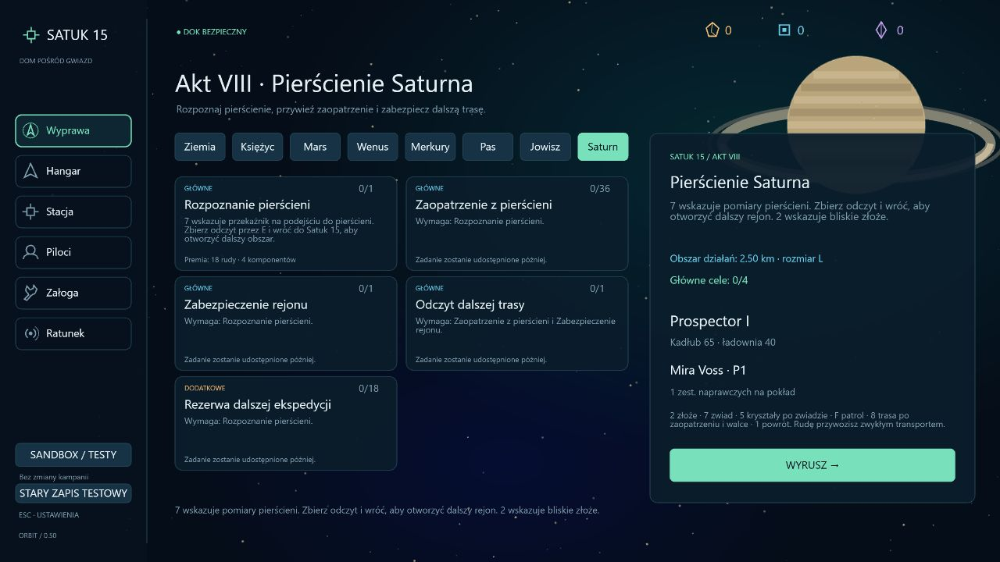
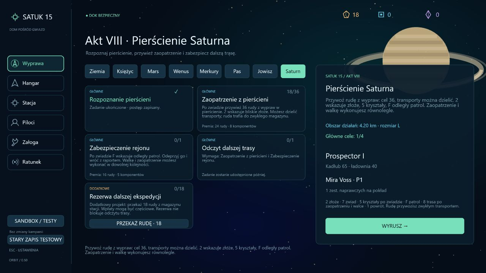
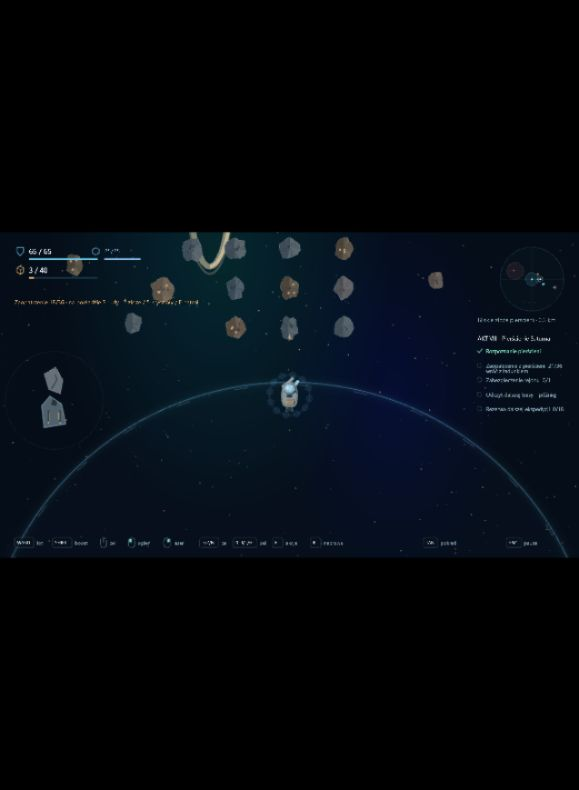
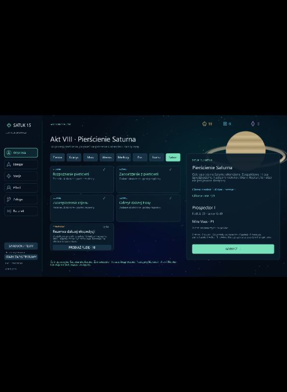

# Wdrożenie 0.50 — pierścienie Saturna

Data: 2026-10-16. Zakres: spokojniejsza eksploracja i wydobycie z walką, zgodnie z kierunkiem aktu VIII. Odblokowanie korzysta z operacyjnych celów Jowisza; nie dopisuje sceny ujawnienia aktu VII ani nie przesądza natury anomalii i przeciwników.

## Przebieg

**Saturn · L**, seed 150078, otwiera się po czterech głównych celach operacyjnych Jowisza. Opcjonalna rezerwa Jowisza nie blokuje podróży. Wcześniejsze sektory zachowują dostęp i historię; podróż nadal wymaga zakończenia aktywnego lotu.

1. **Rozpoznanie pierścieni** — 7 wskazuje przekaźnik. E zbiera odczyt, bezpieczny powrót rozszerza promień sektora z 2,5 do 4,2 km. Premia: 18 rudy / 4 komponenty.
2. **Zaopatrzenie z pierścieni** — po zwiadzie przywieź 36 rudy z udanych wypraw. 2 wskazuje bliskie złoże. Transporty mogą być częściowe; ruda trafia do zwykłego magazynu i nie jest pobierana drugi raz. Premia po osiągnięciu sumy 36: 24 rudy / 8 komponentów.
3. **Zabezpieczenie rejonu** — równolegle do zaopatrzenia można odeprzeć jeden patrol, wskazywany przez F, i wrócić z raportem. Premia: 16 rudy / 5 komponentów.
4. **Odczyt dalszej trasy** — zaopatrzenie i raport z walki rozszerzają sektor do 5,4 km. 8 wskazuje punkt w (4800, -600); E oraz powrót zabezpieczają trasę. Premia: 28 rudy / 8 komponentów.

Łączna premia głównych zadań to 86 rudy / 25 komponentów, oprócz przywiezionego ładunku. Obowiązują dotychczasowe limity magazynu i rozliczenie nadwyżek.

**Rezerwa dalszej ekspedycji** jest osobnym, opcjonalnym projektem: 18 rudy z magazynu, wpłaty również częściowe, premia 8 rudy / 4 komponenty. Projekt nie blokuje dalszej trasy. Nie jest alternatywnym sposobem zaliczenia głównego transportu.

## Wydobycie, eksploracja i zapis transportów

Bliskie pole zawiera piętnaście skał, dodatkowe skupiska tworzą pasy wokół rejonu wydobywczego. Skały są nieruchome; brak rozbłysków Merkurego i wymuszonego ataku na górnika. Jedyny patrol znajduje się po przeciwnej stronie sektora, w (-2200, -1100). Gracz sam wybiera kolejność wydobycia i walki.

Po zwiadzie **5** wskazuje dodatkowe złoże trzech skał kryształowych koło (3000, 1100). To zwykłe, rzeczywiście niszczone i zbierane skały; kryształy nie są obowiązkowym celem aktu. Można wracać do wydobycia po ukończeniu głównych zadań. Pozostaje dotychczasowa zasada odtwarzania asteroid między wyprawami.

Cel zaopatrzenia liczy rudę przywiezioną na końcu udanej wyprawy w sektorze Saturna, po zatwierdzonym zwiadzie. Nie wymaga konkretnego sposobu pozyskania rudy: zwykłe wydobycie i inne źródła ładunku z wyprawy działają jednakowo. Nie liczy starego stanu magazynu, pustych powrotów, przychodów stacji, premii za zadanie ani wpłat do opcjonalnego projektu. Ewentualny wcześniej załadowany fracht jest odejmowany od licznika świeżego transportu.

HUD i TAB pokazują sumę potwierdzoną oraz podgląd aktualnego ładunku z przypomnieniem o powrocie. Dopiero udany powrót utrwala przyrost. Strata lub odświeżenie aktywnej wyprawy odrzuca niezabezpieczony ładunek; wcześniejsze częściowe transporty pozostają. Powtórne zakończenie tego samego lotu nie działa, a cel i premia rozliczają się jednokrotnie. Przewóz po ukończeniu celu nadal normalnie zwiększa zasoby, bez drugiej premii zadania.

Osiem zakładek sektorów pokazuje teraz krótkie nazwy bez dopisków rozmiaru w przycisku; rozmiar sektora pozostaje w prawym panelu odprawy. Tło Saturna korzysta z geometrii i pierścieni w dotychczasowym stylu gry. Statki nie otrzymały kolejnego liftingu.

## Migracja

Kampania: **30**, dziennik: **12**. Migracja z 29 / 11 dodaje pięć pustych zadań Saturna. Zachowuje zasoby, historię wcześniejszych aktów, przeszukane wraki i znacznik aktywnej wyprawy. Nie wypłaca premii ani nie zalicza zaopatrzenia na podstawie starego magazynu. Poprzednie migracje zachowują swoje historyczne zestawy zadań.

## Weryfikacja

- Pełna regresja: **385/385 testów**. TypeScript, ESLint i build produkcyjny przechodzą.
- Sześć nowych testów obejmuje odblokowanie i backtracking, deterministyczną geometrię i zasoby, osobny patrol, stopniowe rozszerzenie sektora, oba porządki walki i zaopatrzenia, częściowe transporty i podgląd HUD, stare zasoby i brak podwójnej opłaty, jednorazowe premie, przedwczesne / obce / utracone transporty, odświeżenie, rzeczywiste wydobycie kryształu oraz migrację wersji 29.
- Bazowy Prospector przechodzi pięć zwykłych wypraw: zwiad, pierwszy transport minimum 18 rudy, patrol, drugi transport i odczyt dalszej trasy. Rzeczywiście leci, wydobywa, zbiera, strzela, skanuje i dokuje. Bez teleportowania, darmowych modułów oraz ręcznego uszkadzania celów w tej próbie. Opcjonalna rezerwa pozostaje niedokończona.
- Przeglądarka: osobny port i przygotowane zapisy QA, osiem zakładek, początek aktu, częściowy stan 18/36, rzeczywisty dolot do złoża, wydobycie 3 rudy i zwykłe dokowanie. Po powrocie stan wzrósł do **21/36**. Konsola bez błędów. Pełne przejście i walkę sprawdza test symulacji; stan podsumowania pochodzi z przygotowanego zapisu QA. W trakcie kontroli okno podglądu zmieniło rozmiar, dlatego późniejsze obrazy mają wąski kadr z pasami wokół gry.

## Dalszy zakres

Następny mechaniczny odcinek to akt IX: Uran i Neptun, odkrywanie baz oraz pierwsza walka z głównym przeciwnikiem. Te sektory i starcie nie są jeszcze grywalne w wersji 0.50. Kluczowe sceny, tożsamość przeciwnika i ujawnienie anomalii pozostają do ustalenia przez autora.
