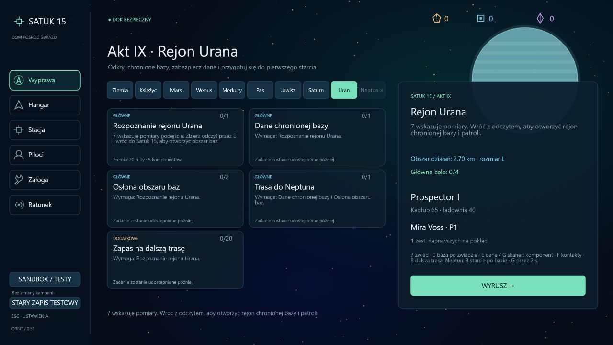
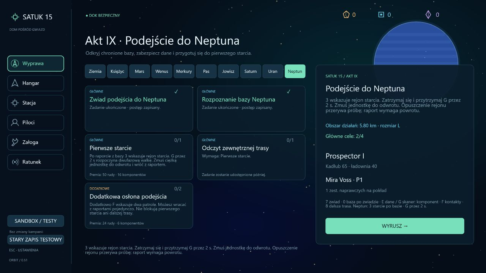
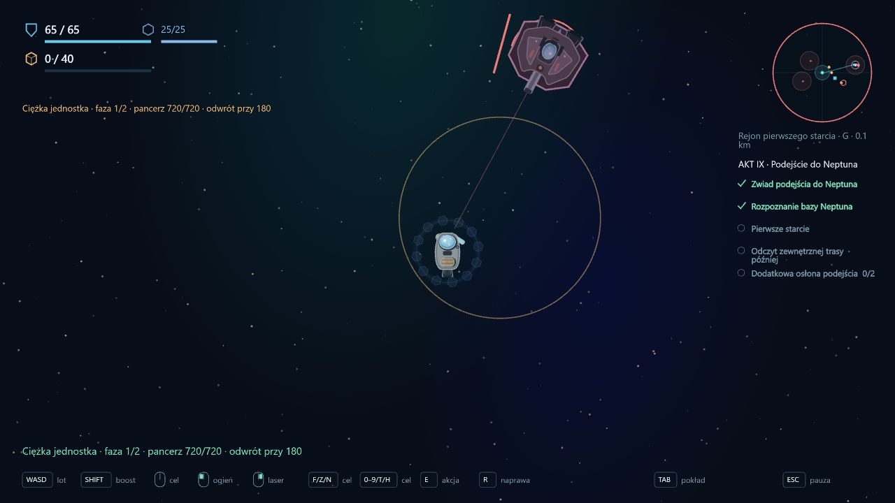
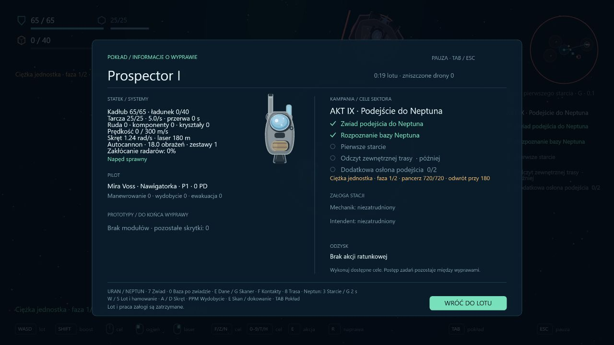
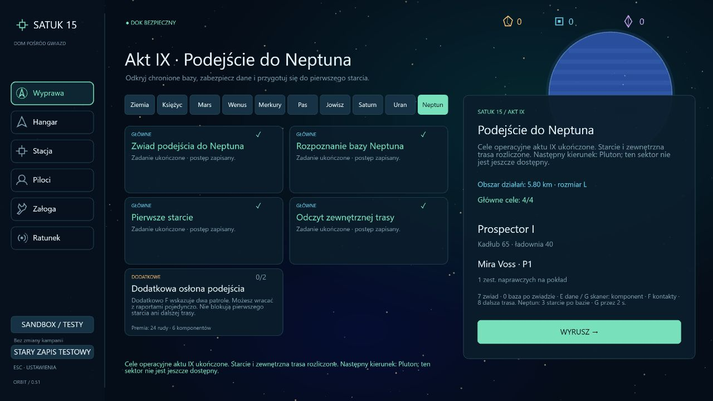

# Wdrożenie 0.51 — Uran, Neptun i pierwsze starcie

Data: 2026-10-16. Zakres: operacyjne cele aktu IX, dwie mapy, rozpoznanie baz i pierwsza dwufazowa walka. Ciężka jednostka wycofuje się po wymuszeniu odwrotu; nie dopisano tożsamości przeciwnika, prawdy o anomalii ani końcowego rozstrzygnięcia fabularnego.

## Uran

**Uran · L**, seed 150079, otwiera się po głównych celach Saturna. Promień początkowy 2,7 km.

1. **Rozpoznanie rejonu Urana** — 7 wskazuje pomiary; E i bezpieczny powrót otwierają 4,6 km. Premia 20 rudy / 5 komponentów.
2. **Dane chronionej bazy** — po zwiadzie 0 wskazuje terminal. Istniejący skaner, alarm, dwa drony obronne, E przez 4 s oraz opcjonalny G przez 3 s za komponent z ładowni działają jak przy Jowiszu. Powrót z danymi: 24 rudy / 7 komponentów.
3. **Osłona obszaru baz** — równolegle można pokonać patrol i Lancera. Raporty da się dostarczać osobno. Premia 30 rudy / 8 komponentów.
4. **Trasa do Neptuna** — oba wcześniejsze raporty otwierają 5,6 km i punkt 8 w (4900, -650). Odczyt oraz powrót odblokowują Neptuna. Premia 24 rudy / 6 komponentów.

Opcjonalny **Zapas na dalszą trasę**: wpłaty 20 rudy w stacji, premia 10 rudy / 5 komponentów. Nie blokuje podróży. Główne premie Urana: 98 rudy / 26 komponentów.

## Neptun

**Neptun · L**, seed 150080, wymaga całej głównej trasy Urana, nie jego zapasu opcjonalnego. Wcześniejsze sektory pozostają dostępne.

1. **Zwiad podejścia do Neptuna** — 7, E i powrót; promień 2,8 → 4,8 km. Premia 22 rudy / 5 komponentów.
2. **Rozpoznanie bazy Neptuna** — 0 wskazuje drugi chroniony terminal. Pobranie danych i powrót rozszerzają sektor do 5,8 km i otwierają rejon starcia. Premia 28 rudy / 8 komponentów.
3. **Pierwsze starcie** — 3 wskazuje rejon w (3900, -900). Po wymuszeniu odwrotu przeciwnika i powrocie: 50 rudy / 16 komponentów oraz 12 PD pilota, jednorazowo i z zachowaniem istniejącego limitu PD wyprawy.
4. **Odczyt zewnętrznej trasy** — dopiero po raporcie ze starcia pojawia się punkt 8 w (5100, 1000). E i powrót kończą operacyjne cele aktu IX. Premia 30 rudy / 10 komponentów.

**Dodatkowa osłona podejścia** to dwa opcjonalne patrole. F wskazuje kontakty; można raportować je osobno. Premia 24 rudy / 6 komponentów. Nie blokują walki ani końcowego odczytu. Główne premie Neptuna: 130 rudy / 39 komponentów. Nadal obowiązują magazyn i nadwyżki.

## Pierwszy przeciwnik główny

Walka jest świadomie uruchamiana: zatrzymaj się w promieniu 180 m od punktu 3, bez ciągu, ognia i innych prac, i przytrzymaj **G przez 2 s**. Nie zużywa surowców. Po 3 s zapowiedzi pojawia się odrębna ciężka jednostka, z własnym profilem AI, dużym kadłubem, pancerzem i paskiem HP.

- Początek: **720 pancerza**, pojedyncze ciężkie pociski, 1,4 s ładowania i 2,5 s odstępu po strzale.
- Przy **468 pancerza, 65%**, przeciwnik przechodzi w drugą fazę: szybszy pościg, 0,9 s ładowania, 1,8 s odstępu i salwy trzech pocisków w wachlarzu. Zwykłe trafienia nie kasują ładowania jego broni.
- Przy **180 pancerza, 25%**, jednostka wycofuje się. Nie jest rozbijana na wrak, nie daje łupu ani licznika zniszczonych patroli. Pierwsza faza zatrzymuje obrażenia na swoim progu do przełączenia profilu; druga kończy się odwrotem, więc bardzo silny strzał nie pomija całego starcia ani nie zabija fabularnego przeciwnika.
- Pole walki jest oczyszczone z asteroid w promieniu 1,2 km. Opuszczenie rejonu 1,5 km od środka, strata statku lub limit 180 s walki przerywają próbę. Usuwane są tylko jednostka i jej pociski; zwykłe patrole pozostają.
- Porażkę można ponowić przy punkcie 3. Trzeba puścić G i nacisnąć ponownie. Samo dalsze trzymanie klawisza nie uruchamia od razu następnej próby.
- Zwycięstwo jest wynikiem wyprawy, a nie natychmiastowym trwałym wpisem. Odświeżenie lub śmierć przed powrotem je odrzuca. Dopiero bezpieczny powrót rozlicza zadanie, premię i PD. Ponowne zgłoszenie nie wypłaca ich drugi raz.

To taktyczna forma pierwszego spotkania, pozostawiająca autora z możliwością określenia, kto lub co kieruje jednostką. Finał przy Plutonie nie został dopisany.

## Interfejs i zapis

Dziesięć przycisków sektorów mieści się w jednym rzędzie dzięki mniejszym odstępom i czcionce; etykiety nie nachodzą na siebie. Dane obu baz trafiają przez rzeczywisty mechanizm terminala, nie przez skrócony skan. Przed zwiadem klawisz 0 wskazuje najpierw pomiary, zamiast prowadzić poza mapę do nieaktywnej bazy. HUD i TAB pokazują stan starcia, fazę, pancerz oraz raport oczekujący na powrót. Po zamknięciu celów pojawia się kierunek Pluton z informacją o jego niedostępności w tej wersji.

Kampania ma wersję **31**, dziennik **13**. Migracja z 30 / 12 dodaje dziesięć pustych zadań obu sektorów, zachowując bank, historię, przeszukane wraki i znacznik aktywnej wyprawy. Nie przyznaje nowych raportów, premii ani zwycięstwa. Zachowana jest dotychczasowa zasada rozliczania odświeżonej aktywnej wyprawy jako straty.

## Weryfikacja

- Pełna regresja: **392/392 testów**. TypeScript, ESLint i produkcyjny build przechodzą.
- Siedem nowych testów obejmuje oba sektory, zależności i kolejność równoległych celów, brak blokady przez cele opcjonalne, raporty i premie, dwa profile przeciwnika oraz prawdziwą salwę, uruchamianie przez G, wyjście / timeout / śmierć, ponowienie po puszczeniu klawisza, sprzątanie obiektów i pocisków bez usuwania patroli, wymuszony odwrót bez łupu, utratę nieoddanego raportu, jednorazowe PD i migrację wersji 30.
- Bazowy Prospector przechodzi **dziewięć zwykłych wypraw** przez oba sektory: zwiad Urana, wydobycie komponentu i włamanie, po jednym kontakcie bojowym, odczyt trasy, zwiad Neptuna, kolejne wydobycie i włamanie, dwufazowe starcie i końcowy odczyt. Rzeczywiście leci, kopie, zbiera, sabotuje, strzela, skanuje i dokuje. Brak teleportowania, darmowych modułów i ręcznie odejmowanego HP celów w tej próbie. Opcjonalne cele pozostają niedokończone.
- Przeglądarka na osobnym porcie i przygotowanych zapisach QA: dziesięć zakładek i odprawy, rzeczywisty dolot do rejonu 3, uruchomienie walki, pojawienie się ciężkiej jednostki, jej pancerz i ostrzał oraz strata statku bez zaliczenia zadania. Pełne zwycięstwo obu faz i powrót sprawdza symulacja, nie są przedstawiane jako ręczne przejście całej kampanii w przeglądarce. Kontrola obejmuje także panel TAB i przygotowane podsumowanie operacyjne.

## Dalszy zakres

Następny mechaniczny zakres to Pluton i akt X: cele prowadzące do finałowego starcia. Treść zakończenia i prawda o anomalii wymagają ustaleń autora. Wersja 0.51 nie dodaje grywalnego Plutona ani końca fabularnego.
