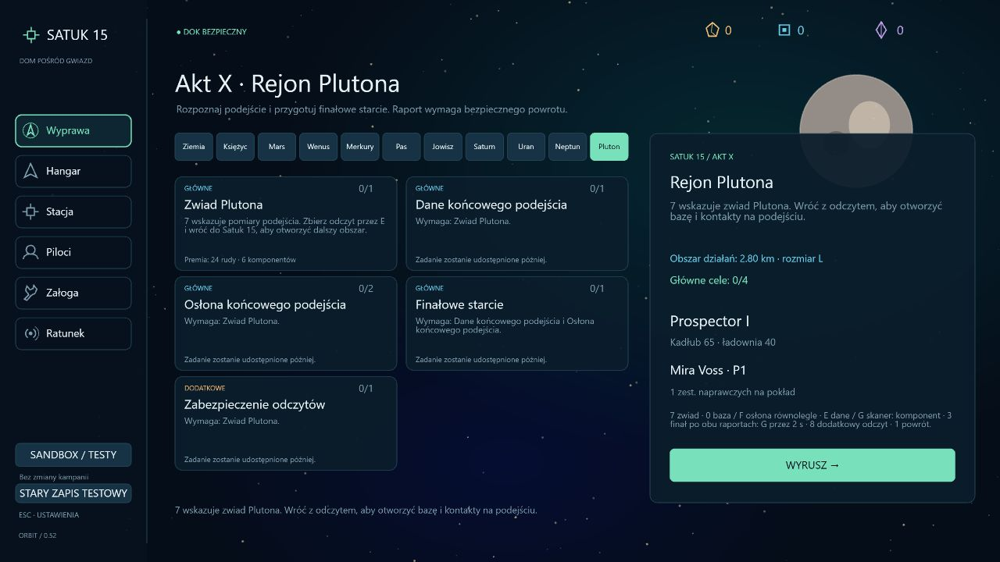
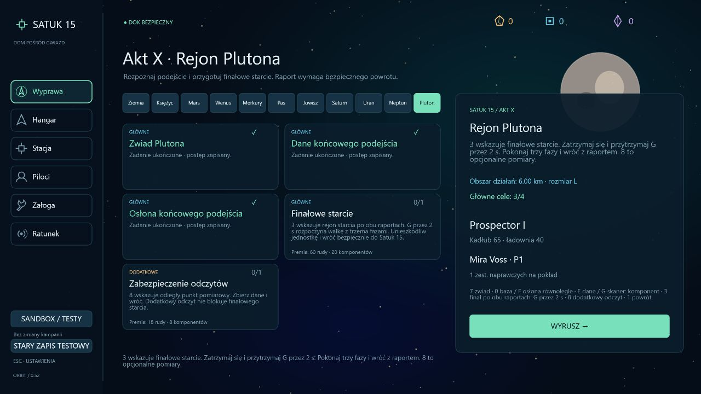
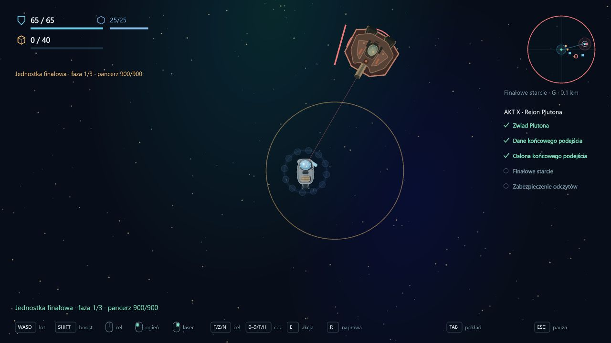
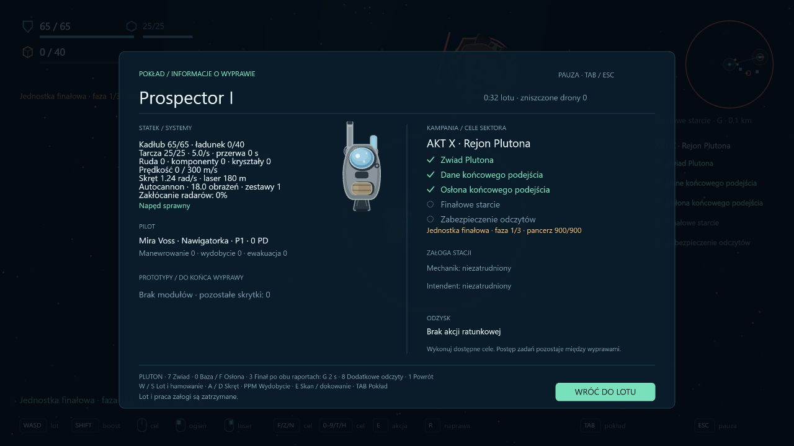
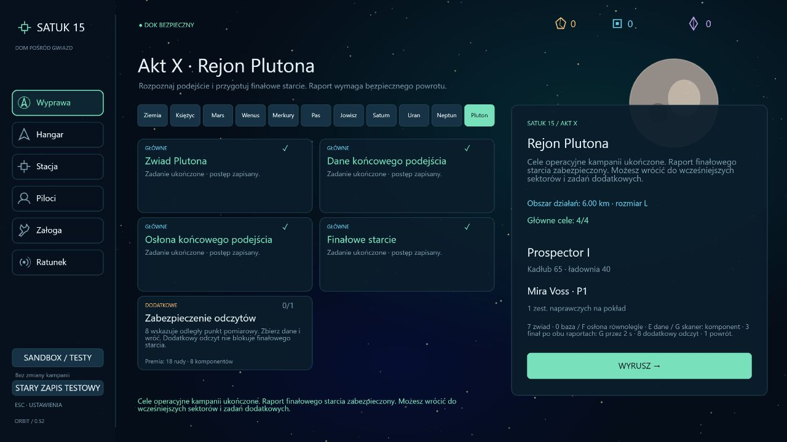

# 0.52 — Pluton i mechaniczny finał aktu X

Pluton odblokowuje się po wszystkich głównych raportach Neptuna. To operacyjny finał mechanik kampanii. Tożsamość jednostki, prawda o anomalii, dialogi i fabularne zakończenie nie zostały dopisane.

## Cele i sektor

Sektor L, seed 150081, promień 2,8 km. Zwiad przy punkcie 7 przez E i bezpieczny powrót rozszerzają obszar do 4,8 km (24 rudy / 6 komponentów).

Potem dostępne są dwa równoległe cele:

- Dane końcowego podejścia: 0 wskazuje chroniony terminal. E pobiera dane bez alarmu; G za komponent z ładowni wyłącza skaner na 20 s. Raport: 30 rudy / 10 komponentów.
- Osłona końcowego podejścia: patrol i Lancer wskazywani przez F. Można raportować po jednym kontakcie. Premia: 36 rudy / 10 komponentów.

Oba raporty rozszerzają rejon do 6 km i otwierają finał. Dodatkowe odczyty przy punkcie 8 są dostępne po zwiadzie, mają premię 18 rudy / 8 komponentów i nie blokują finału.

## Starcie

Punkt 3 znajduje się w (4200, -1000). G przez 2 s, na postoju bez ognia i innych prac w promieniu 180 m, uruchamia czterosekundową zapowiedź. Jednostka ma 900 pancerza i trzy fazy:

| Faza | Próg | Salwa | Ładowanie | Odstęp po strzale | Pościg |
| --- | --- | --- | --- | --- | --- |
| I | 900–540 | 1 pocisk, 14 obrażeń | 1,4 s | 2,5 s | 135 |
| II | 540–270 | 3 pociski, po 10 obrażeń | 1,1 s | 2,2 s | 160 |
| III | 270–unieszkodliwienie | 5 pocisków, po 8 obrażeń | 0,9 s | 2 s | 185 |

Duże trafienie zatrzymuje się na progu zmiany fazy. Zwykłe trafienia nie przerywają ładowania. Po ostatniej fazie jednostka zostaje unieszkodliwiona, znika z pola walki i daje efekt eksplozji; nie tworzy zwykłego wraku, łupu ani raportu patrolu. Techniczna granica 1 HP pozwala kontrolerowi zdjąć jednostkę bez uruchamiania zwykłych nagród za drona; HUD po zwycięstwie pokazuje 0.

Opuszczenie rejonu 1,5 km, strata statku lub upływ 210 s przerywają próbę. Sprzątana jest jednostka i jej pociski, nie pozostałe kontakty. Po puszczeniu G można ponowić od pełnego pancerza. Odświeżenie lub śmierć przed oddaniem raportu odrzuca wynik wyprawy.

Bezpieczny powrót przyznaje jednorazowo 60 rudy / 20 komponentów i 18 PD pilota w ramach istniejącego limitu wyprawy. Rozlicza główne cele Plutona i pokazuje operacyjne ukończenie kampanii. Nadal można podróżować i wykonywać zadania dodatkowe. To nie jest zatwierdzone zakończenie fabularne ani deklaracja finalnego balansu.

## Zapis i interfejs

Kampania 32, dziennik 14. Migracja z 31 / 13 dodaje pięć pustych zadań Plutona, zachowuje dotychczasowe raporty, bank, przeszukane wraki i aktywną wyprawę. Starsze migracje przechodzą kolejno. Raport finału jest osobnym polem, niezależnym od wymuszenia odwrotu przy Neptunie i kontrolowanym przez sektor oraz oba wymagane raporty.

Jedenaście zakładek sektorów mieści się w rzędzie z mniejszą czcionką. HUD, odprawa, TAB i komunikaty pokazują cele Plutona, zapowiedź, trzy fazy oraz oczekujący raport. Tło Plutona ma osobną sylwetkę. Pierwsze starcie przy Neptunie zachowuje swoje dwie fazy i odwrót przy 25%.

## Weryfikacja

Sześć testów Plutona obejmuje zależności, oba porządki równoległych celów, częściowe raporty, opcjonalny odczyt, blokadę przedwczesnych i obcych flag, porażki, pełny reset, salwę pięciu pocisków, progi faz przy nadmiernych obrażeniach, brak farmienia, powrót, jednorazowe nagrody i migrację aktywnego zapisu.

Bazowy Prospector odbywa pięć zwykłych wypraw: zwiad, wydobycie komponentu i włamanie, dwa pojedyncze raporty bojowe i trzyfazowy finał. Leci, wydobywa, zbiera, sabotuje, strzela i dokuje bez teleportowania, darmowych ulepszeń ani ręcznego odejmowania HP w tej próbie. Testowane wejście ma przygotowany wcześniejszy postęp; nie jest to ciągłe przejście całej kampanii od nowego zapisu.

Pełna regresja: **398/398 testów**, około 112 s. TypeScript, ESLint, produkcyjny build i `git diff --check` przechodzą.

Kontrola przeglądarki na osobnym porcie i przygotowanych zapisach QA obejmuje odprawę wejściową, jedenaście zakładek, gotowość do finału, rzeczywisty dolot i uruchomienie przez G, pojawienie się jednostki 900 HP, panel TAB oraz przygotowany stan 4/4. Brak błędów konsoli. Pełna walka i dokowanie są sprawdzone w symulacji; nie przedstawiamy przygotowanego widoku ukończenia jako ręcznie wygranej kampanii w przeglądarce. Zmiany nie naruszają zwykłego zapisu użytkownika na jego porcie.

## Następny zakres

Ciągłe testy kampanii od Ziemi po Plutona, tempo ekonomii, czytelność wymagań i balans starć. Następnie autorskie ustalenia ujawnień oraz zakończenia. Istniejące sektory wykorzystują wspólną gramatykę zwiadu, bazy i walki; ich większe zróżnicowanie wymaga kolejnych iteracji.
