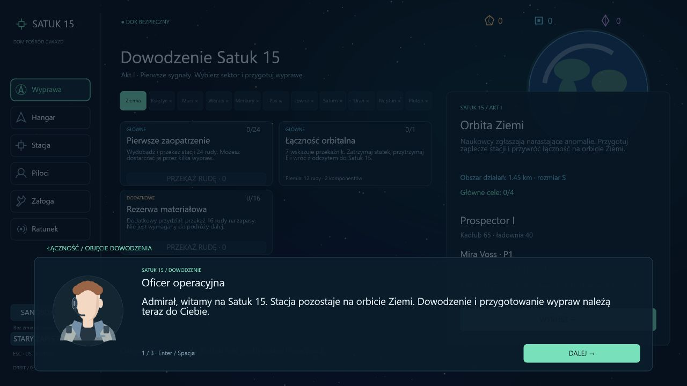
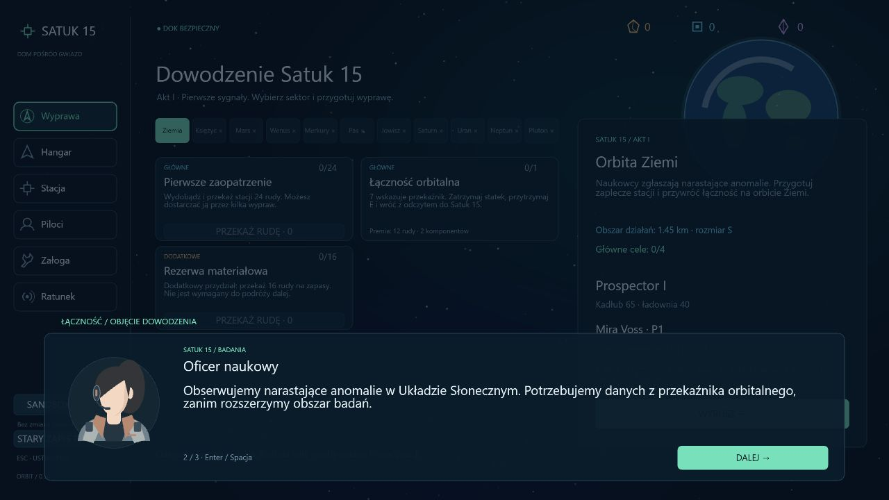
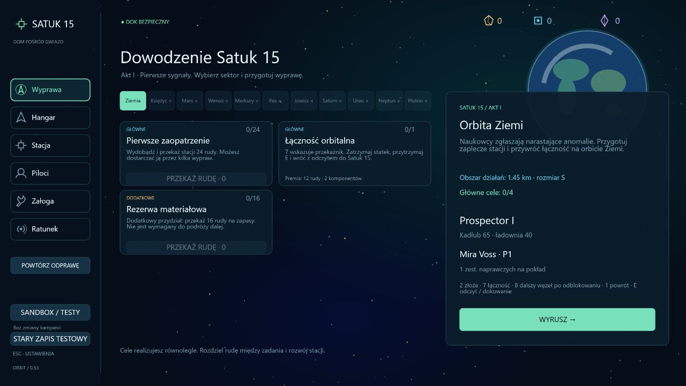
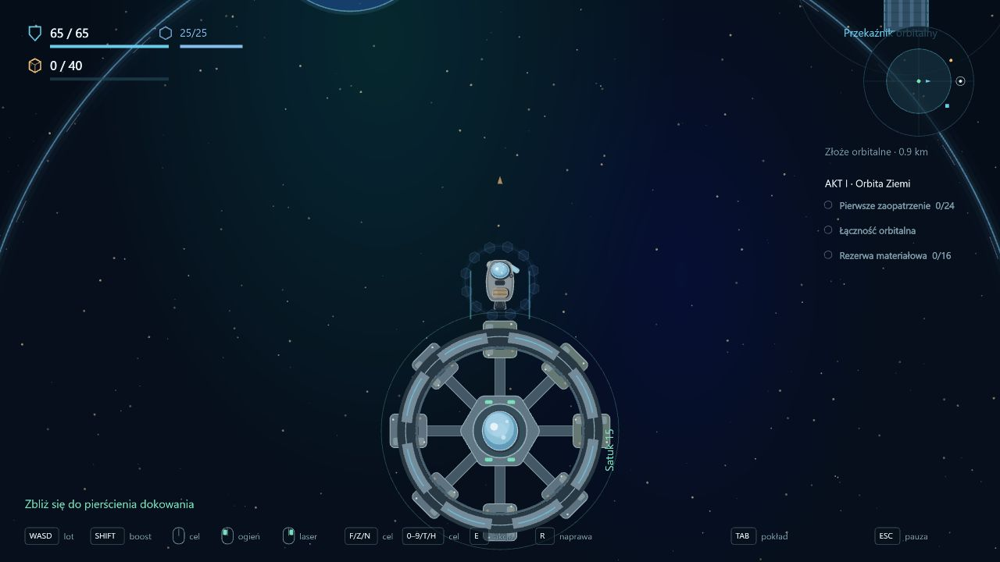
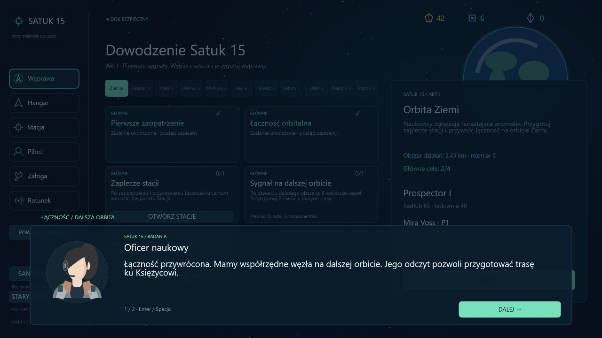
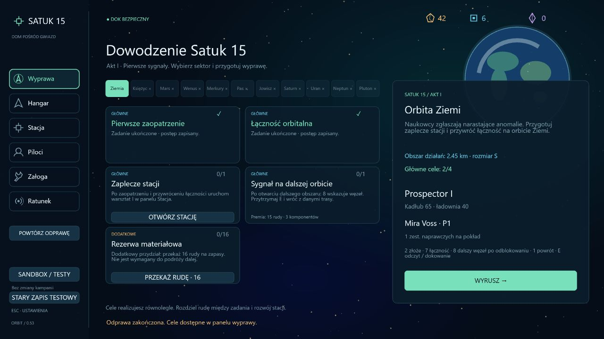

# 0.53 — odprawy i stopniowe ujawnianie zadań

Pierwszy pakiet rozbudowy zawartości po ukończeniu operacyjnego szkieletu kampanii. Zakres obejmuje dialogi na stacji przy Ziemi i odkrywanie zadań we wszystkich sektorach. Nie obejmuje jeszcze odblokowań kadłubów, blokady powrotu, nowej gospodarki ani scen kamery.

## Dialogi

Sekwencje mają identyfikatory, tytuł, wymagany sektor, wcześniejsze rozmowy, raporty zadań i kolejne kwestie. Role oraz tekst są danymi, oddzielonymi od odtwarzacza i warstwy interfejsu. Portrety korzystają ze wspólnego generatora sylwetek używanego w panelu pilotów; role mają stały wygląd.

W dolnej części ekranu pojawia się panel z portretem, rolą, imieniem osoby mówiącej, pełną kwestią i numerem wypowiedzi. **Enter, Spacja lub przycisk Dalej** przechodzą o jedną kwestię. Ostatnia wymaga osobnego potwierdzenia zakończenia. Nie ma automatycznego przewijania. Powtarzanie przytrzymanego klawisza nie przewija sekwencji.

Panel przechwytuje kliknięcia nad bazą. Podczas rozmowy nie można rozpocząć wyprawy ani kupować wyposażenia. Zakończenie czyści wejście, więc kliknięcie lub klawisz zamykający odprawę nie staje się akcją lotu. Ustawienia pod Esc pozostają dostępne; rozmowa nie postępuje pod otwartym oknem ustawień.

Dodano trzy krótkie odprawy:

1. **Objęcie dowodzenia** — nowa kampania przy Ziemi, trzy wypowiedzi. Przedstawia Satuk 15, obserwowane anomalie oraz równoległe zaopatrzenie i łączność.
2. **Dalsza orbita** — po raportach zaopatrzenia i przekaźnika, dwie wypowiedzi. Wyjaśnia dostęp do dalszego węzła i warsztatu.
3. **Kierunek: Księżyc** — po warsztacie i odczycie dalszej trasy, dwie wypowiedzi. Wskazuje następny sektor i zachowanie dostępu do wcześniejszych obszarów.

Rozmowy uruchamiają się na stacji po zamknięciu podsumowania lub innych okien. Nie zastępują oddawania raportu. Nie ujawniają obecności obcych ani nie nadają przeciwnikowi tożsamości. Ostatnią ukończoną odprawę bieżącego sektora można powtórzyć przyciskiem w lewym panelu.

Ukończenie zapisuje się po ostatniej kwestii. Przerwana rozmowa rozpoczyna się od początku, a ukończona nie uruchamia się automatycznie po odświeżeniu. Powtórka nie przyznaje surowców, PD, postępu ani nagród. Pierwszy pakiet uruchamia dialogi wyłącznie w fazie stacji; rozmowy podczas lotu i reżyseria kamery to następne rozszerzenia.

## Odkrywanie zadań

Panel wyprawy, HUD i TAB pokazują wyłącznie zadania ukończone lub dostępne według aktualnych zależności. Nie pokazują przyszłych kart z opisem blokady. Zachowano równoległe cele, odkryte zadania dodatkowe i historię wcześniejszego aktu Marsa. Definicje oraz warunki rozliczenia wszystkich zadań pozostają zachowane.

Na początku Ziemi widać zaopatrzenie, łączność i opcjonalną rezerwę. Warsztat oraz dalszy węzeł ujawniają się po obu pierwszych raportach. Samo posiadanie nieoddanego odczytu na pokładzie nie ujawnia kolejnych etapów. Licznik głównych celów nadal odnosi się do całego sektora, aby częściowo odkrytej listy nie uznać za ukończony sektor.

Nie wprowadzono jeszcze ręcznego wyboru pojedynczej śledzonej misji; interfejs pokazuje dostępne równoległe cele. Nie zmieniono zasad porażki ani możliwości powrotu do stacji.

## Zapis

Kampania **33**, dziennik **15**, nowe pole `dialogues`. Walidacja odrzuca brak historii w nowym formacie, nieznane identyfikatory, duplikaty i sekwencje bez poprzedzających rozmów lub wymaganych zadań.

Migracja 32 / 14 zachowuje bank, flotę, raporty i znacznik aktywnej wyprawy. Dla wcześniejszego postępu oznacza jako obsłużone odprawy odpowiadające już przebytym etapom, aby nie narzucać graczowi serii spóźnionych scen. Świeży zapis bez ukończonych zadań dostaje pustą historię. Odtwarzanie migracyjnie obsłużonej odprawy jest możliwe przy Ziemi. Stary profil testowy i sandbox nie otrzymują dialogów kampanii.

## Weryfikacja

Sześć nowych testów obejmuje pojedyncze naciśnięcia i przytrzymanie klawisza, kolejność odpraw, zapis i przerwanie, powtórki bez nagród, niepoprawną historię, migrację aktywnej wyprawy oraz odkrywanie równoległych celów dopiero po raportach. Istniejące testy liczby celów uwzględniają teraz odkrytą część dziennika.

Pełna regresja: **404/404 testów**, około 121 s. TypeScript, ESLint, produkcyjny build i `git diff --check` przechodzą.

Przeglądarka na osobnym porcie QA: pierwsza odprawa, zmiana portretu, przytrzymany Enter przesuwający tylko jedną kwestię, odświeżenie w połowie rozpoczynające rozmowę od początku, ukończenie myszą i brak ponownego automatycznego odtwarzania po odświeżeniu. Sprawdzono dziennik z trzema początkowymi celami, zwykły wylot z tymi celami w HUD, odprawę dalszej orbity na przygotowanym stanie raportów, nowe karty warsztatu i węzła, przycisk powtórki, brak kliknięcia przez panel oraz ustawienia bez przewijania rozmowy. Konsola bez błędów. Podgląd działał na odrębnym zapisie testowym; nie nadpisano normalnego profilu użytkownika.

## Następny zakres

Cykl wybranej wyprawy i odblokowania kadłubów: początkowo Prospector i Swift, kolejne statki zdobywane w toku gry, rozdzielenie wykonania celu od oddania raportu oraz jawne zasady ukończenia i awaryjnego przerwania misji. Dopiero ten model umożliwi bezpieczne wprowadzanie uzgodnionych ograniczeń dokowania.
