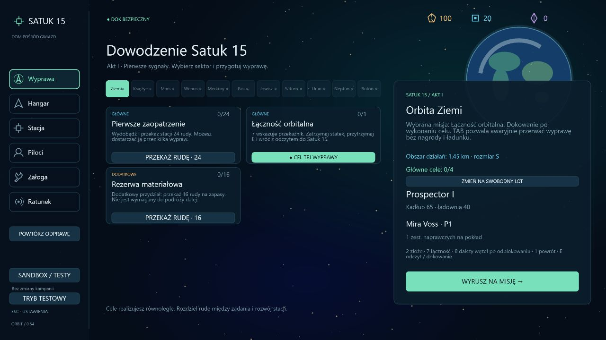
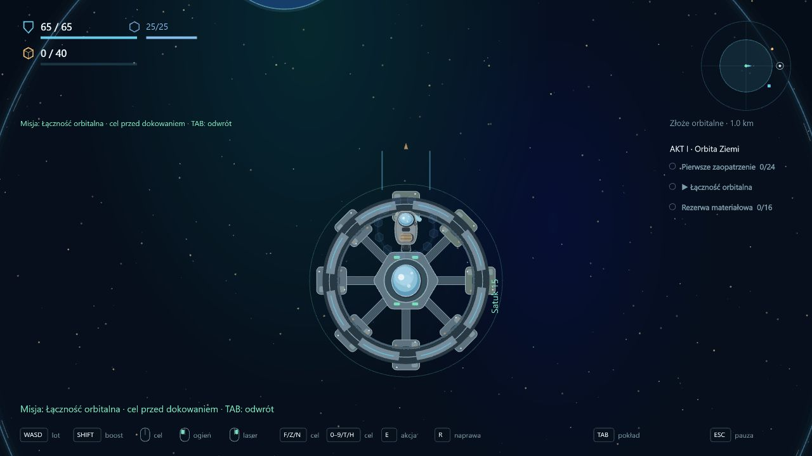
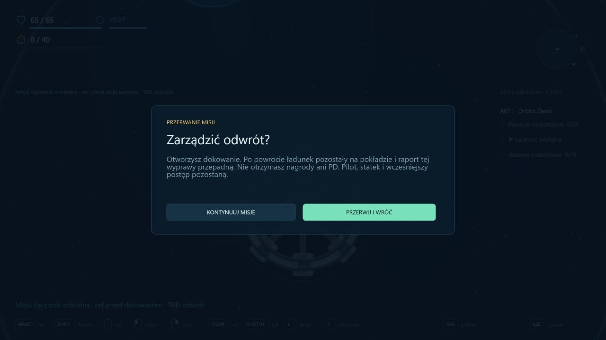
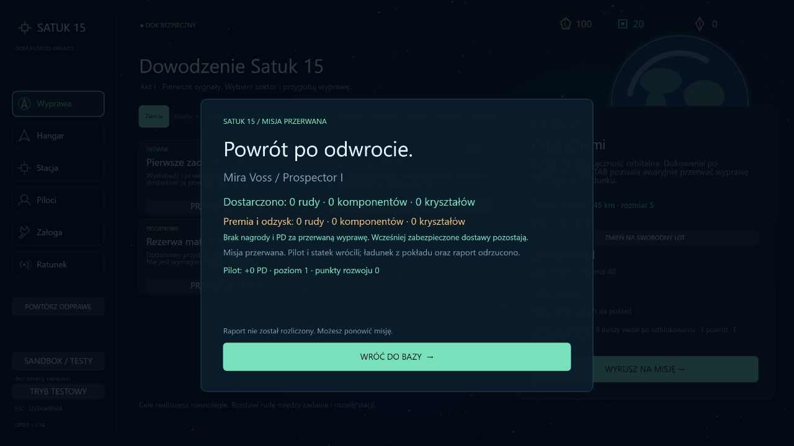
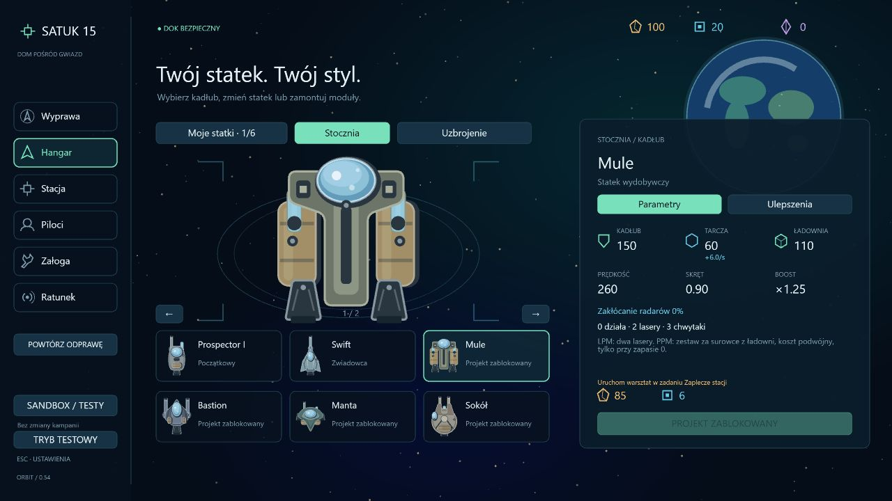

# 0.54 — odblokowania floty, wybór misji i odwrót

Drugi pakiet rozbudowy po szkielecie kampanii. Nowa kampania zaczyna z posiadanym Prospectorem i dostępem do zakupu Swifta. Pozostałe projekty są odblokowywane postępem. Wybrane wyprawy mają teraz cel, który trzeba wykonać przed dokowaniem, oraz jawny awaryjny odwrót.

## Aktualna polityka zapisu — decyzja autora

**Nie wspieramy starszych zapisów.** Parser przyjmuje wyłącznie bieżący format kampanii 34 i dziennika 15. Odrzuca wszystkie wcześniejsze wersje, także ich znaczniki aktywnych wypraw. Brak migracji i odziedziczonych licencji na statki. Niezgodny zapis powoduje komunikat i rozpoczęcie nowej kampanii. Nie odtwarzamy z niego materiałów, floty ani raportów.

Usunięto historyczne gałęzie migracji i testy wymagające ich utrzymywania. Profil kampanii i osobny tryb testowy nadal istnieją, ale oba wymagają aktualnego formatu. Sandbox pozostaje niezależny. Przycisk dawnego profilu nosi teraz nazwę Tryb testowy, aby nie sugerować możliwości otwierania starszych formatów. Kolejne breaking changes mogą wymagać nowej kampanii.

## Odblokowania

| Kadłub | Warunek projektu |
| --- | --- |
| Prospector, Swift | Dostępne od początku |
| Mule | Zaplecze stacji — warsztat na Ziemi |
| Manta | Zwiad trasy księżycowej |
| Bastion | Odbiór stacji księżycowej |
| Sokół | Odprawa ziemska otwierająca Wenus |
| Widmo | Budowa placówki Wenus |
| Harpun | Gotowa osłona przed wyprawą na Merkurego |
| Aegis | Technologia z Merkurego |
| Atlas | Budowa bazy marsjańskiej |
| Stinger | Potwierdzenie przejścia pasa asteroid |
| Feniks | Pakiet obserwacyjny Jowisza |

Odblokowanie nie daje darmowego statku. Nadal obowiązują warsztat, cena i limit hangaru. Stan wynika z trwałych raportów; utrata jednostki nie cofa projektu. Stocznia umożliwia podgląd, pokazuje warunek i blokuje zakup również na poziomie funkcji stanu. Kadłuby z odzysku zachowują dotychczasową odrębność. Tryb testowy i sandbox nie otrzymują ograniczeń fabularnych stoczni.

Nie dodano jeszcze nowych wymogów konkretnych statków do misji, premii hakowania ani specjalnego materiału Harpuna na Merkurym. Mapa odblokowań zapewnia dostęp do Harpuna przed tą planowaną wyprawą.

## Dwa tryby wyprawy

- **Swobodny lot:** wydobycie, eksploracja, zadania, ratunek i dostawy według dotychczasowych reguł; powrót nie jest blokowany przez wybór jednego celu.
- **Wybrana misja:** na karcie dostępnego zwiadu, patrolu lub bossa kliknij Wybierz na misję. Odprawa pokazuje wybrany cel, warunek dokowania i możliwość przerwania. Przed startem można wrócić do swobodnego lotu.

Pierwsza wersja rozkazów obejmuje **skanowanie, walkę z patrolami i oba starcia z bossem**. Projekty stacji, dostawy powierzchniowe, budowa, obrona i wydobycie nie mają jeszcze osobnych rozkazów. Pozostają wykonalne podczas zwykłych wypraw. Wylot ratunkowy i transport konstrukcyjny nie mogą jednocześnie otrzymać takiego rozkazu.

Wybór nie ujawnia przyszłych misji. Można wybrać tylko dostępny, nieukończony cel bieżącego sektora. W locie oznacza go strzałka, HUD i TAB pokazują stan. Nie da się zmienić celu podczas wyprawy.

## Wykonanie i raport

Odczyt wymaganej lokacji, pozostała liczba patrolowych kontaktów albo odpowiedni wynik starcia wykonują **cel w locie** i otwierają dokowanie. Wcześniej próba dokowania nie rozlicza wyprawy; komunikat wskazuje wykonanie celu lub odwrót pod TAB. Patrole wymagają pozostałej liczby kontaktów danego zadania; nie wymuszają ponownego zdobycia już oddanych raportów.

Wykonanie celu pozostaje wynikiem wyprawy. Dopiero bezpieczny powrót zatwierdza raport i premię. Śmierć lub odświeżenie odrzuca niezabezpieczony wynik. Funkcja rozliczenia odrzuca również próbę udanego powrotu z niewykonanym rozkazem. Inne równoległe cele nadal można wykonać podczas tej samej udanej wyprawy.

## Awaryjne przerwanie

TAB → Przerwij misję pokazuje osobny ekran z opisem konsekwencji. Można anulować decyzję. Potwierdzenie nie teleportuje do stacji: otwiera dokowanie, a pilot musi wrócić fizycznie.

Po takim powrocie pilot i statek pozostają, ale ładunek na pokładzie, niezabezpieczone odczyty, raporty walk, premia i PD za wyprawę przepadają. Przerwana misja pozostaje do ponowienia. Stan odwrotu jest zapisany; nie można odwołać go w locie i jednak oddać raportu. Wcześniej bezpiecznie przekazane dostawy i trwały postęp nie są cofane. Po przerwaniu zablokowane są kolejne automatyczne rozliczenia holowanego złomu. Śmierć w drodze do stacji nadal jest zwykłą stratą pilota i jednostki.

## Weryfikacja

- Pełna regresja: **384/384 testów**, około 114 s. Liczba zmalała po świadomym usunięciu testów nieobsługiwanych już migracji; nie wyłączano ich przez skip.
- Siedem testów rozkazów i floty: zakup i blokady, odblokowanie Muła przez rzeczywiste zaopatrzenie i warsztat, niepoprawne rozkazy bez pobierania zasobów, rozliczenie patroli i właściwego bossa, odwrót, straty i zachowanie swobodnego lotu.
- Bazowy Prospector rzeczywiście leci do doku z niewykonanym rozkazem, nie może zakończyć wyprawy, następnie leci do przekaźnika, skanuje i wraca z raportem. Bez teleportowania i dopisywania odczytu w tej próbie.
- Trzy testy formatu: odrzucenie starszych i przyszłych wersji, świeża kampania z komunikatem zamiast importowania starego stanu oraz rozdzielenie aktualnych zapisów profili.
- TypeScript, ESLint, produkcyjny build i kontrola diff przechodzą. Po doprecyzowaniu nagłówka podsumowania odwrotu ponownie sprawdzono siedem testów floty i rozkazów.

Kontrola przeglądarki: przygotowany bieżący zapis QA przy Ziemi, wybór zwiadu, rzeczywisty wylot i próba przedwczesnego dokowania, TAB, anulowanie decyzji i potwierdzenie odwrotu, rzeczywisty powrót, brak premii i PD oraz podgląd blokady Muła. Osobny port; normalny zapis użytkownika nie został użyty.

## Dalszy zakres

Następny pakiet: gospodarka i Satuk 15 — mały zestaw rud oraz receptur, odrębne kategorie komponentów, modułów i konstrukcji, magazyn i rozwój stacji. Rozkazy należy rozszerzać o kolejne typy wraz z ich pełnymi misjami, jawnie określając reguły częściowych dostaw i porażki. Nie wprowadzać globalnej blokady dokowania dla zadań, których warunkiem jest wpłata w stacji.
