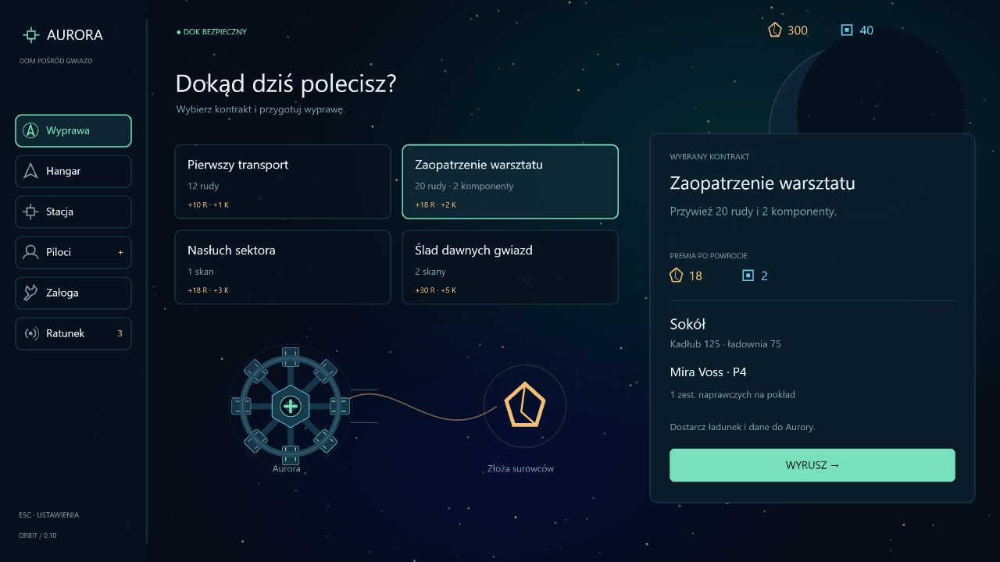
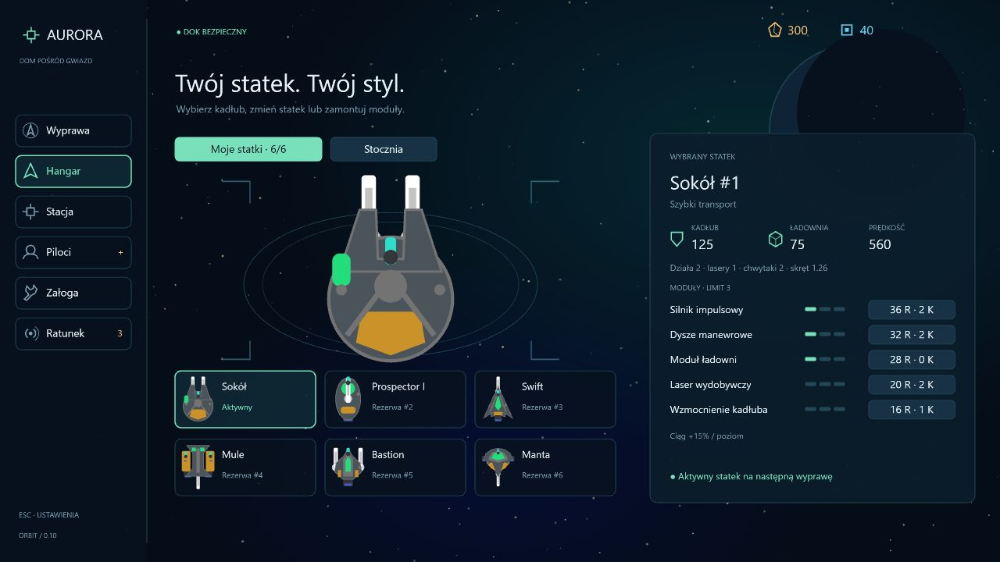
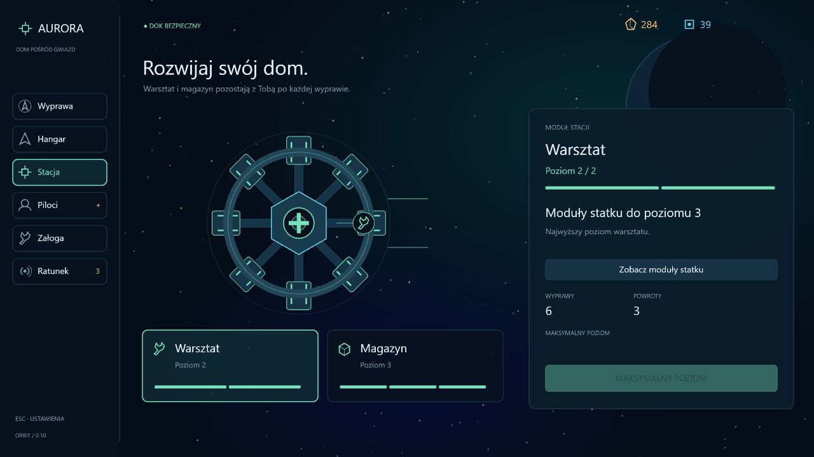
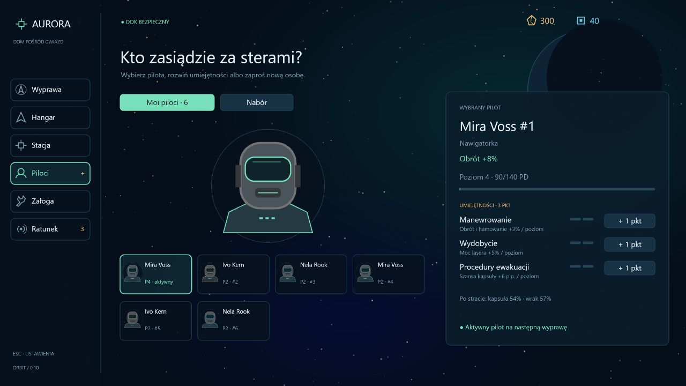
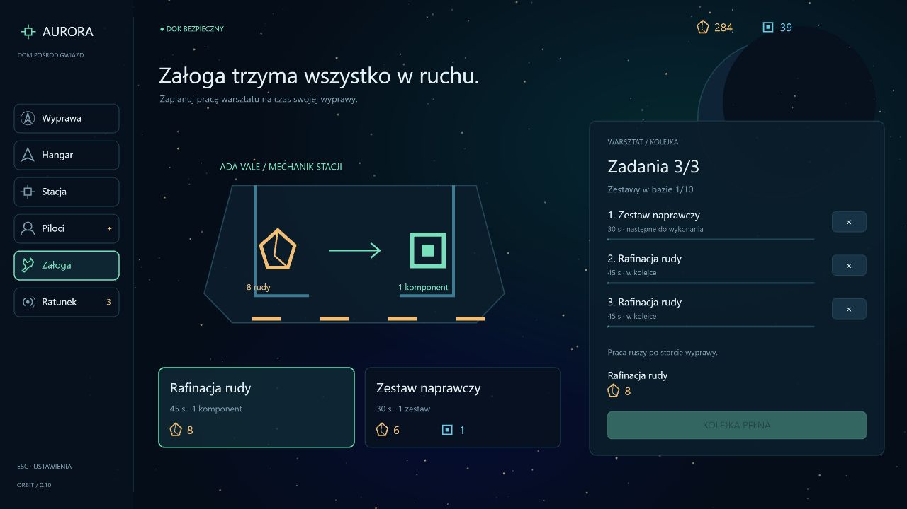
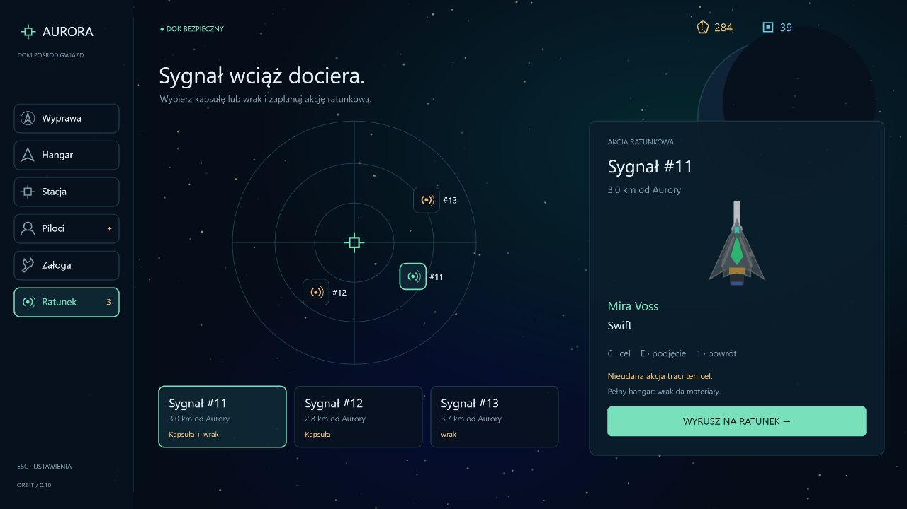

# Lobby Aurory — nowy interfejs

Data: 2026-10-14. Projekt i wdrożenie liftingu po uproszczeniu HUD wyprawy.

## Układ

Lobby ma stałą nawigację po lewej, kontekstowy podgląd w środku oraz panel wybranego elementu po prawej. Surowce pozostają w jednym miejscu na górze. Zielone obramowanie oznacza element oglądany; podpis „Aktywny” wskazuje statek lub pilota przygotowanego do wyprawy.

Wybranie miniatury pozwala obejrzeć szczegóły. Przy przeglądaniu posiadanej floty lub załogi zmiana aktywnego statku albo pilota wymaga osobnego przycisku. Zakup i zatrudnienie zachowują dotychczasową zasadę: nowy statek lub pilot zostają aktywni. Samo przeglądanie nie zmienia przygotowania wyprawy.

| Zakładka | Podgląd | Główne akcje |
| --- | --- | --- |
| Wyprawa | Karty kontraktów i schemat drogi od Aurory do celu | Wybór kontraktu, przygotowanie i start |
| Hangar | Duży, dopasowany model wybranego statku i miniatury floty | Ustawienie aktywnego kadłuba, moduły, zakup w stoczni, złomowanie rezerwy |
| Stacja | Aurora z wyróżnionym warsztatem lub magazynem | Rozbudowa wybranego modułu i podgląd pojemności |
| Piloci | Portret wybranego pilota, doświadczenie i umiejętności | Wybór aktywnego pilota, rozwój, nabór |
| Załoga | Stanowisko rafinacji lub produkcji zestawów | Zatrudnienie mechanika, dodawanie i anulowanie zadań |
| Ratunek | Mapa sygnałów i podgląd kapsuły lub wraku | Wybór sygnału i start akcji ratunkowej |

Każdy widok ma własną scenę Pixi, a nie wspólny podgląd stacji. Modele statków są dopasowywane do dostępnego miejsca z uwzględnieniem działek i laserów. Portrety i ilustracje produkcji również powstają z figur, bez nowych grafik z internetu.

## Ograniczenie tekstu i nawigacja

- Informacje o poziomach, cenach i stanie dotyczą tylko wybranego elementu. Poziomy modułów i umiejętności pokazują krótkie segmenty, zasoby mają ikony.
- Opis działania modułu statku znajduje się w jednej linii; wskazanie przycisku zakupu zmienia ją na opis tego modułu. Po zakupie opis pozostaje związany z ostatnio wybranym modułem.
- Hangar ma dwa czytelne tryby: **Moje statki** i **Stocznia**. Wszystkie sześć pozycji mieści się w siatce, bez poprzedniej paginacji i osobnego przełączania między flotą a modułami.
- Piloci mają **Moi piloci** i **Nabór**. Rozwój jest częścią szczegółów wybranego pilota. Znak **+** przy zakładce sygnalizuje dostępne punkty.
- Statystyki bazy i zajętość magazynu są w Stacji, a kolejka i limity zestawów w Załodze. Nie powtarzają się w pozostałych zakładkach.
- Start występuje tylko w Wyprawie i Ratunku. Wyprawa rozpoczyna zwykły sektor; Ratunek rozpoczyna akcję dla konkretnego sygnału. Oglądanie sygnału nie zmienia późniejszego startu zwykłej wyprawy.
- Komunikaty po akcjach są krótkie i wygasają po sześciu sekundach. Koszty, blokady warsztatu, pełny hangar, limity kolejki i wyposażenie awaryjne zachowują dotychczasowe zasady.

Złomowanie nadal wymaga potwierdzenia i miejsca na zwrot materiałów. Brak statku lub pilota prowadzi do odpowiedniej zakładki; dostępne wyposażenie awaryjne można odebrać przy przygotowaniu wyprawy.

## Weryfikacja

Przeszło 108 istniejących testów gry, kontrola typów, lint i build. Mechaniki kampanii i format zapisu 7 pozostają bez zmian.

W przeglądarce sprawdzono wszystkie zakładki na jednorazowych kampaniach pod portem 3001: pełną flotę, wielu pilotów, trzy sygnały ratunkowe, pełną i pustą kolejkę, nową kampanię oraz brak statku i pilota. Sprawdzono zmianę aktywnego statku, zakup kadłuba i dysz, rozwój pilota, zatrudnianie pilota i mechanika, dodawanie i anulowanie zadania, rozbudowę warsztatu, potwierdzenie i anulowanie złomowania oraz wyposażenie awaryjne i start wyprawy. Konsola nie zgłosiła błędów ani ostrzeżeń. Testy nie używały kampanii gracza na localhost:3000.

## Podglądy

