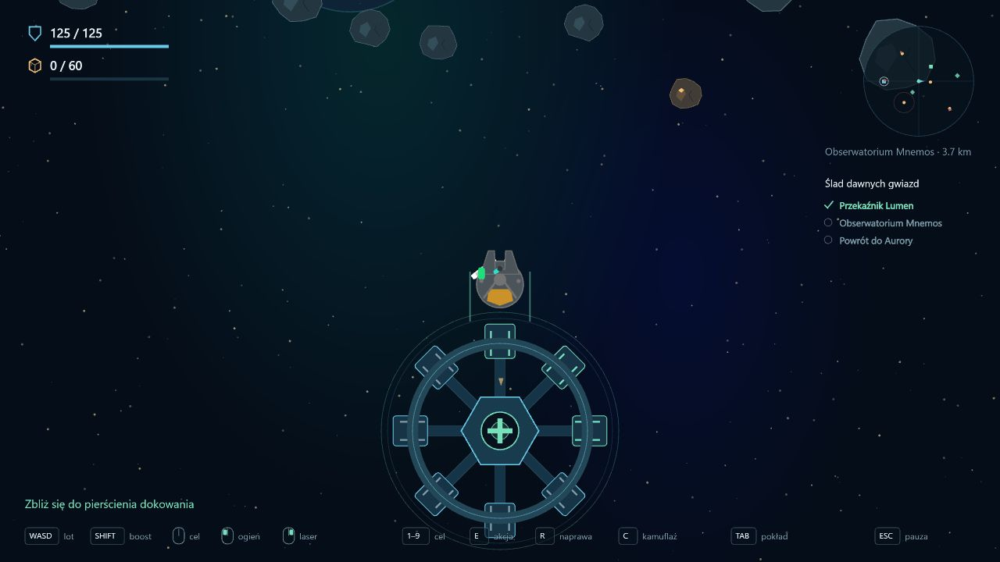
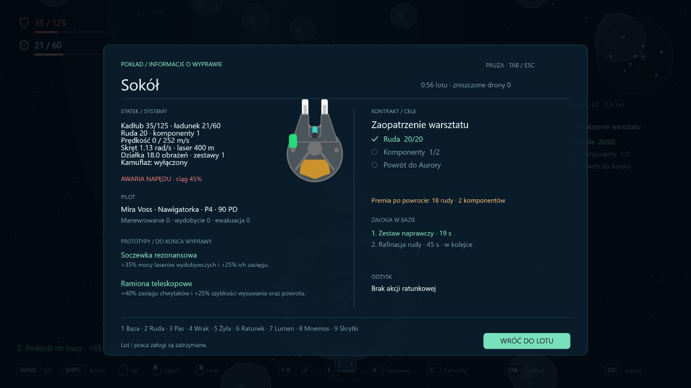

# Interfejs wyprawy

Data: 2026-10-14. Porządkowanie UI po etapie 0.10, przed dalszą rozbudową mechanik.

## Widok lotu

Usunięto osiem dużych paneli z tłem. Stały HUD zawiera:

- Dwa cienkie paski w lewym górnym rogu: kadłub z ikoną pancerza oraz ładunek z ikoną skrzyni. Wartości liczbowe pozostają widoczne; kadłub poniżej 30% zmienia kolor na czerwony, a pełna ładownia wyróżnia się bursztynem.
- Mały radar w prawym górnym rogu, bez prostokątnego kontenera. Zachowuje pozycje miejsc, skrytek, celów ratunkowych, dronów i statku. Czerwona obwódka oznacza pościg. Pod nim znajduje się nazwa bieżącego celu i odległość.
- Listę celów kontraktu pod radarem. Każdy wymóg ma własny stan: puste koło lub zielony znacznik. Zbieranie rudy nie oznacza ukończenia wymogu komponentów. Skany wymagają konkretnych miejsc. Podjęcie kapsuły/wraku kończy cel odzysku, ale powrót do Aurory pozostaje osobnym wymaganiem.
- Jeden wąski rząd podpowiedzi przy dolnej krawędzi: klawisze i ikony myszy. Podpowiedź **Tab / pokład** jest również klikalna.
- Krótką wskazówkę sytuacyjną, gdy można zadokować, podjąć cel, otworzyć skrytkę, wykonać skan, przeszukać wrak lub naprawić statek. Postęp czynności pokazuje procent. W zwykłym locie ta linia jest pusta.

Nazwy pilota i statku, czas lotu, prędkość, licznik zniszczonych dronów, kolejka załogi, prototypy, rozpiska odzysku i komunikaty systemowe znajdują się w panelu pokładu. Środek ekranu pozostaje dostępny dla świata gry i małego znacznika kierunku lotu do celu.

Napisy mają delikatny cień, a radar własne przyciemnione koło, żeby zachować czytelność na tle skał bez przywracania dużych ramek.

## Panel pokładu — Tab

Panel korzysta z istniejącego mechanizmu `PopupContainer` i komponentów boilera. Otwiera się Tabem albo kliknięciem podpowiedzi. Ponowny Tab, Esc lub przycisk wraca do lotu. Podczas wyboru prototypu i innych aktywnych okien panel się nie otwiera.

Widok pokazuje sylwetkę statku, aktualne parametry, stan napędu i kamuflażu, zasoby, zestawy naprawcze, pilota z umiejętnościami, opisy prototypów, cele i premię kontraktu, kolejkę mechanika, odzysk oraz skróty nawigacyjne.

Lot, pociski, AI, czas wyprawy i zadania w bazie są zatrzymane. Otwarcie i zamknięcie czyści stan klawiszy oraz przycisków myszy, chroniąc przed przypadkowym ciągiem i ostrzałem po wyjściu z menu. Tab nie przenosi fokusu do przeglądarki podczas misji. Zapisy pozostają w formacie 7; odświeżenie podczas otwartego menu nadal oznacza stratę aktywnej wyprawy.

## Weryfikacja

Przeszło 108 testów, w tym trzy scenariusze poprawnego oznaczania wymogów surowców, konkretnych skanów i podjęcia celu ratunkowego przy pozostającym wymogu powrotu. Kontrola typów, lint i build również przeszły.

Podgląd przeglądarkowy używał jednorazowych kampanii na porcie 3001 oraz przykładów stanów misji: uszkodzony Sokół, częściowy ładunek, dwa prototypy, kolejka załogi i częściowo wykonany kontrakt badawczy. Kampania gracza na localhost:3000 pozostała bez zmian. Sprawdzono układ HUD, statusy celów, otwarcie/zamknięcie panelu i zatrzymanie czasu lotu oraz pracy mechanika.

