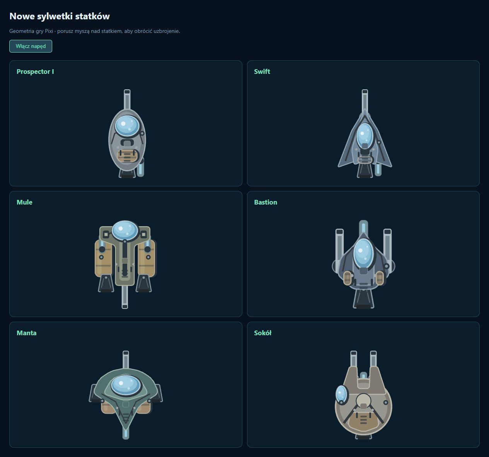

# Wygląd statków — 2026-10-14

Sylwetki nadal powstają z geometrii Pixi, bez bitmap. Wspólny `ShipView` pokazuje je podczas lotu, w hangarze, panelu pokładu i przy odzysku wraków.

- **Prospector I:** owal z panelami, szklany wizjer i okrągłe refleksy; działko pod dziobem, laser pod tylną częścią kadłuba.
- **Swift:** zaokrąglony korpus z ostrymi skrzydłami, szklana osłona kabiny i tylny laser pod poszyciem. Powtórzony punkt o silniku został potraktowany jako jedno wymaganie; zwiadowca zachowuje jeden silnik.
- **Mule:** szeroka przednia belka i węższy tylny korpus tworzą T; wystający wizjer, dwa boczne zbiorniki i dwa silniki.
- **Bastion:** wygładzone płyty kadłuba, wystający szklany wizjer, detale poszycia i mocowania bocznych działek pod kadłubem.
- **Manta:** zaokrąglone zbiorniki w przygaszonym odcieniu ochry pod skrzydłami, płynniejszy kontur płaszczki i trapezowe silniki.
- **Sokół:** delikatnie zaokrąglony rozwidlony dziób, panele i szklany boczny wizjer, zgodne ze wspólnym stylem floty.

Obudowy silników mają kształt trapezów równoramiennych, metalowe krawędzie i szare dysze. Niebieski kolor pozostaje wyłącznie w płomieniu pracującego napędu. Wizjery składają się z obramowania, ciemnego szkła, przezroczystych jasnoniebieskich warstw i okrągłych odbić światła. Poszycie ma krzywe w narożnikach, linie paneli, otwory serwisowe i drobne mocowania.

Mocowania Prospectora zmieniono na działko `(25, 0)` i laser `(-25, 16)`; laser Swifta na `(-24, 17)`. Wspólne definicje służą zarówno grafice, jak i symulacji, więc pociski oraz wiązki korzystają z nowych pozycji. Małe odsunięcie laserów od osi pozwala zobaczyć mocowanie spod poszycia. Wszystkie obrotowe działka i lasery znajdują się pod warstwą kadłuba. Zasięg, obrażenia, liczba narzędzi i statystyki lotu zachowują dotychczasowe wartości; tylne położenie krótkiego lasera wymaga bliższego podejścia dziobem do skały.

Weryfikacja: 121 testów, kontrola typów, lint i build. Dwa istniejące testy obrażeń dostosowano do tylnego mocowania lasera, pozostawiając sprawdzanie zasięgu, mocy oraz zatrzymywania wiązki na pierwszej przeszkodzie. Galerię sprawdzono w przeglądarce na osobnym porcie 3001, bez ładowania zapisu kampanii gracza. Konsola bez błędów i ostrzeżeń.

## Drugi lifting: materiały i kolory

Kolory szkicu były oznaczeniami elementów, a nie docelową paletą. Obecna flota używa sześciu stonowanych odcieni kadłuba: stalowy Prospector, granatowy Swift, oliwkowy Mule, grafitowy Bastion, morska Manta i piaskowy Sokół. Panele i krawędzie każdego modelu pochodzą z tej samej rodziny kolorów. Szkło wszystkich kabin jest jasnoniebieskie, broń stalowa, a zbiorniki mają desaturowane odcienie ochry i szarości. Laser ma metalową obudowę z niewielką jasnoniebieską wkładką; refleksy są subtelniejsze.

Manta ma teraz działko pod dziobem `(28, 0)` i laser pod tyłem `(-30, 0)`. Grafika i symulacja korzystają z tych samych mocowań. Dodano ciemne wyloty luf, oprawy chwytaków, zagłębione żaluzje i pokrywy serwisowe. Zasięg oraz statystyki narzędzi pozostają bez zmian. Ponownie przeszły wszystkie 121 testów, typecheck, lint i build; podgląd całej floty nie zgłosił błędów konsoli.

[Galeria pierwszego liftingu](screenshots/ship-visuals-gallery.png).
